<div dir="rtl" align="right">

# الوحدة السابعة: Attacks and Defenses

## 📑 فهرس الوحدة

<table dir="rtl" width="100%">
<thead><tr><th align="right" style="text-align:right">#</th><th align="right" style="text-align:right">الغرفة</th><th align="right" style="text-align:right">الموضوعات بالترتيب</th></tr></thead>
<tbody>
<tr><td align="right" style="text-align:right">—</td><td align="right" style="text-align:right"><a href="#module-intro">مقدمة الوحدة</a></td><td align="right" style="text-align:right">ثلاثية CIA والتشفير وعقلية المهاجم وعقلية المدافع وتحديات CTF</td></tr>
<tr><td align="right" style="text-align:right">1</td><td dir="ltr" align="left" style="text-align:left"><a href="#room-1">The CIA Triad</a></td><td align="right" style="text-align:right"><a href="#t1-1">1.1 التعريف بالغرفة وأهدافها</a><br><a href="#t1-2">1.2 لماذا نحتاج إطارًا للأمن؟</a><br><a href="#t1-3">1.3 الأصول والتهديدات والثغرات والمخاطر</a><br><a href="#t1-4">1.4 ثلاثية CIA نظرة عامة</a><br><a href="#t1-5">1.5 السرية (Confidentiality)</a><br><a href="#t1-6">1.6 السلامة / النزاهة (Integrity)</a><br><a href="#t1-7">1.7 التوافر / الإتاحة (Availability)</a><br><a href="#t1-8">1.8 كيف تُنتهك الركائز الثلاث</a><br><a href="#t1-9">1.9 العلاقة بين الركائز والموازنة بينها</a><br><a href="#t1-10">1.10 ما بعد الثلاثية: مفاهيم مكملة</a><br><a href="#t1-11">1.11 عقلية الأمن السيبراني (Security Mindset)</a><br><a href="#t1-12">1.12 الزاوية الأمنية: تقييم أثر الحادث بالثلاثية</a><br><a href="#t1-13">1.13 أدوات بسيطة لتطبيق الثلاثية عمليًا</a><br><a href="#t1-14">1.14 جدول مرجعي: ثلاثية CIA (Cheatsheet)</a><br><a href="#t1-15">1.15 سيناريو: تقييم حادث فدية بالثلاثية</a><br><a href="#t1-16">1.16 كيف تتعامل مع أسئلة الغرفة بمنهجية</a></td></tr>
<tr><td align="right" style="text-align:right">2</td><td dir="ltr" align="left" style="text-align:left"><a href="#room-2">Cryptography Concepts</a></td><td align="right" style="text-align:right"><a href="#t2-1">2.1 التعريف بالغرفة وأهدافها</a><br><a href="#t2-2">2.2 لماذا نحتاج التشفير؟</a><br><a href="#t2-3">2.3 حالات البيانات الثلاث (Data States)</a><br><a href="#t2-4">2.4 المصطلحات الأساسية في التشفير</a><br><a href="#t2-5">2.5 عملية التشفير وفك التشفير</a><br><a href="#t2-6">2.6 مثال تعليمي: شفرة قيصر (Caesar Cipher)</a><br><a href="#t2-7">2.7 التشفير المتماثل (Symmetric Encryption)</a><br><a href="#t2-8">2.8 التشفير غير المتماثل (Asymmetric Encryption)</a><br><a href="#t2-9">2.9 المقارنة والنهج الهجين (Hybrid Approach)</a><br><a href="#t2-10">2.10 دوال التجزئة (Hashing)</a><br><a href="#t2-11">2.11 التوقيع الرقمي (Digital Signature)</a><br><a href="#t2-12">2.12 الشهادات الرقمية و HTTPS</a><br><a href="#t2-13">2.13 HTTPS: النهج الهجين في العمل</a><br><a href="#t2-14">2.14 تقادم الخوارزميات وأنواع الهجمات على التشفير</a><br><a href="#t2-15">2.15 الزاوية الأمنية: التشفير في عمل المدافع</a><br><a href="#t2-16">2.16 تجربة التشفير بأوامر سطر الأوامر</a><br><a href="#t2-17">2.17 جدول مرجعي: التشفير والأدوات (Cheatsheet)</a><br><a href="#t2-18">2.18 سيناريو: شهادة مشبوهة على صفحة تسجيل دخول</a><br><a href="#t2-19">2.19 كيف تتعامل مع أسئلة الغرفة بمنهجية</a></td></tr>
<tr><td align="right" style="text-align:right">3</td><td dir="ltr" align="left" style="text-align:left"><a href="#room-3">Become a Hacker</a></td><td align="right" style="text-align:right"><a href="#t3-1">3.1 التعريف بالغرفة وأهدافها</a><br><a href="#t3-2">3.2 فلسفة الهجوم: لماذا يفكر المدافع كمهاجم؟</a><br><a href="#t3-3">3.3 أنواع المهاجمين والهاكرز</a><br><a href="#t3-4">3.4 الهاكر الأخلاقي والحدود القانونية</a><br><a href="#t3-5">3.5 دورة حياة الهجوم</a><br><a href="#t3-6">3.6 تفصيل المراحل: الاستطلاع والفحص</a><br><a href="#t3-7">3.7 تفصيل المراحل: الاستغلال والحصول على الوصول</a><br><a href="#t3-8">3.8 الهندسة الاجتماعية (Social Engineering)</a><br><a href="#t3-9">3.9 تفصيل المراحل: الإبقاء على الوصول ومحو الآثار</a><br><a href="#t3-10">3.10 منهجية اختبار الاختراق (Penetration Testing)</a><br><a href="#t3-11">3.11 أطر العمل: Cyber Kill Chain و MITRE ATT&CK</a><br><a href="#t3-12">3.12 الزاوية الأمنية: كيف يكتشف المدافع كل مرحلة؟</a><br><a href="#t3-13">3.13 أدوات الكشف الدفاعي لمراحل الهجوم</a><br><a href="#t3-14">3.14 جدول مرجعي: مراحل الهجوم والكشف (Cheatsheet)</a><br><a href="#t3-15">3.15 سيناريو: سلسلة تنبيهات تحكي قصة اختراق</a><br><a href="#t3-16">3.16 كيف تتعامل مع أسئلة الغرفة بمنهجية</a></td></tr>
<tr><td align="right" style="text-align:right">4</td><td dir="ltr" align="left" style="text-align:left"><a href="#room-4">Mystery Chest</a></td><td align="right" style="text-align:right"><a href="#t4-1">4.1 التعريف بالغرفة وأهدافها</a><br><a href="#t4-2">4.2 ما هو الـ CTF ولماذا يهم؟</a><br><a href="#t4-3">4.3 فئات تحديات الـ CTF</a><br><a href="#t4-4">4.4 منهجية حل التحديات</a><br><a href="#t4-5">4.5 التعرف على الترميزات والتشفيرات الشائعة</a><br><a href="#t4-6">4.6 أدوات الحل الأساسية</a><br><a href="#t4-7">4.7 مثال تطبيقي كامل: فك طبقتين</a><br><a href="#t4-8">4.8 الزاوية الأمنية: من الـ CTF إلى عمل المحلل</a><br><a href="#t4-9">4.9 أدوات فك الترميز في سطر الأوامر</a><br><a href="#t4-10">4.10 جدول مرجعي: تحديات التشفير والترميز (Cheatsheet)</a><br><a href="#t4-11">4.11 سيناريو: أمر PowerShell مرمّز في تنبيه EDR</a><br><a href="#t4-12">4.12 كيف تتعامل مع أسئلة الغرفة بمنهجية</a></td></tr>
<tr><td align="right" style="text-align:right">5</td><td dir="ltr" align="left" style="text-align:left"><a href="#room-5">Become a Defender</a></td><td align="right" style="text-align:right"><a href="#t5-1">5.1 التعريف بالغرفة وأهدافها</a><br><a href="#t5-2">5.2 عقلية الدفاع وفريق Blue Team</a><br><a href="#t5-3">5.3 الدفاع العميق (Defense in Depth)</a><br><a href="#t5-4">5.4 طبقات الدفاع بالتفصيل</a><br><a href="#t5-5">5.5 أنواع الضوابط الأمنية</a><br><a href="#t5-6">5.6 ربط الضوابط بثلاثية CIA</a><br><a href="#t5-7">5.7 تقليل سطح الهجوم والتقوية (Hardening)</a><br><a href="#t5-8">5.8 فريق SOC وأدواته</a><br><a href="#t5-9">5.9 فرز التنبيهات (Alert Triage)</a><br><a href="#t5-10">5.10 الاستجابة للحوادث (Incident Response)</a><br><a href="#t5-11">5.11 الزاوية الأمنية: بناء قاعدة كشف وقياس الأداء</a><br><a href="#t5-12">5.12 أدوات المراقبة والاستجابة الأساسية</a><br><a href="#t5-13">5.13 جدول مرجعي: الدفاع والاستجابة (Cheatsheet)</a><br><a href="#t5-14">5.14 سيناريو: فرز تنبيه واستجابة كاملة</a><br><a href="#t5-15">5.15 كيف تتعامل مع أسئلة الغرفة بمنهجية</a></td></tr>
<tr><td align="right" style="text-align:right">—</td><td align="right" style="text-align:right"><a href="#module-glossary">جدول المصطلحات</a></td><td align="right" style="text-align:right">أهم مصطلحات الوحدة بمعانيها وأرقام الغرف</td></tr>
</tbody>
</table>

<a id="module-intro"></a>

## 🧭 مقدمة عن الوحدة

درسنا في الوحدات السابقة كيف تعمل الأجهزة وأنظمة التشغيل والشبكات والويب. وهذه الوحدة الأخيرة في المسار تنقلنا إلى السؤال الأهم: **كيف نحمي كل ذلك، وكيف يفكر من يهاجمه؟** فالأمن السيبراني ليس أداة نثبتها ولا إعدادًا نضبطه مرة واحدة، بل **طريقة تفكير** تقوم على فهم ما نحميه (البيانات والخدمات)، وما يهددها، وكيف نكتشف التهديد ونتعامل معه.

ومحور الوحدة هو أن المحلل الأمني يحتاج **عينين**: عين تنظر كما ينظر المهاجم لتعرف أين الثغرات، وعين تنظر كما ينظر المدافع لتعرف كيف تُكتشف الهجمات وتُصد.

تسير الوحدة في خمس غرف:

- **The CIA Triad:** الركائز الثلاث التي يُقاس بها كل شيء في الأمن: السرية والسلامة والتوافر.
- **Cryptography Concepts:** التشفير بنوعيه، والتجزئة، والشهادات الرقمية، وكيف يحمي HTTPS اتصالك.
- **Become a Hacker:** عقلية المهاجم الأخلاقي، ومراحل الهجوم، وما يتركه كل مرحلة من أثر.
- **Mystery Chest:** غرفة تحدٍّ (CTF) تجمع المفاهيم، ومنهجية حل الألغاز التقنية.
- **Become a Defender:** الدفاع العميق، ودور فريق الدفاع (Blue Team / SOC)، والاستجابة للحوادث.

وفي كل غرفة: **زاوية أمنية** تربط الموضوع بعمل فريق الدفاع، وجدول مرجعي **Cheatsheet** في نهاية الغرفة، وفقرة **خلاصة المحلل الأمني (SOC Takeaways)**، وفي آخر الوحدة جدول مصطلحات. والأمثلة والأوامر في الملف **للتعلم الدفاعي وعلى بيئات تملكها أو مصرح لك بها فقط**، وهي بقيم خاصة بنا (مثل `example.com` وعناوين `192.0.2.x` و`203.0.113.x`)، ولا تتضمن إجابات أو Flags لأسئلة المنصة.

<br>

<a id="room-1"></a>
<table align="center" width="100%"><tr><td align="right" style="text-align:right">

### 🚪 الغرفة 1: The CIA Triad (ثلاثية الأمن السيبراني)

</td></tr></table>

<h1 dir="ltr" align="left" style="text-align:left">The CIA Triad</h1>

### <a id="t1-1"></a>1.1 التعريف بالغرفة وأهدافها

انتهينا من أساسيات التقنية (الأنظمة والشبكات والويب)، وهنا ننتقل إلى **ما نحميه وبأي معيار**. فالأمن السيبراني لا يعني فقط منع الهجمات أو تثبيت برامج الحماية، بل **ضمان شروط معينة للبيانات الرقمية**، تُلخَّص في ثلاثية تُعرف بـ **CIA Triad** وتُعد عماد الأمن السيبراني.

ومن أهداف الغرفة أن نكون قادرين في نهايتها على:
- ذكر الركائز الثلاث: **Confidentiality** و**Integrity** و**Availability** وشرح كل منها بمثال.
- معرفة **ما يحدث حين تنكسر** كل ركيزة وما أثره على الأفراد والمؤسسات.
- ربط الهجمات والحوادث بالركيزة أو الركائز التي أصابتها.
- معرفة **الضوابط** التي تحمي كل ركيزة، وأمثلة على تقنياتها.
- فهم أن الركائز **تتداخل وتتوازن** أحيانًا ببعضها.
- تطبيق **عقلية الأمن (Security Mindset)** عند تقييم أي حادث.

<h2 dir="ltr" align="left" style="text-align:left">📌 Concepts Covered</h2>

### <a id="t1-2"></a>1.2 لماذا نحتاج إطارًا للأمن؟

كل مؤسسة تملك **أصولًا (Assets)**: بيانات عملاء، ملفات مالية، أنظمة تعمل، خدمات يعتمد عليها الناس. وإذا قلنا "نريد حمايتها" فسؤال: **حمايتها من ماذا بالضبط؟** هل نخشى أن يقرأها غريب؟ أم أن يغيرها أحد؟ أم أن تتعطل وقت الحاجة؟

هذه الأسئلة الثلاثة هي أساس الثلاثية. ولهذا يستخدمها المحترفون كـ **لغة مشتركة** لوصف أي مشكلة أمنية وقياس خطورتها. وبدونها يصير الحديث عن الأمن كلامًا عامًا لا يمكن قياسه.

### <a id="t1-3"></a>1.3 الأصول والتهديدات والثغرات والمخاطر

قبل الثلاثية نحتاج أربع كلمات يخلط بينها المبتدئون، وتتكرر في كل غرفة قادمة:

<table dir="rtl" width="100%">
<thead><tr><th align="right" style="text-align:right">المصطلح</th><th align="right" style="text-align:right">معناه</th><th align="right" style="text-align:right">مثال</th></tr></thead>
<tbody>
<tr><td align="right" style="text-align:right"><b>الأصل (Asset)</b></td><td align="right" style="text-align:right">أي شيء له قيمة ويجب حمايته</td><td align="right" style="text-align:right">قاعدة بيانات العملاء</td></tr>
<tr><td align="right" style="text-align:right"><b>التهديد (Threat)</b></td><td align="right" style="text-align:right">ما قد يسبب ضررًا للأصل</td><td align="right" style="text-align:right">مهاجم، برنامج فدية، موظف مهمل</td></tr>
<tr><td align="right" style="text-align:right"><b>الثغرة (Vulnerability)</b></td><td align="right" style="text-align:right">نقطة ضعف يستغلها التهديد</td><td align="right" style="text-align:right">نظام غير محدّث، كلمة مرور ضعيفة</td></tr>
<tr><td align="right" style="text-align:right"><b>الخطر (Risk)</b></td><td align="right" style="text-align:right">احتمال أن يستغل تهديدٌ ثغرةً فيضر الأصل</td><td align="right" style="text-align:right">احتمال تسريب قاعدة العملاء عبر خادم قديم</td></tr>
</tbody>
</table>

والعلاقة بينها: **الخطر = تهديد يستغل ثغرة في أصل**. فلو اختفت الثغرة أو التهديد قلّ الخطر. وتأتي الثلاثية لتصف **أي جانب** من الأصل تضرر: سريته أم سلامته أم توافره.

### <a id="t1-4"></a>1.4 ثلاثية CIA نظرة عامة

اسم **CIA** مأخوذ من الحروف الأولى للركائز الثلاث. وليس له علاقة بالوكالة الحكومية المعروفة.

<p align="center">
  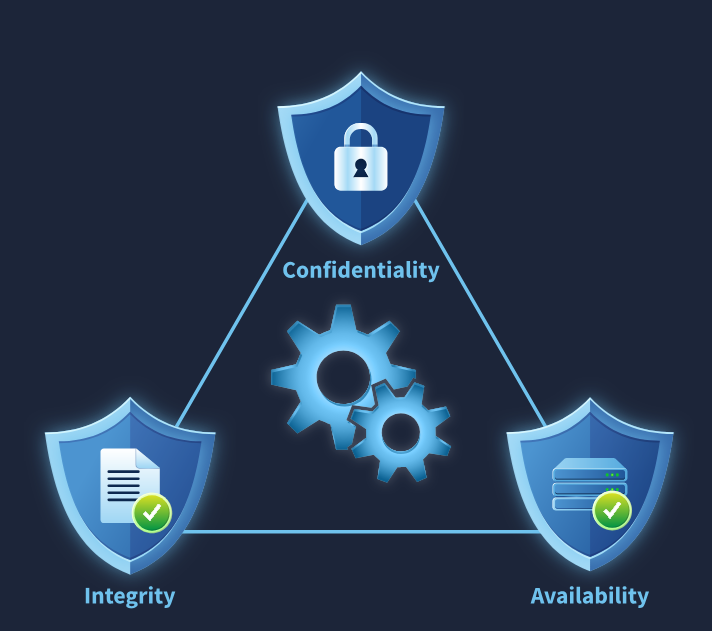<br>
  <sub>المثلث: السرية في الأعلى، والسلامة والتوافر في القاعدة، وكلها تعمل معًا</sub>
</p>

<table dir="rtl" width="100%">
<thead><tr><th align="right" style="text-align:right">الركيزة</th><th align="right" style="text-align:right">الاسم بالعربية</th><th align="right" style="text-align:right">السؤال الذي تجيب عنه</th></tr></thead>
<tbody>
<tr><td dir="ltr" align="left" style="text-align:left"><b>Confidentiality</b></td><td align="right" style="text-align:right">السرية</td><td align="right" style="text-align:right">هل يرى البيانات <b>من يحق له فقط</b>؟</td></tr>
<tr><td dir="ltr" align="left" style="text-align:left"><b>Integrity</b></td><td align="right" style="text-align:right">السلامة / النزاهة</td><td align="right" style="text-align:right">هل البيانات <b>صحيحة وغير معدلة</b> بلا إذن؟</td></tr>
<tr><td dir="ltr" align="left" style="text-align:left"><b>Availability</b></td><td align="right" style="text-align:right">التوافر / الإتاحة</td><td align="right" style="text-align:right">هل البيانات والخدمات <b>متاحة وقت الحاجة</b>؟</td></tr>
</tbody>
</table>

والأمن الجيد يحقق الثلاثة معًا، فإذا سقطت إحداها صار النظام غير آمن حتى لو سلمت الأخريان.

### <a id="t1-5"></a>1.5 السرية (Confidentiality)

**السرية** هي ضمان **ألا يصل إلى البيانات الحساسة أو يطلع عليها إلا الأشخاص المصرح لهم**.

**ما يحدث عند غيابها:** انتهاك الخصوصية، وخسائر مالية، وعواقب قانونية، وفقدان ثقة العملاء حين تصل المعلومات لأشخاص خطأ.

**أمثلة على انكسارها:**
- كتابة كلمات المرور على **ورقة لاصقة (Sticky Note)** في مكان العمل يراها من يمر.
- **اعتراض بيانات الدخول** على شبكة Wi-Fi عامة غير مؤمنة (Eavesdropping)، ثم فقدان الحساب.
- إرسال ملف حساس بالبريد إلى عنوان خاطئ.
- قاعدة بيانات مكشوفة للإنترنت بلا كلمة مرور.

**كيف تُحمى:**

<table dir="rtl" width="100%">
<thead><tr><th align="right" style="text-align:right">الضابط</th><th align="right" style="text-align:right">الفكرة</th></tr></thead>
<tbody>
<tr><td align="right" style="text-align:right"><b>التشفير (Encryption)</b></td><td align="right" style="text-align:right">تحويل البيانات إلى نص غير مقروء إلا بالمفتاح، أثناء النقل وأثناء التخزين</td></tr>
<tr><td align="right" style="text-align:right"><b>ضوابط الوصول (Access Controls)</b></td><td align="right" style="text-align:right">من يحق له ماذا: كلمات المرور وMFA والصلاحيات</td></tr>
<tr><td align="right" style="text-align:right"><b>مبدأ الحاجة للمعرفة (Need to Know)</b></td><td align="right" style="text-align:right">لا يرى الموظف إلا ما تتطلبه مهمته</td></tr>
<tr><td align="right" style="text-align:right"><b>تصنيف البيانات (Data Classification)</b></td><td align="right" style="text-align:right">عام، داخلي، سري، سري جدًا، ولكل مستوى معاملة</td></tr>
<tr><td align="right" style="text-align:right"><b>منع تسريب البيانات (DLP)</b></td><td align="right" style="text-align:right">أدوات ترصد خروج بيانات حساسة وتحجبه</td></tr>
</tbody>
</table>

### <a id="t1-6"></a>1.6 السلامة / النزاهة (Integrity)

**السلامة** هي ضمان **ألا يعدّل أحد غير مصرح له البيانات**، فتبقى **موثوقة ودقيقة** من لحظة إنشائها إلى لحظة استخدامها.

**ما يحدث عند غيابها:** قرارات خاطئة مبنية على بيانات مزورة، وتلاعب بالمعاملات، ونتائج قد تكون كارثية دون أن يلاحظ أحد.

**أمثلة على انكسارها:**
- تعديل **درجات الامتحانات** قبل اعتمادها النهائي.
- تغيير **بيانات حساب المستلم** في تحويل بنكي قبل إتمامه فتذهب الأموال لجهة أخرى.
- تغيير **سجلات الحضور** بعد أن أغلقها المعلم.
- تعديل ملف برنامج ليحمل شيفرة خبيثة، أو تعديل سجلات النظام لإخفاء أثر.

**كيف تُحمى:**

<table dir="rtl" width="100%">
<thead><tr><th align="right" style="text-align:right">الضابط</th><th align="right" style="text-align:right">الفكرة</th></tr></thead>
<tbody>
<tr><td align="right" style="text-align:right"><b>دوال التجزئة (Hashing)</b></td><td align="right" style="text-align:right">بصمة للملف: أي تغيير ولو بحرف يغير البصمة (<code>sha256sum</code>)</td></tr>
<tr><td align="right" style="text-align:right"><b>التوقيع الرقمي (Digital Signature)</b></td><td align="right" style="text-align:right">يثبت أن الملف من صاحبه ولم يتغير</td></tr>
<tr><td align="right" style="text-align:right"><b>مراقبة سلامة الملفات (FIM)</b></td><td align="right" style="text-align:right">تنبيه عند تغير ملف نظام أو موقع مهم</td></tr>
<tr><td align="right" style="text-align:right"><b>ضوابط الصلاحيات</b></td><td align="right" style="text-align:right">من يحق له <b>الكتابة</b> وليس القراءة فقط</td></tr>
<tr><td align="right" style="text-align:right"><b>سجلات التدقيق (Audit Logs)</b></td><td align="right" style="text-align:right">من غيّر ماذا ومتى، ويُفضل حفظها في مكان غير قابل للتعديل</td></tr>
<tr><td align="right" style="text-align:right"><b>التحكم في الإصدارات والنسخ الاحتياطي</b></td><td align="right" style="text-align:right">الرجوع لنسخة سليمة عند الحاجة</td></tr>
</tbody>
</table>

### <a id="t1-7"></a>1.7 التوافر / الإتاحة (Availability)

**التوافر** هو ضمان أن **البيانات والخدمات متاحة للمستخدمين المصرح لهم وقت حاجتهم**، دون انقطاع. وتعطل الخدمة حتى لفترة قصيرة قد يسبب خسائر ضخمة للشركات والمستخدمين.

**أمثلة على انكسارها:**
- **انقطاع الكهرباء** عن مركز البيانات فلا يستطيع العملاء الوصول لأموالهم رغم أنها في مكان آمن.
- **هجوم حجب الخدمة الموزع (DDoS)** يغرق الموقع بالطلبات حتى يتوقف، **دون أن يسرق أو يعدل بيانات**.
- **فدية (Ransomware)** تشفر الملفات فلا يستطيع أصحابها استخدامها.
- عطل في قرص أو خادم بلا نسخة احتياطية أو نظام بديل.

**كيف تُحمى:**

<table dir="rtl" width="100%">
<thead><tr><th align="right" style="text-align:right">الضابط</th><th align="right" style="text-align:right">الفكرة</th></tr></thead>
<tbody>
<tr><td align="right" style="text-align:right"><b>التكرار (Redundancy)</b></td><td align="right" style="text-align:right">خادم أو قرص أو خط اتصال بديل جاهز</td></tr>
<tr><td align="right" style="text-align:right"><b>النسخ الاحتياطي (Backups)</b></td><td align="right" style="text-align:right">قاعدة <b>3-2-1</b>: ثلاث نسخ، على وسيطين مختلفين، واحدة خارج الموقع</td></tr>
<tr><td align="right" style="text-align:right"><b>خطط الاستمرارية والتعافي (BCP / DR)</b></td><td align="right" style="text-align:right">ماذا نفعل وكم نحتاج لنعود للعمل</td></tr>
<tr><td align="right" style="text-align:right"><b>إدارة الأحمال (Load Balancing)</b></td><td align="right" style="text-align:right">توزيع الطلبات على عدة خوادم</td></tr>
<tr><td align="right" style="text-align:right"><b>الحماية من DDoS</b></td><td align="right" style="text-align:right">حظر الطلبات الزائدة عن الحد الطبيعي وتصفيتها</td></tr>
<tr><td align="right" style="text-align:right"><b>التحديثات والصيانة</b></td><td align="right" style="text-align:right">سد الثغرات التي قد تُستغل لإسقاط الخدمة</td></tr>
</tbody>
</table>

وتقاس الإتاحة غالبًا بنسبة الوقت الذي تعمل فيه الخدمة، وتبدو الفروق صغيرة لكنها كبيرة جدًا:

<table dir="rtl" width="100%">
<thead><tr><th align="right" style="text-align:right">نسبة التوافر</th><th align="right" style="text-align:right">مدة التوقف المسموحة في السنة تقريبًا</th></tr></thead>
<tbody>
<tr><td align="right" style="text-align:right">99%</td><td align="right" style="text-align:right">نحو 3.65 يوم</td></tr>
<tr><td align="right" style="text-align:right">99.9%</td><td align="right" style="text-align:right">نحو 8.76 ساعة</td></tr>
<tr><td align="right" style="text-align:right">99.99%</td><td align="right" style="text-align:right">نحو 52.6 دقيقة</td></tr>
<tr><td align="right" style="text-align:right">99.999%</td><td align="right" style="text-align:right">نحو 5.3 دقائق</td></tr>
</tbody>
</table>

### <a id="t1-8"></a>1.8 كيف تُنتهك الركائز الثلاث

يلخص الرسم التالي ثلاث نتائج أساسية لأي هجوم ناجح: **بيانات رُئيت** (السرية)، **بيانات تغيّرت** (السلامة)، **بيانات لم تصل** (التوافر).

<p align="center">
  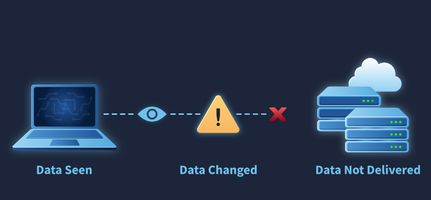<br>
  <sub>بيانات رُئيت دون إذن، بيانات تغيّرت دون إذن، وبيانات لم تصل إلى مستخدميها</sub>
</p>

والجدول التالي يربط أنواعًا شائعة من الحوادث بالركائز التي تتضرر (أمثلة من تصميمنا):

<table dir="rtl" width="100%">
<thead><tr><th align="right" style="text-align:right">الحادث</th><th align="right" style="text-align:right">السرية</th><th align="right" style="text-align:right">السلامة</th><th align="right" style="text-align:right">التوافر</th><th align="right" style="text-align:right">ملاحظة</th></tr></thead>
<tbody>
<tr><td align="right" style="text-align:right"><b>سرقة قاعدة بيانات عملاء</b></td><td align="right" style="text-align:right">نعم</td><td align="right" style="text-align:right">—</td><td align="right" style="text-align:right">—</td><td align="right" style="text-align:right">البيانات رُئيت أو نُسخت</td></tr>
<tr><td align="right" style="text-align:right"><b>هجوم DDoS على موقع</b></td><td align="right" style="text-align:right">—</td><td align="right" style="text-align:right">—</td><td align="right" style="text-align:right">نعم</td><td align="right" style="text-align:right">لا تسريب ولا تعديل</td></tr>
<tr><td align="right" style="text-align:right"><b>حقن SQL يقرأ ويعدل جدول المستخدمين</b></td><td align="right" style="text-align:right">نعم</td><td align="right" style="text-align:right">نعم</td><td align="right" style="text-align:right">—</td><td align="right" style="text-align:right">قراءة وتعديل معًا</td></tr>
<tr><td align="right" style="text-align:right"><b>رجل في المنتصف (MitM) يغير محتوى الصفحة</b></td><td align="right" style="text-align:right">نعم</td><td align="right" style="text-align:right">نعم</td><td align="right" style="text-align:right">—</td><td align="right" style="text-align:right">يرى ويعدل أثناء الطريق</td></tr>
<tr><td align="right" style="text-align:right"><b>فدية تشفر الملفات</b></td><td align="right" style="text-align:right">—</td><td align="right" style="text-align:right">—</td><td align="right" style="text-align:right">نعم</td><td align="right" style="text-align:right">وغالبًا تسرق نسخة أولًا فتتأثر <b>السرية</b> أيضًا</td></tr>
<tr><td align="right" style="text-align:right"><b>موظف يحذف سجلات الأحداث</b></td><td align="right" style="text-align:right">—</td><td align="right" style="text-align:right">نعم</td><td align="right" style="text-align:right">—</td><td align="right" style="text-align:right">يخفي أثرًا ويضعف التحقيق</td></tr>
<tr><td align="right" style="text-align:right"><b>انقطاع كهرباء بلا مولد احتياطي</b></td><td align="right" style="text-align:right">—</td><td align="right" style="text-align:right">—</td><td align="right" style="text-align:right">نعم</td><td align="right" style="text-align:right">حادث غير خبيث أيضًا يضر بالتوافر</td></tr>
</tbody>
</table>

وانتبه إلى أن **حادثًا واحدًا قد يصيب أكثر من ركيزة**، ولذلك يسأل المحلل الأسئلة الثلاثة دائمًا ولا يكتفي بأول إجابة.

### <a id="t1-9"></a>1.9 العلاقة بين الركائز والموازنة بينها

الركائز الثلاث **مترابطة** وأحيانًا **متعارضة**، والتصميم الأمني الجيد يوازن بينها بحسب قيمة الأصل.

<p align="center">
  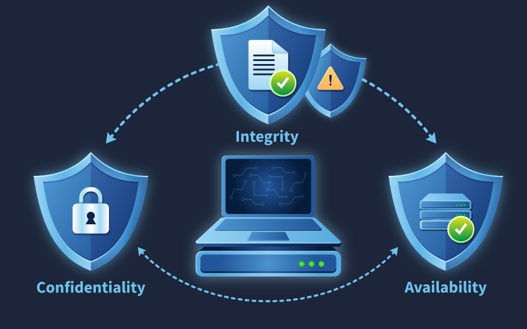<br>
  <sub>السلامة والسرية والتوافر تتفاعل مع بعضها حول النظام الذي نحميه</sub>
</p>

أمثلة على التوازن:
- **سرية مشددة تضر بالتوافر:** إذا جعلنا الدخول يتطلب خطوات معقدة جدًا أو قفلنا الحساب عند أي خطأ، منعنا المستخدم الشرعي نفسه من العمل.
- **توافر عالٍ يضعف السرية:** وضع نسخ البيانات في أماكن كثيرة لتكون متاحة دائمًا يزيد فرص تسريبها.
- **السلامة تعتمد على السرية:** إذا سرق أحد كلمة مرور مدير النظام (انكسرت السرية) استطاع تعديل البيانات (انكسرت السلامة).
- **التوافر يعتمد على السلامة:** إذا عُدّلت إعدادات الخادم خطأً أو عمدًا قد يتعطل.

والقاعدة: **حدد ما يهم أكثر لكل أصل**. فمستشفى يعطي التوافر أولوية قصوى للأجهزة المنقذة للحياة، وبنك يعطي السلامة والسرية أولوية قصوى للمعاملات، وموقع أخبار يهتم أكثر بالتوافر.

### <a id="t1-10"></a>1.10 ما بعد الثلاثية: مفاهيم مكملة

تغطي CIA الأساس، لكن أمورًا أخرى تكملها وتظهر كثيرًا في العمل:

<table dir="rtl" width="100%">
<thead><tr><th align="right" style="text-align:right">المفهوم</th><th align="right" style="text-align:right">معناه</th><th align="right" style="text-align:right">علاقته</th></tr></thead>
<tbody>
<tr><td align="right" style="text-align:right"><b>Authentication</b> (المصادقة)</td><td align="right" style="text-align:right">التأكد من <b>هوية</b> المستخدم: من أنت؟</td><td align="right" style="text-align:right">يخدم السرية</td></tr>
<tr><td align="right" style="text-align:right"><b>Authorization</b> (التفويض)</td><td align="right" style="text-align:right">ما <b>الذي يحق</b> لك فعله بعد معرفة هويتك</td><td align="right" style="text-align:right">يخدم السرية والسلامة</td></tr>
<tr><td align="right" style="text-align:right"><b>Accountability / Auditing</b> (المساءلة)</td><td align="right" style="text-align:right">تسجيل <b>من فعل ماذا</b> ليمكن التتبع</td><td align="right" style="text-align:right">يخدم السلامة والتحقيق</td></tr>
<tr><td align="right" style="text-align:right"><b>Non-repudiation</b> (عدم الإنكار)</td><td align="right" style="text-align:right">لا يستطيع شخص إنكار فعل قام به (توقيع رقمي، سجلات)</td><td align="right" style="text-align:right">يخدم السلامة</td></tr>
<tr><td align="right" style="text-align:right"><b>Authenticity</b> (الأصالة)</td><td align="right" style="text-align:right">أن الرسالة أو الملف <b>من مصدره الحقيقي</b></td><td align="right" style="text-align:right">يخدم السلامة</td></tr>
</tbody>
</table>

وتُجمع المصادقة والتفويض والمساءلة في اختصار **AAA** (Authentication, Authorization, Accounting).

### <a id="t1-11"></a>1.11 عقلية الأمن السيبراني (Security Mindset)

الثلاثية ليست تعريفات نظرية للحفظ، بل **عقلية تفكير** يمارسها مهندسو الأمن في عملهم اليومي. وحين يقع **حادث أمني (Security Incident)**، لا يبدأ المحلل بالسؤال عن اسم الهجوم، بل **يقيّم الأثر** بثلاثة أسئلة:

<table dir="rtl" width="100%">
<thead><tr><th align="right" style="text-align:right">السؤال</th><th align="right" style="text-align:right">الركيزة</th><th align="right" style="text-align:right">ما يبحث عنه المحلل</th></tr></thead>
<tbody>
<tr><td align="right" style="text-align:right">هل <b>وصل أحد</b> إلى بيانات حساسة دون إذن؟</td><td align="right" style="text-align:right">السرية</td><td align="right" style="text-align:right">سجلات الدخول، نقل ملفات كبير، وصول لقواعد البيانات</td></tr>
<tr><td align="right" style="text-align:right">هل <b>عُدّلت</b> البيانات دون إذن؟</td><td align="right" style="text-align:right">السلامة</td><td align="right" style="text-align:right">تغير بصمات الملفات، سجلات التعديل، سجلات قواعد البيانات</td></tr>
<tr><td align="right" style="text-align:right">هل <b>تعطلت</b> الأنظمة أو الخدمات عن مستخدميها؟</td><td align="right" style="text-align:right">التوافر</td><td align="right" style="text-align:right">سجلات التوقف، مراقبة الخدمة، شكاوى المستخدمين</td></tr>
</tbody>
</table>

وجواب هذه الأسئلة يحدد **الأولوية والإجراء**: حادث يمس السرية يحتاج غالبًا إشعارًا قانونيًا للمتضررين، وحادث يمس التوافر يحتاج استعادة سريعة، وحادث يمس السلامة يحتاج التحقق من كل بيانات المدة المتأثرة قبل الوثوق بها.

### <a id="t1-12"></a>1.12 الزاوية الأمنية: تقييم أثر الحادث بالثلاثية

حين يصل تنبيه إلى المحلل، تساعده الثلاثية على **ترتيب التحقيق**:

1. **حدد الأصل:** أي نظام أو بيانات؟ وما أهميته للعمل؟
2. **اسأل الأسئلة الثلاثة** للتأكد أي ركيزة أصيبت (وقد تكون أكثر من واحدة).
3. **اجمع الدليل** المناسب لكل ركيزة (انظر الجدول أعلاه) ولا تكتفِ بدليل واحد.
4. **قدّر الخطورة:** كم سجل؟ ما حساسيتها؟ كم مدة التوقف؟ هل التعديل مستمر؟
5. **اختر الإجراء الأنسب:** عزل (حماية السرية)، واستعادة من نسخة سليمة (حماية السلامة والتوافر)، وحجب مصدر الهجوم (حماية التوافر).
6. **وثّق** الأثر على كل ركيزة في التقرير، فهو ما تحتاجه الإدارة لاتخاذ القرار.

والمبدأ المهم: **لا تتحدث عن الحادث بأنه "اختراق" فقط**، بل قل: "حادث أصاب السرية والتوافر لنظام الفواتير"، فهذا وصف قابل للقياس والمتابعة.

<h2 dir="ltr" align="left" style="text-align:left">🛠 Commands &amp; Hands-on</h2>

### <a id="t1-13"></a>1.13 أدوات بسيطة لتطبيق الثلاثية عمليًا

الغرفة نظرية في أغلبها، لكن يمكن رؤية الركائز على جهازك بأوامر صغيرة (لينكس) كأمثلة تعليمية:

**1) السرية: صلاحيات الملفات**

<div dir="ltr" align="left">

```bash
ls -l report.txt              # who can read / write now
chmod 600 report.txt          # owner only: read + write
ls -l report.txt              # -rw------- confirms it
```

</div>

والرقم `600` يعني: المالك يقرأ ويكتب، والبقية لا يملكون أي صلاحية، فلا يستطيع مستخدم آخر قراءة الملف.

**2) السلامة: بصمة الملف قبل وبعد**

<div dir="ltr" align="left">

```bash
sha256sum report.txt > report.sha256     # save a baseline
sha256sum -c report.sha256               # report.txt: OK
echo "extra line" >> report.txt          # someone changes it
sha256sum -c report.sha256               # report.txt: FAILED
```

</div>

وتفسير: الأمر `-c` يقارن البصمة الحالية بالمحفوظة، فإذا تغير حرف واحد ظهرت كلمة **FAILED**. وعلى هذا المبدأ تعمل أدوات **FIM**.

**3) التوافر: هل الخدمة تعمل؟**

<div dir="ltr" align="left">

```bash
ping -c 3 192.0.2.10                                  # host reachable?
curl -s -o /dev/null -w "%{http_code}\n" http://example.com
systemctl is-active nginx                             # service running?
```

</div>

وهذه فحوصات تستخدمها أدوات المراقبة لتنبيهك فور توقف الخدمة. والرمز `200` من `curl` يعني أن الموقع يرد.

### <a id="t1-14"></a>1.14 جدول مرجعي: ثلاثية CIA (Cheatsheet)

<table dir="rtl" width="100%">
<thead><tr><th align="right" style="text-align:right">الركيزة</th><th align="right" style="text-align:right">أشهر التهديدات</th><th align="right" style="text-align:right">أمثلة ضوابط</th><th align="right" style="text-align:right">أين يظهر الدليل</th><th align="right" style="text-align:right">أمر أو أداة</th></tr></thead>
<tbody>
<tr><td dir="ltr" align="left" style="text-align:left"><b>Confidentiality</b></td><td align="right" style="text-align:right">تنصت، سرقة بيانات، كلمات مرور ضعيفة</td><td align="right" style="text-align:right">تشفير، MFA، صلاحيات، DLP</td><td align="right" style="text-align:right">سجلات الدخول، نقل بيانات كبير</td><td dir="ltr" align="left" style="text-align:left"><code>chmod 600 &lt;file&gt;</code></td></tr>
<tr><td dir="ltr" align="left" style="text-align:left"><b>Integrity</b></td><td align="right" style="text-align:right">تعديل بيانات، برمجيات مزورة، حذف سجلات</td><td align="right" style="text-align:right">Hashing، توقيع رقمي، FIM، سجلات تدقيق</td><td align="right" style="text-align:right">تغير بصمة ملف، سجل تعديل</td><td dir="ltr" align="left" style="text-align:left"><code>sha256sum -c &lt;file&gt;</code></td></tr>
<tr><td dir="ltr" align="left" style="text-align:left"><b>Availability</b></td><td align="right" style="text-align:right">DDoS، فدية، عطل، انقطاع</td><td align="right" style="text-align:right">تكرار، نسخ احتياطي، DR، حماية DDoS</td><td align="right" style="text-align:right">مراقبة الخدمة، سجلات توقف</td><td dir="ltr" align="left" style="text-align:left"><code>systemctl is-active &lt;svc&gt;</code></td></tr>
<tr><td dir="ltr" align="left" style="text-align:left"><b>AAA</b></td><td align="right" style="text-align:right">استخدام حساب مسروق</td><td align="right" style="text-align:right">MFA، Least Privilege، تسجيل</td><td align="right" style="text-align:right">سجلات المصادقة</td><td align="right" style="text-align:right">سجلات <code>auth</code> و<code>Security</code></td></tr>
</tbody>
</table>

<h2 dir="ltr" align="left" style="text-align:left">🖼 Practical Scenarios</h2>

### <a id="t1-15"></a>1.15 سيناريو: تقييم حادث فدية بالثلاثية

يتصل موظف بأن ملفات القسم المالي لا تفتح وتظهر لها امتداد غريب ورسالة تطالب بمبلغ. خطوات المحلل:

1. **التوافر:** الملفات **غير متاحة** فعلًا، فالركيزة الأولى أصيبت بوضوح. تحديد عدد الأجهزة والخوادم المتأثرة.
2. **السلامة:** الملفات **عُدّلت** (شُفّرت)، لكن هل عدّلها المهاجم قبل ذلك؟ يُراجع مصدر الإصابة وتوقيت الدخول الأول.
3. **السرية:** تعتمد العصابات الحديثة على **سرقة نسخة** قبل التشفير للابتزاز، فيُفحص حجم الحركة الصادرة الشاذ إلى الإنترنت. فإن وُجدت نسخة مسروقة فالسرية أصيبت أيضًا.
4. **الاحتواء:** عزل الأجهزة المصابة عن الشبكة، وتعطيل الحسابات المخترقة.
5. **التعافي:** الاستعادة من **نسخة احتياطية سليمة** وغير متصلة بالشبكة (حماية التوافر)، وليس دفع الفدية.
6. **التوثيق:** كتابة الأثر على الركائز الثلاث، وهو ما يحدد هل يلزم إبلاغ جهات خارجية.

والدرس: **حادث واحد، ثلاث ركائز**، ومن يقيّم ركيزة واحدة فقط يفوته نصف الأثر.

### <a id="t1-16"></a>1.16 كيف تتعامل مع أسئلة الغرفة بمنهجية

تتضمن الغرفة أسئلة قصيرة تربط **حالة** بالركيزة المناسبة. ولا تُذكر هنا إجابات، بل **طريقة التفكير**:

1. **اقرأ الحالة وحدد ما حدث للبيانات فعلًا:** هل رُئيت؟ هل تغيرت؟ هل لم تصل؟
2. **اربط الفعل بالركيزة:** رؤية دون إذن = السرية، تعديل دون إذن = السلامة، عدم الإتاحة = التوافر.
3. **انتبه لكلمة "وقت الحاجة" و"دون إذن":** تدل على التوافر والسرية على الترتيب.
4. **لا تحكم بالاسم:** هجوم اسمه "حجب" يخص التوافر، لكن تحقق من الحالة نفسها.
5. **راجع المصطلح الجماعي والتعريفات:** حفظ العبارة الأصلية بالإنجليزية يسرّع الفهم.

<h2 dir="ltr" align="left" style="text-align:left">📝 Practical Takeaways</h2>

- **CIA** = **Confidentiality** (من يرى) و**Integrity** (من يعدل) و**Availability** (الإتاحة وقت الحاجة).
- **السرية** تُحمى بالتشفير وضوابط الوصول، و**السلامة** بالتجزئة والتوقيع والمراقبة، و**التوافر** بالتكرار والنسخ الاحتياطي وإدارة الأحمال.
- **الحادث الواحد** قد يصيب أكثر من ركيزة، فاسأل الأسئلة الثلاثة دائمًا.
- الركائز **تتداخل وتتوازن**، وأولويتها تختلف بحسب الأصل.
- **AAA** (مصادقة وتفويض ومساءلة) و**Non-repudiation** مفاهيم مكملة تظهر في كل تحقيق.
- الثلاثية **عقلية تفكير** للمحلل عند تقييم أي حادث.

## 🛡 خلاصة المحلل الأمني (SOC Takeaways)

- **ابدأ كل تقييم حادث بالأسئلة الثلاثة:** هل رُئيت؟ هل تغيرت؟ هل تعطلت؟ ثم اكتب الجواب في التقرير.
- **اجمع الدليل المناسب لكل ركيزة:** سجلات الدخول ونقل البيانات (السرية)، وبصمات الملفات وسجلات التعديل (السلامة)، ومراقبة الخدمة (التوافر).
- **راقب الحركة الصادرة** لا الواردة فقط، فسرقة البيانات تظهر كخروج غير عادي.
- **احمِ السجلات نفسها:** هي دليلك على السلامة، وحذفها هجوم على السلامة.
- **اختبر النسخ الاحتياطية** دوريًا وخزّن نسخة غير متصلة بالشبكة (قاعدة 3-2-1)، فالفدية تستهدفها.
- **لا تعتمد على ركيزة واحدة** عند ترتيب الأولويات، فقيمة الأصل هي التي تحدد أيها أهم.
- **سمِّ الأثر بدقة** ("أصاب السرية والتوافر لنظام كذا") بدل "اختراق" العامة.

<br>

<a id="room-2"></a>
<table align="center" width="100%"><tr><td align="right" style="text-align:right">

### 🚪 الغرفة 2: Cryptography Concepts (مفاهيم التشفير)

</td></tr></table>

<h1 dir="ltr" align="left" style="text-align:left">Cryptography Concepts</h1>

### <a id="t2-1"></a>2.1 التعريف بالغرفة وأهدافها

عرفنا في الغرفة السابقة أن المطلوب حماية **السرية** و**السلامة** و**التوافر**. وتنتقل هذه الغرفة إلى **الأداة الأهم** لتحقيق السرية والسلامة عمليًا: **التشفير (Cryptography)**. فحين تنتقل بياناتك عبر الإنترنت لا تذهب مباشرة إلى المستقبل، بل تمر عبر عشرات الأجهزة والموجهات، ومن يصل إلى أحدها يستطيع نظريًا قراءتها أو تعديلها أو حجبها.

ومن أهداف الغرفة أن نكون قادرين في نهايتها على:
- شرح لماذا نحتاج التشفير وما المشكلة التي يحلها.
- تعريف **Plaintext** و**Ciphertext** و**Key** و**Algorithm** واستخدامها.
- شرح **شفرة قيصر** وسبب ضعفها وكيف تُكسر.
- التفريق بين **التشفير المتماثل** و**غير المتماثل** ومزايا وعيوب كل منهما.
- فهم **النهج الهجين** الذي يستخدمه HTTPS، ودور **الشهادات الرقمية**.
- التفريق بين **التشفير** و**التجزئة** و**الترميز**.
- معرفة **حالات البيانات** الثلاث وكيف تُحمى كل حالة.
- فهم لماذا **تتقادم** الخوارزميات وأنواع الهجمات على التشفير.
- استخدام أدوات `openssl` وسطر الأوامر لتجربة المفاهيم عمليًا.

<h2 dir="ltr" align="left" style="text-align:left">📌 Concepts Covered</h2>

### <a id="t2-2"></a>2.2 لماذا نحتاج التشفير؟

حين ترسل رسالة من جهازك إلى موقع أو صديق، فإنها تعبر **سلسلة طويلة** من الأجهزة: الراوتر المنزلي، ومزود الإنترنت، وموجهات كثيرة، ثم الخادم. وفي أي نقطة يمكن لطرف ثالث أن:
- **يقرأ** الرسالة (فتضيع السرية).
- **يعدلها** في الطريق (فتضيع السلامة).
- **يحجبها** فلا تصل (فيضيع التوافر).

والحل هو **التشفير**: استخدام **قواعد رياضية ومفاتيح سرية** لتحويل المعلومات إلى نص غير مفهوم (Gibberish) لا يستطيع فك رموزه إلا المخوَّلون. فإذا اعترض المهاجم الرسالة لم يجد إلا رموزًا بلا معنى.

### <a id="t2-3"></a>2.3 حالات البيانات الثلاث (Data States)

تحتاج البيانات إلى حماية في **ثلاث حالات** مختلفة:

<table dir="rtl" width="100%">
<thead><tr><th align="right" style="text-align:right">الحالة</th><th align="right" style="text-align:right">المعنى</th><th align="right" style="text-align:right">كيف تُحمى</th></tr></thead>
<tbody>
<tr><td align="right" style="text-align:right"><b>Data in Transit</b> (أثناء النقل)</td><td align="right" style="text-align:right">تنتقل عبر الشبكة</td><td align="right" style="text-align:right"><b>TLS / HTTPS</b>، VPN، SSH</td></tr>
<tr><td align="right" style="text-align:right"><b>Data at Rest</b> (مخزنة)</td><td align="right" style="text-align:right">على قرص أو قاعدة بيانات أو نسخة احتياطية</td><td align="right" style="text-align:right">تشفير الأقراص والملفات (BitLocker وAES-256 وLUKS)</td></tr>
<tr><td align="right" style="text-align:right"><b>Data in Use</b> (قيد الاستخدام)</td><td align="right" style="text-align:right">في الذاكرة أثناء المعالجة</td><td align="right" style="text-align:right">الأصعب: ضوابط الوصول، وعزل العمليات، وتقنيات حديثة مثل <b>Confidential Computing</b> وHomomorphic Encryption (قيد التطور)</td></tr>
</tbody>
</table>

وأكثر ما يُهمَل هو **Data at Rest**: ضياع حاسوب محمول غير مشفر يعني تسرب كل ما عليه.

### <a id="t2-4"></a>2.4 المصطلحات الأساسية في التشفير

<table dir="rtl" width="100%">
<thead><tr><th align="right" style="text-align:right">المصطلح</th><th align="right" style="text-align:right">المعنى</th><th align="right" style="text-align:right">مثال</th></tr></thead>
<tbody>
<tr><td align="right" style="text-align:right"><b>Plaintext</b> (النص الصريح)</td><td align="right" style="text-align:right">الرسالة الأصلية المقروءة</td><td align="right" style="text-align:right"><code>HELLO</code> أو اسم مريض</td></tr>
<tr><td align="right" style="text-align:right"><b>Ciphertext</b> (النص المشفر)</td><td align="right" style="text-align:right">الناتج المبعثر الذي لا يفصح عن المعنى</td><td dir="ltr" align="left" style="text-align:left"><code>KHOOR</code></td></tr>
<tr><td align="right" style="text-align:right"><b>Key</b> (المفتاح)</td><td align="right" style="text-align:right">العنصر السري الذي يتحكم في التشفير وفك التشفير، ويشبه كلمة السر للخوارزمية</td><td align="right" style="text-align:right">الرقم <code>3</code> في قيصر</td></tr>
<tr><td align="right" style="text-align:right"><b>Algorithm</b> (الخوارزمية)</td><td align="right" style="text-align:right">الخطوات الرياضية العامة التي تطبق المفتاح على الرسالة</td><td align="right" style="text-align:right">"أزح كل حرف" أو AES</td></tr>
<tr><td align="right" style="text-align:right"><b>Encryption</b> (التشفير)</td><td align="right" style="text-align:right">تحويل Plaintext إلى Ciphertext</td><td align="right" style="text-align:right"><code>HELLO</code> إلى <code>KHOOR</code></td></tr>
<tr><td align="right" style="text-align:right"><b>Decryption</b> (فك التشفير)</td><td align="right" style="text-align:right">استرجاع Plaintext من Ciphertext</td><td align="right" style="text-align:right"><code>KHOOR</code> إلى <code>HELLO</code></td></tr>
</tbody>
</table>

<p align="center">
  <br>
  <sub>المتنصت يفهم النص الصريح، بينما النص المشفر يظهر له رموزًا بلا معنى</sub>
</p>

ومن أهم المبادئ أن **الخوارزمية معروفة للجميع**، وأن **الأمان كله يعتمد على سرية المفتاح**، وهذا ما يُعرف بمبدأ **كيركهوفس (Kerckhoffs's principle)**. فالخوارزميات القوية مثل AES منشورة وخضعت لفحص آلاف الخبراء، ولا يثق أحد في خوارزمية "سرية" لا يراجعها أحد.

### <a id="t2-5"></a>2.5 عملية التشفير وفك التشفير

يمكن تلخيص العملية بمعادلتين:

<div dir="ltr" align="left">

```text
Plaintext  + Encryption Algorithm + Key  ->  Ciphertext
Ciphertext + Decryption Algorithm + Key  ->  Plaintext
```

</div>

فالمرسل يضع الرسالة في خوارزمية التشفير مع المفتاح فيخرج النص المشفر:

<p align="center">
  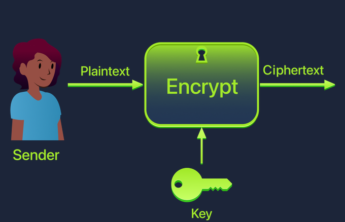<br>
  <sub>المرسل يدخل Plaintext والمفتاح في الخوارزمية فيخرج Ciphertext</sub>
</p>

ثم يستقبله المستقبل ويطبق عملية فك التشفير بالمفتاح المناسب فيحصل على النص الأصلي:

<p align="center">
  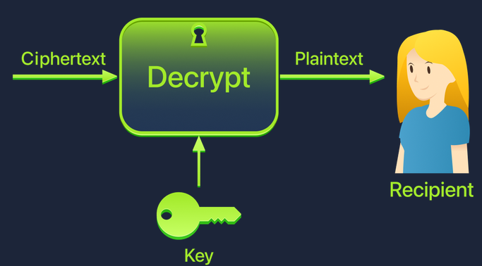<br>
  <sub>المستقبل يدخل Ciphertext والمفتاح في خوارزمية فك التشفير فيخرج Plaintext</sub>
</p>

وفي الرسمين المفتاح واحد في الجهتين، وهذا هو **التشفير المتماثل** الذي نشرحه بعد قليل. وسنرى أن التشفير غير المتماثل يغير هذه الصورة بمفتاحين.

### <a id="t2-6"></a>2.6 مثال تعليمي: شفرة قيصر (Caesar Cipher)

**شفرة قيصر** من أقدم الشفرات: تُزيح كل حرف في الأبجدية **عددًا ثابتًا من الأماكن**، وهذا العدد هو **المفتاح**. فبإزاحة مقدارها 3 تصبح `HELLO` هي `KHOOR`.

<p align="center">
  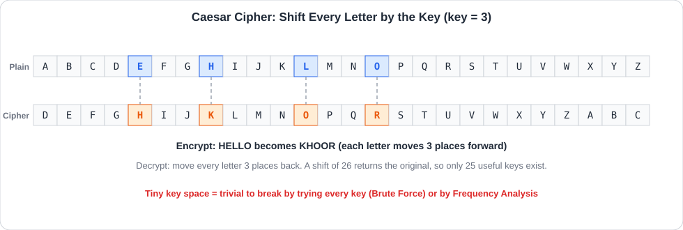<br>
  <sub>الصف العلوي هو الأبجدية الأصلية، والسفلي هو الأبجدية بعد الإزاحة، وتظهر الأحرف المستخدمة في HELLO مظللة</sub>
</p>

وخصائصها:

<table dir="rtl" width="100%">
<thead><tr><th align="right" style="text-align:right">الخاصية</th><th align="right" style="text-align:right">التفصيل</th></tr></thead>
<tbody>
<tr><td align="right" style="text-align:right"><b>المفتاح</b></td><td align="right" style="text-align:right">رقم الإزاحة، من 1 إلى 25</td></tr>
<tr><td align="right" style="text-align:right"><b>فك التشفير</b></td><td align="right" style="text-align:right">الإزاحة بنفس العدد في الاتجاه المعاكس</td></tr>
<tr><td align="right" style="text-align:right"><b>الإزاحة للأمام بـ k</b></td><td align="right" style="text-align:right">تساوي الإزاحة للخلف بـ (26 − k)</td></tr>
<tr><td dir="ltr" align="left" style="text-align:left"><b>ROT13</b></td><td align="right" style="text-align:right">حالة خاصة بإزاحة 13، تشفيرها وفكها بالأمر نفسه</td></tr>
<tr><td align="right" style="text-align:right"><b>عدد المفاتيح الممكنة</b></td><td align="right" style="text-align:right">25 فقط (المفتاح 0 أو 26 يعيد النص كما هو)</td></tr>
</tbody>
</table>

وسبب ضعفها: **مساحة المفاتيح (Key Space) صغيرة جدًا**، فيمكن لأي حاسوب بل أي شخص تجربة الاحتمالات الـ25 كلها خلال لحظات حتى يظهر نص مفهوم، وهذا **هجوم القوة الغاشمة (Brute Force)**. كما تنكسر بـ **تحليل الترددات (Frequency Analysis)** لأن حرف E مثلًا هو الأكثر ظهورًا في الإنجليزية، فيعرف المحلل أي حرف في النص المشفر يقابله.

ولذلك لا تُستخدم قيصر في أي حماية حقيقية، لكنها تبين **فكرة الخوارزمية والمفتاح** بوضوح. والأنظمة الحقيقية تستخدم معايير قوية مثل **AES**.

### <a id="t2-7"></a>2.7 التشفير المتماثل (Symmetric Encryption)

يستخدم **المفتاح نفسه** لتشفير الرسالة (القفل) وفك تشفيرها (الفتح).

**المميزات:**
- **سريع وعالي الكفاءة**، فهو مثالي لتشفير **الملفات والأقراص وحركة الشبكة**.
- يعمل جيدًا مع البيانات الضخمة.

**التحدي الرئيسي: مشكلة توزيع المفاتيح (Key Distribution Problem):** كيف يشارك المرسل والمستقبل المفتاح نفسه **سرًّا** عبر شبكة عامة دون أن يراه المهاجم؟ إرساله مكشوفًا يعرضه للاعتراض، فيفك المهاجم كل الرسائل القادمة.

**أشهر الخوارزميات:**

<table dir="rtl" width="100%">
<thead><tr><th align="right" style="text-align:right">الخوارزمية</th><th align="right" style="text-align:right">النوع</th><th align="right" style="text-align:right">الحالة</th></tr></thead>
<tbody>
<tr><td align="right" style="text-align:right"><b>AES</b> (بمفاتيح 128 أو 192 أو 256 بت)</td><td align="right" style="text-align:right">تشفير كتل (Block) بحجم كتلة 128 بت</td><td align="right" style="text-align:right"><b>المعيار الحالي</b></td></tr>
<tr><td dir="ltr" align="left" style="text-align:left"><b>ChaCha20</b></td><td align="right" style="text-align:right">تشفير تدفق (Stream)</td><td align="right" style="text-align:right">حديث، ويُستخدم في TLS خاصة على الجوالات</td></tr>
<tr><td align="right" style="text-align:right"><b>3DES</b> و<b>DES</b></td><td align="right" style="text-align:right">كتل</td><td align="right" style="text-align:right"><b>متقادمان</b> وغير موصى بهما (مفتاح DES قصير وانكسر)</td></tr>
<tr><td dir="ltr" align="left" style="text-align:left"><b>RC4</b></td><td align="right" style="text-align:right">تدفق</td><td align="right" style="text-align:right"><b>مهجور</b> بسبب نقاط ضعف معروفة</td></tr>
</tbody>
</table>

والفرق بين النوعين:
- **Block Cipher:** يشفر البيانات على **كتل ثابتة الحجم** (مثل 128 بت في AES)، وهو الأكثر استخدامًا للملفات والأقراص.
- **Stream Cipher:** يشفر البيانات **بتًا ببت أو بايتًا ببايت** كأنها تيار مستمر، ويفيد في البث المباشر.

وللكتل **أوضاع تشغيل (Modes)** مثل **CBC** و**GCM**. وأهم ملاحظة للمحلل أن الوضع **ECB** ضعيف لأنه يشفر الكتل المتطابقة إلى ناتج متطابق فتظهر الأنماط، أما **GCM** فيجمع بين التشفير والتحقق من سلامة البيانات.

### <a id="t2-8"></a>2.8 التشفير غير المتماثل (Asymmetric Encryption)

يستخدم **مفتاحين مرتبطين رياضيًا**:
- **المفتاح العام (Public Key):** متاح للجميع، ويُستخدم **للتشفير** (أي لوضع الرسالة في "الصندوق").
- **المفتاح الخاص (Private Key):** يحتفظ به المالك **بسرية تامة**، ويُستخدم **لفك التشفير**.

<p align="center">
  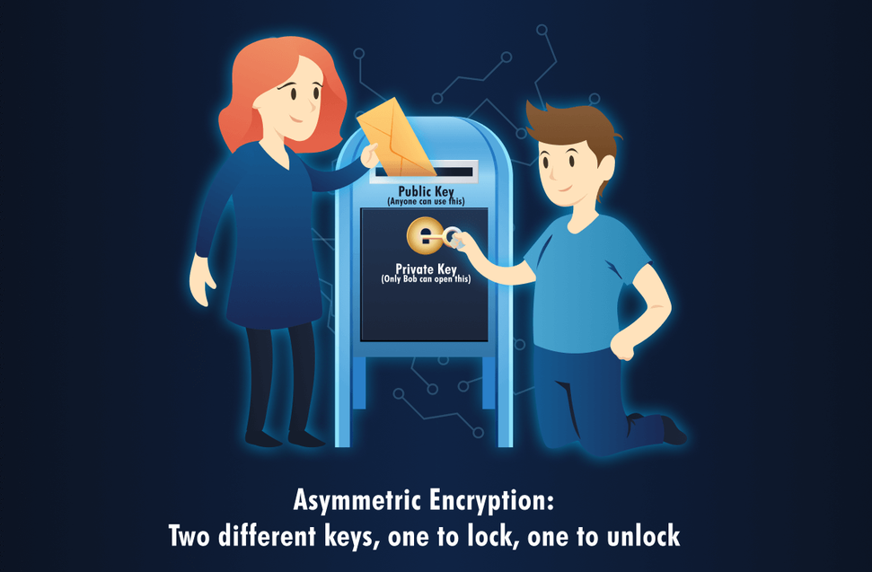<br>
  <sub>أي شخص يضع الرسالة في الصندوق عبر المفتاح العام، ولا يفتحه إلا مالك المفتاح الخاص</sub>
</p>

وهذا التشبيه يوضح الفكرة: **أي أحد** يستطيع إلقاء رسالة في صندوق البريد (المفتاح العام)، لكن **صاحب المفتاح وحده** يفتح الصندوق ويقرأ الرسائل (المفتاح الخاص).

وبالأسماء المعتادة: تريد Alice إرسال رسالة لـ Bob، فتشفرها بـ **المفتاح العام لـ Bob**، فلا يفكها إلا **المفتاح الخاص لـ Bob**.

<p align="center">
  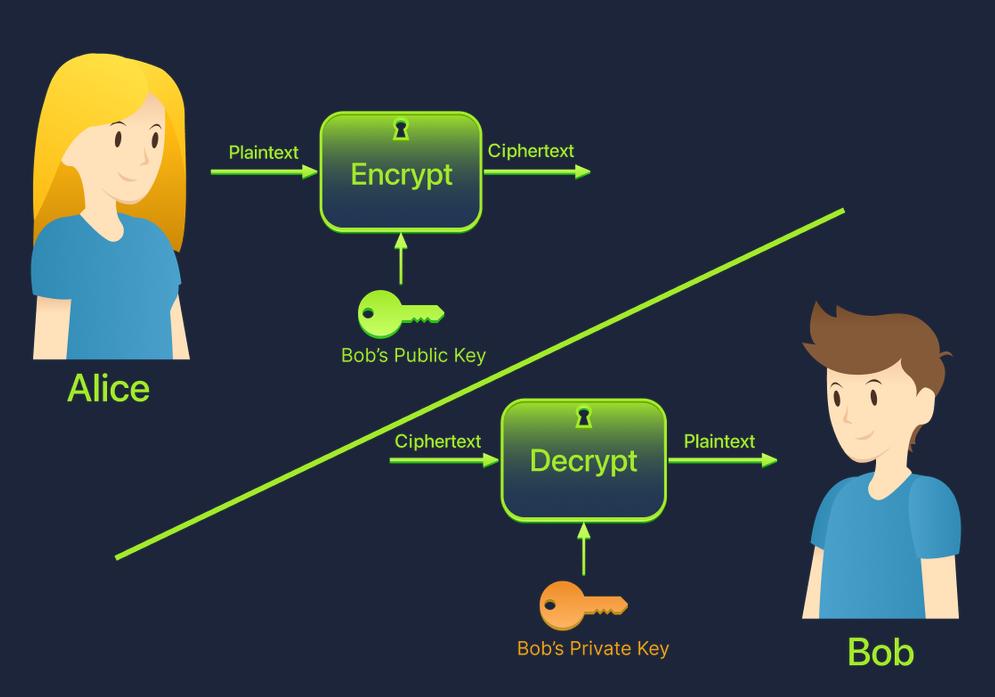<br>
  <sub>Alice تشفر بالمفتاح العام لـ Bob، وBob يفك بمفتاحه الخاص</sub>
</p>

**كيف حل مشكلة توزيع المفاتيح؟** لا حاجة لتبادل مفتاح سري مسبقًا. المفتاح العام يُنشر علنًا بلا خطر، والسر الوحيد هو المفتاح الخاص الذي **لا يغادر جهاز صاحبه** أبدًا.

**الخوارزميات الشائعة:** **RSA** (بأطوال 2048 بت أو أكثر) و**ECC** (منحنيات إهليلجية، مفاتيح أقصر وأمان مماثل)، و**Diffie-Hellman** لتبادل المفاتيح.

وللتشفير غير المتماثل استخدام آخر عكسي هو **التوقيع الرقمي**: يوقّع المالك الرسالة **بمفتاحه الخاص**، فيتحقق أي شخص **بمفتاحه العام** أن الرسالة منه ولم تتغير (انظر موضوع التجزئة والتوقيع).

وعيبه أنه **أبطأ نسبيًا** ولا يصلح لتشفير البيانات الكبيرة.

### <a id="t2-9"></a>2.9 المقارنة والنهج الهجين (Hybrid Approach)

<table dir="rtl" width="100%">
<thead><tr><th align="right" style="text-align:right">الميزة</th><th align="right" style="text-align:right">متماثل (Symmetric)</th><th align="right" style="text-align:right">غير متماثل (Asymmetric)</th></tr></thead>
<tbody>
<tr><td align="right" style="text-align:right"><b>عدد المفاتيح</b></td><td align="right" style="text-align:right">مفتاح واحد مشترك</td><td align="right" style="text-align:right">مفتاحان: عام وخاص</td></tr>
<tr><td align="right" style="text-align:right"><b>مشاركة المفتاح</b></td><td align="right" style="text-align:right">يجب مشاركته <b>سرًّا</b></td><td align="right" style="text-align:right">العام يُنشر علنًا</td></tr>
<tr><td align="right" style="text-align:right"><b>السرعة</b></td><td align="right" style="text-align:right">سريع جدًا</td><td align="right" style="text-align:right">أبطأ نسبيًا</td></tr>
<tr><td align="right" style="text-align:right"><b>الاستخدام الأساسي</b></td><td align="right" style="text-align:right">تشفير الملفات والأقراص وحركة الشبكة</td><td align="right" style="text-align:right">تبادل المفاتيح والتوقيعات والشهادات</td></tr>
<tr><td align="right" style="text-align:right"><b>أمثلة</b></td><td align="right" style="text-align:right">AES، ChaCha20</td><td align="right" style="text-align:right">RSA، ECC، Diffie-Hellman</td></tr>
</tbody>
</table>

وبما أن لكل نوع ميزة وعيبًا، تجمع الأنظمة الحديثة بينهما: **التشفير غير المتماثل لبدء الاتصال وتبادل المفتاح بأمان، ثم التشفير المتماثل لنقل البيانات** لسرعته. وهذا ما يفعله **HTTPS**، وسنرى تفاصيله بعد أن نتعلم التجزئة والتوقيع والشهادات.

### <a id="t2-10"></a>2.10 دوال التجزئة (Hashing)

**دالة التجزئة (Hash Function)** تحول أي بيانات إلى **بصمة ثابتة الطول**، وتتميز بأنها:
- **اتجاه واحد (One-way):** لا يمكن استرجاع الأصل من البصمة.
- **حتمية:** نفس المدخل يعطي نفس البصمة دائمًا.
- **حساسة جدًا:** تغيير حرف واحد يغير البصمة كلها.
- **مقاومة للتصادم (Collision Resistant):** يصعب إيجاد مدخلين مختلفين لهما نفس البصمة.

وهذا يختلف عن التشفير الذي يمكن عكسه بالمفتاح. وكثيرًا ما يُخلط بين ثلاثة مفاهيم:

<table dir="rtl" width="100%">
<thead><tr><th align="right" style="text-align:right">المفهوم</th><th align="right" style="text-align:right">الهدف</th><th align="right" style="text-align:right">هل يُعكس؟</th><th align="right" style="text-align:right">هل يحتاج مفتاحًا؟</th><th align="right" style="text-align:right">أمثلة</th></tr></thead>
<tbody>
<tr><td align="right" style="text-align:right"><b>Encoding</b> (ترميز)</td><td align="right" style="text-align:right">تمثيل البيانات بصيغة أخرى للتوافق</td><td align="right" style="text-align:right"><b>نعم</b> بسهولة</td><td align="right" style="text-align:right">لا</td><td align="right" style="text-align:right">Base64، Hex، ASCII</td></tr>
<tr><td align="right" style="text-align:right"><b>Encryption</b> (تشفير)</td><td align="right" style="text-align:right">إخفاء المحتوى (السرية)</td><td align="right" style="text-align:right">نعم <b>بالمفتاح</b></td><td align="right" style="text-align:right"><b>نعم</b></td><td align="right" style="text-align:right">AES، RSA</td></tr>
<tr><td align="right" style="text-align:right"><b>Hashing</b> (تجزئة)</td><td align="right" style="text-align:right">التحقق من السلامة</td><td align="right" style="text-align:right"><b>لا</b></td><td align="right" style="text-align:right">لا (أو HMAC بمفتاح)</td><td dir="ltr" align="left" style="text-align:left">SHA-256</td></tr>
</tbody>
</table>

فالـ Base64 **ليس تشفيرًا**: أي أحد يفكه دون مفتاح. ويخدع المهاجمون بهذا كثيرًا (سنرى في الغرف التالية).

**أنواع الدوال وحالتها:**

<table dir="rtl" width="100%">
<thead><tr><th align="right" style="text-align:right">الدالة</th><th align="right" style="text-align:right">حجم البصمة</th><th align="right" style="text-align:right">الحالة</th></tr></thead>
<tbody>
<tr><td dir="ltr" align="left" style="text-align:left"><b>MD5</b></td><td align="right" style="text-align:right">128 بت</td><td align="right" style="text-align:right"><b>مكسورة</b> (تصادمات سهلة)، لا تُستخدم للأمن</td></tr>
<tr><td dir="ltr" align="left" style="text-align:left"><b>SHA-1</b></td><td align="right" style="text-align:right">160 بت</td><td align="right" style="text-align:right"><b>مكسورة</b> للتصادم، متقادمة</td></tr>
<tr><td align="right" style="text-align:right"><b>SHA-256</b> (عائلة SHA-2)</td><td align="right" style="text-align:right">256 بت</td><td align="right" style="text-align:right"><b>آمنة ومعتمدة</b></td></tr>
<tr><td dir="ltr" align="left" style="text-align:left"><b>SHA-3</b></td><td align="right" style="text-align:right">متنوع</td><td align="right" style="text-align:right">آمنة، بتصميم مختلف</td></tr>
</tbody>
</table>

ومن المهم أن **MD5 و SHA-1 دالتا تجزئة وليستا خوارزميتي تشفير**، لكنهما تتقادمان كما تتقادم خوارزميات التشفير.

**تخزين كلمات المرور:** لا تُخزَّن كلمات المرور نصًا ولا بتجزئة سريعة بسيطة، بل بتجزئة **بطيئة ومملحة (Salted)** مثل **bcrypt** أو **Argon2**. فـ **الملح (Salt)** قيمة عشوائية تُضاف قبل التجزئة، فتختلف بصمة كلمتين متطابقتين ويفشل الهجوم بالجداول الجاهزة (Rainbow Tables).

### <a id="t2-11"></a>2.11 التوقيع الرقمي (Digital Signature)

**التوقيع الرقمي (Digital Signature)** يجمع التجزئة والتشفير غير المتماثل، ويحل مشكلة: كيف أتأكد أن الرسالة جاءت من صاحبها فعلًا ولم تتغير في الطريق؟
1. يحسب المرسل **بصمة** الرسالة.
2. يشفر البصمة **بمفتاحه الخاص**، والناتج هو **التوقيع**.
3. يحسب المستقبل بصمة الرسالة، ويفك التوقيع **بالمفتاح العام**، ثم يقارن.
4. إن تطابقتا فالرسالة **من صاحب المفتاح** و**لم تتغير**.

فيحقق التوقيع **السلامة** و**الأصالة** و**عدم الإنكار** معًا.

<p align="center">
  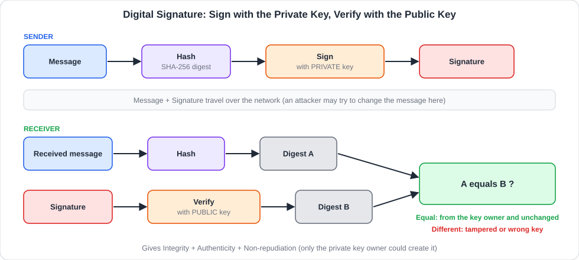<br>
  <sub>المرسل يوقّع بصمة الرسالة بمفتاحه الخاص، والمستقبل يتحقق بالمفتاح العام ويقارن البصمتين</sub>
</p>

لاحظ أن الاتجاه هنا **معكوس** عن التشفير: نوقّع بالمفتاح **الخاص** (لا يملكه غيرك) ويتحقق **الجميع** بالمفتاح **العام**. وبهذا يكون التوقيع هو أساس الشهادات في الموضوع التالي.

### <a id="t2-12"></a>2.12 الشهادات الرقمية و HTTPS

المشكلة التي يحلها التشفير غير المتماثل ليست كافية: كيف أعرف أن **المفتاح العام** الذي أستلمه يخص فعلًا الموقع الذي أريده، وليس مهاجمًا انتحل شخصيته؟ هنا تأتي **الشهادة الرقمية (Digital Certificate)**.

**الشهادة** وثيقة رقمية تربط **هوية** (اسم النطاق) **بمفتاح عام**، وتكون **موقّعة** من جهة موثوقة تسمى **جهة إصدار الشهادات (Certificate Authority - CA)**. والمتصفح يحتفظ بقائمة جهات يثق بها (Trust Store)، فإذا كانت الشهادة موقعة من إحداها (مباشرة أو عبر سلسلة وسطاء) يطمئن لها.

يظهر ذلك للمستخدم في **أيقونة القفل** بجوار العنوان. وعند الضغط عليها وفتح **Connection is secure** يخبرك المتصفح أن الاتصال آمن وأن الشهادة صالحة (انظر الصورة المتحركة):

<p align="center">
  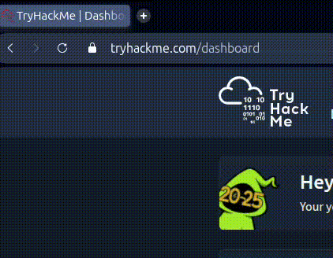<br>
  <sub>صورة متحركة: الضغط على القفل ثم Connection is secure ثم عرض أن الشهادة صالحة</sub>
</p>

ويمكن فتح الشهادة وقراءة بياناتها:

<p align="center">
  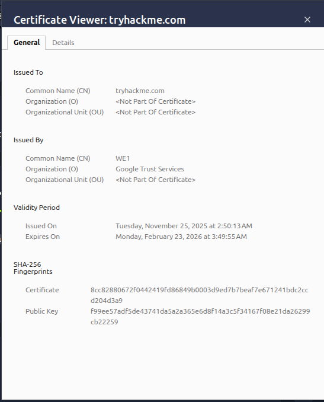<br>
  <sub>الشهادة صادرة للنطاق من جهة إصدار وبصلاحية محددة ومعها بصمات SHA-256</sub>
</p>

وتفسير الحقول الظاهرة في الصورة:

<table dir="rtl" width="100%">
<thead><tr><th align="right" style="text-align:right">الحقل</th><th align="right" style="text-align:right">معناه</th><th align="right" style="text-align:right">في الصورة</th></tr></thead>
<tbody>
<tr><td dir="ltr" align="left" style="text-align:left"><b>Issued To</b> (Common Name)</td><td align="right" style="text-align:right">النطاق الذي صدرت له الشهادة</td><td dir="ltr" align="left" style="text-align:left"><code>tryhackme.com</code></td></tr>
<tr><td dir="ltr" align="left" style="text-align:left"><b>Issued By</b></td><td align="right" style="text-align:right">جهة الإصدار (CA)</td><td align="right" style="text-align:right"><code>WE1</code> من منظمة Google Trust Services</td></tr>
<tr><td dir="ltr" align="left" style="text-align:left"><b>Validity Period</b></td><td align="right" style="text-align:right">تاريخ البداية والانتهاء</td><td align="right" style="text-align:right">مدتها نحو 90 يومًا</td></tr>
<tr><td dir="ltr" align="left" style="text-align:left"><b>SHA-256 Fingerprint</b></td><td align="right" style="text-align:right">بصمة الشهادة والمفتاح العام للتحقق</td><td align="right" style="text-align:right">سلسلة سداسية عشرية طويلة</td></tr>
</tbody>
</table>

وهناك حقول أخرى مهمة في تبويب Details: **Subject Alternative Name (SAN)** وهو قائمة الأسماء التي تغطيها الشهادة، و**Serial Number** و**Signature Algorithm**. وما تشاهده من مدة قصيرة (نحو 90 يومًا) طبيعي اليوم لأن التجديد **آلي**، والمدة القصيرة تحد من أثر سرقة المفتاح.

**ماذا يتحقق منه المتصفح؟**

<table dir="rtl" width="100%">
<thead><tr><th align="right" style="text-align:right">الفحص</th><th align="right" style="text-align:right">يفشل عندما</th></tr></thead>
<tbody>
<tr><td align="right" style="text-align:right"><b>الاسم</b> يطابق النطاق في الرابط</td><td align="right" style="text-align:right">شهادة لنطاق آخر</td></tr>
<tr><td align="right" style="text-align:right"><b>الصلاحية</b> (التاريخ)</td><td align="right" style="text-align:right">الشهادة منتهية أو لم تبدأ</td></tr>
<tr><td align="right" style="text-align:right"><b>السلسلة</b> تنتهي بجهة موثوقة</td><td align="right" style="text-align:right">شهادة موقعة ذاتيًا (Self-Signed) أو جهة غير معروفة</td></tr>
<tr><td align="right" style="text-align:right"><b>عدم الإلغاء</b></td><td align="right" style="text-align:right">الشهادة مسحوبة (Revoked)، ويُتحقق عبر <b>CRL</b> (قائمة الشهادات الملغاة) أو <b>OCSP</b> (استعلام مباشر عن حالة الشهادة)</td></tr>
</tbody>
</table>

وعند فشل أي فحص يعرض المتصفح تحذيرًا كبيرًا، **ولا يجوز تجاهله** على موقع حساس.

وسلسلة الثقة تكون هكذا: **Root CA** (في مخزن الثقة) توقع **Intermediate CA** التي توقع **شهادة الموقع (Leaf)**.

### <a id="t2-13"></a>2.13 HTTPS: النهج الهجين في العمل

الآن تجتمع كل القطع: **الشهادة** تثبت هوية الخادم، و**التشفير غير المتماثل** يتفق به الطرفان على مفتاح، و**التشفير المتماثل** ينقل البيانات بسرعة. وهذا ما يحدث في كل مرة تفتح فيها موقعًا بـ HTTPS:

<p align="center">
  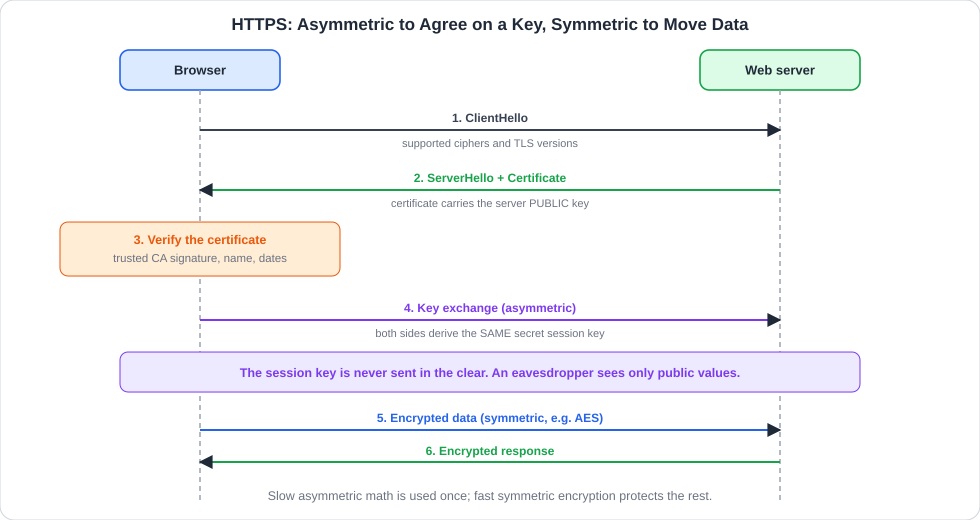<br>
  <sub>المتصفح والخادم يتفقان على مفتاح جلسة بتبادل غير متماثل، ثم يشفران البيانات بتشفير متماثل</sub>
</p>

وهذا الرسم مبسط، وأدق تفصيلة للمهتمين: في **TLS 1.3** يتم الاتفاق على المفتاح بتبادل **Diffie-Hellman مؤقت (Ephemeral)**، ويستخدم مفتاح الشهادة لـ **توقيع** الإثبات أن الخادم هو صاحب الشهادة، وهذا يعطي **السرية الأمامية (Forward Secrecy)**: حتى لو سُرق مفتاح الخادم الخاص لاحقًا لا تُفك به الجلسات القديمة المسجلة.

### <a id="t2-14"></a>2.14 تقادم الخوارزميات وأنواع الهجمات على التشفير

الخوارزميات **تتقادم** لأن قدرة الحواسيب تزيد باستمرار، وتُكتشف نقاط ضعف رياضية. فتصبح **مكسورة أو مهجورة (Deprecated)**: DES وRC4 وMD5 وSHA-1 أمثلة. والعلاج هو **الانتقال** إلى البدائل الحديثة: **AES** و**SHA-256** و**TLS 1.2 أو 1.3**. وتظهر في الأفق **الحوسبة الكمّية** التي قد تكسر RSA وECC مستقبلًا، ولهذا تُطوَّر **خوارزميات ما بعد الكم (Post-Quantum)**.

<table dir="rtl" width="100%">
<thead><tr><th align="right" style="text-align:right">الهجوم</th><th align="right" style="text-align:right">الفكرة</th><th align="right" style="text-align:right">الحماية</th></tr></thead>
<tbody>
<tr><td dir="ltr" align="left" style="text-align:left"><b>Brute Force</b></td><td align="right" style="text-align:right">تجربة كل المفاتيح الممكنة</td><td align="right" style="text-align:right">مفاتيح طويلة (AES-128 أو أكثر)</td></tr>
<tr><td dir="ltr" align="left" style="text-align:left"><b>Frequency Analysis</b></td><td align="right" style="text-align:right">استغلال تكرار الحروف لكسر الشفرات البسيطة</td><td align="right" style="text-align:right">خوارزميات حديثة</td></tr>
<tr><td dir="ltr" align="left" style="text-align:left"><b>Dictionary / Rainbow Table</b></td><td align="right" style="text-align:right">تجربة كلمات شائعة أو جداول بصمات جاهزة</td><td align="right" style="text-align:right">Salt وتجزئة بطيئة</td></tr>
<tr><td dir="ltr" align="left" style="text-align:left"><b>Collision Attack</b></td><td align="right" style="text-align:right">إيجاد ملفين ببصمة واحدة</td><td align="right" style="text-align:right">تجنب MD5 وSHA-1</td></tr>
<tr><td dir="ltr" align="left" style="text-align:left"><b>Man-in-the-Middle (MitM)</b></td><td align="right" style="text-align:right">الوقوف بين الطرفين وانتحال هوية الخادم</td><td align="right" style="text-align:right">شهادات صحيحة وTLS</td></tr>
<tr><td dir="ltr" align="left" style="text-align:left"><b>Downgrade Attack</b></td><td align="right" style="text-align:right">إجبار الاتصال على إصدار أضعف</td><td align="right" style="text-align:right">تعطيل الإصدارات القديمة، HSTS</td></tr>
<tr><td dir="ltr" align="left" style="text-align:left"><b>Weak / Reused Keys</b></td><td align="right" style="text-align:right">مفاتيح ضعيفة أو مكررة أو مسربة</td><td align="right" style="text-align:right">إدارة مفاتيح محكمة وتدوير</td></tr>
</tbody>
</table>

والخلاصة: **أضعف نقطة في التشفير غالبًا ليست الرياضيات** بل **إدارة المفاتيح**: مفتاح خاص مخزن في ملف مفتوح، أو كلمة مرور ضعيفة تحمي مفتاحًا قويًا.

### <a id="t2-15"></a>2.15 الزاوية الأمنية: التشفير في عمل المدافع

يتقاطع التشفير مع عمل المحلل في أماكن كثيرة:

1. **أخطاء الشهادات:** شهادة **منتهية** تعطل خدمة وتدرب المستخدمين على تجاهل التحذيرات، وشهادة موقعة ذاتيًا على خادم عام مؤشر خلل، وشهادة لنطاق **مشابه** لنطاق شركتك دليل تصيد.
2. **مراقبة إعدادات TLS:** وجود خوادم ما زالت تقبل **TLS 1.0/1.1** أو شفرات ضعيفة (مثل RC4 وDES) يعتبر ثغرة في فحوص الامتثال.
3. **التشفير يعمي المراقبة:** كل البرمجيات الخبيثة تقريبًا تتصل بـ HTTPS كي تختبئ بين الحركة المشفرة، ولذلك تلجأ المؤسسات إلى **فحص TLS (TLS Inspection)** عند الحدود، أو تعتمد على بيانات وصفية (النطاق في الشهادة، و**SNI** وهو اسم الموقع المطلوب الذي يُرسل في بداية اتصال TLS قبل التشفير، و**JA3** وهي بصمة تميز برنامج العميل من طريقة بدء TLS) دون فك المحتوى.
4. **فدية تستخدم التشفير ضدك:** الفدية تشفر ملفاتك بمفاتيح لا تملكها، وهذا استخدام معاكس للتشفير نفسه. والحماية بنسخ احتياطية غير متصلة.
5. **البصمات كمؤشرات اختراق (IoC):** يبحث المحللون عن **SHA-256 لملف خبيث** في أنظمة الشركة وفي خدمات مثل VirusTotal. وأي تغير حتى بحرف يغير البصمة، فهي مؤشر دقيق لكنه هش.
6. **الترميز يخدع العين:** كثير من البرمجيات والهجمات يخفي أوامره بـ **Base64** أو Hex ويحسبه الضحية "مشفرًا". والمحلل يعرف أنه **ترميز** يُفك بلا مفتاح.
7. **إدارة المفاتيح:** مفاتيح في الأكواد المصدرية أو مستودعات عامة أو ملفات إعدادات مفتوحة أخطر ما يكون.

<h2 dir="ltr" align="left" style="text-align:left">🛠 Commands &amp; Hands-on</h2>

### <a id="t2-16"></a>2.16 تجربة التشفير بأوامر سطر الأوامر

كل الأوامر اختُبرت على لينكس بأمثلة من تصميمنا (ويمكن تنفيذها على أي جهاز بدون إنترنت).

**1) شفرة قيصر بالأمر `tr`:**

<div dir="ltr" align="left">

```bash
# encrypt with shift 3 (A->D, B->E ... Z->C)
echo "ATTACK AT DAWN" | tr 'A-Z' 'D-ZA-C'
# decrypt: shift back by 3
echo "DWWDFN DW GDZQ" | tr 'D-ZA-C' 'A-Z'
# ROT13: the same command encrypts and decrypts
echo "Hello" | tr 'A-Za-z' 'N-ZA-Mn-za-m'
```

</div>

والناتج `DWWDFN DW GDZQ` ثم `ATTACK AT DAWN` ثم `Uryyb`. و`tr` يستبدل كل حرف في المجموعة الأولى بالمقابل في الثانية.

**2) كسر قيصر بالقوة الغاشمة (بايثون):**

<div dir="ltr" align="left">

```python
import string
a = string.ascii_uppercase
ct = "FYYFHP FY IFBS"          # our own sample ciphertext
for k in range(1, 26):
    pt = "".join(a[(a.index(c) - k) % 26] if c in a else c
                 for c in ct)
    print(k, pt)
```

</div>

والبرنامج يجرب كل المفاتيح الـ25 ويطبع المحاولات، فنبحث بالعين عن السطر الذي يحمل جملة مفهومة. وعملية `% 26` (Modulo) تجعل الإزاحة تدور حول الأبجدية.

**3) التجزئة بـ `sha256sum` و`md5sum`:**

<div dir="ltr" align="left">

```bash
echo -n "hello" | sha256sum    # 2cf24dba5fb0a30e...
echo -n "Hello" | sha256sum    # 185f8db32271fe25... (completely different)
echo -n "hello" | md5sum       # 5d41402abc4b2a76... (broken for security)
```

</div>

والخيار `-n` يمنع إضافة سطر جديد لأنه يغير البصمة. وانظر كيف **تغير حرف واحد** (h إلى H) غير البصمة بالكامل.

**4) تشفير متماثل بـ AES عبر `openssl`:**

<div dir="ltr" align="left">

```bash
# encrypt a file with AES-256 (password-based)
openssl enc -aes-256-cbc -pbkdf2 -salt \
        -in msg.txt -out msg.enc -pass pass:LabPass123
# decrypt it
openssl enc -d -aes-256-cbc -pbkdf2 \
        -in msg.enc -pass pass:LabPass123
```

</div>

وشرح الخيارات: `enc` للتشفير المتماثل، و`-aes-256-cbc` الخوارزمية والوضع، و`-pbkdf2` اشتقاق مفتاح قوي من كلمة المرور، و`-salt` يضيف ملحًا عشوائيًا، و`-d` لفك التشفير. وعمليًا لا تكتب كلمة المرور في الأمر في الأنظمة الحقيقية لأنها تظهر في سجل الأوامر، بل دع الأداة تسألك عنها.

**5) تشفير غير متماثل بـ RSA:**

<div dir="ltr" align="left">

```bash
openssl genrsa -out priv.pem 2048               # private key
openssl rsa -in priv.pem -pubout -out pub.pem   # matching public key

# anyone encrypts with the PUBLIC key
openssl pkeyutl -encrypt -pubin -inkey pub.pem \
        -pkeyopt rsa_padding_mode:oaep \
        -in msg.txt -out msg.rsa
# only the PRIVATE key decrypts
openssl pkeyutl -decrypt -inkey priv.pem \
        -pkeyopt rsa_padding_mode:oaep -in msg.rsa
```

</div>

والرسالة يجب أن تكون صغيرة (RSA لا تشفر الملفات الكبيرة)، ولهذا نشفر **مفتاحًا** ثم نستخدم المتماثل للبيانات.

**6) التوقيع الرقمي والتحقق:**

<div dir="ltr" align="left">

```bash
openssl dgst -sha256 -sign priv.pem -out msg.sig msg.txt
openssl dgst -sha256 -verify pub.pem -signature msg.sig msg.txt
# Verified OK
echo "tampered" >> msg.txt
openssl dgst -sha256 -verify pub.pem -signature msg.sig msg.txt
# Verification failure
```

</div>

فالتوقيع يتم بالمفتاح الخاص، والتحقق بالعام. وبعد تعديل الملف يفشل التحقق وتظهر **Verification failure**، وهذا هو إثبات السلامة.

**7) فحص الشهادات:**

<div dir="ltr" align="left">

```bash
# make a self-signed lab certificate (90 days)
openssl req -x509 -newkey rsa:2048 -nodes \
        -keyout k.pem -out c.pem -days 90 \
        -subj "/CN=lab.example.com"

# read it
openssl x509 -in c.pem -noout -subject -issuer -dates \
        -fingerprint -sha256

# look at a live site's certificate (needs internet)
openssl s_client -connect example.com:443 \
        -servername example.com </dev/null 2>/dev/null \
  | openssl x509 -noout -subject -issuer -dates
```

</div>

ولاحظ أن شهادة اللاب **Self-Signed**: `subject` و`issuer` متطابقان، وهي علامة الشهادة الموقعة ذاتيًا التي ينبهك المتصفح منها. أما شهادة موقع حقيقي فيختلف فيها الاثنان.

### <a id="t2-17"></a>2.17 جدول مرجعي: التشفير والأدوات (Cheatsheet)

<table dir="rtl" width="100%">
<thead><tr><th align="right" style="text-align:right">الأمر أو المفهوم</th><th align="right" style="text-align:right">الاستخدام الشائع</th><th align="right" style="text-align:right">مثال عملي</th></tr></thead>
<tbody>
<tr><td dir="ltr" align="left" style="text-align:left"><code>tr 'A-Z' 'D-ZA-C'</code></td><td align="right" style="text-align:right">قيصر بإزاحة 3</td><td dir="ltr" align="left" style="text-align:left"><code>echo HELLO | tr 'A-Z' 'D-ZA-C'</code></td></tr>
<tr><td dir="ltr" align="left" style="text-align:left"><code>tr 'A-Za-z' 'N-ZA-Mn-za-m'</code></td><td dir="ltr" align="left" style="text-align:left">ROT13</td><td dir="ltr" align="left" style="text-align:left"><code>echo Uryyb | tr 'A-Za-z' 'N-ZA-Mn-za-m'</code></td></tr>
<tr><td dir="ltr" align="left" style="text-align:left"><code>sha256sum</code></td><td align="right" style="text-align:right">بصمة SHA-256</td><td dir="ltr" align="left" style="text-align:left"><code>sha256sum file.iso</code></td></tr>
<tr><td dir="ltr" align="left" style="text-align:left"><code>sha256sum -c</code></td><td align="right" style="text-align:right">التحقق من بصمة محفوظة</td><td dir="ltr" align="left" style="text-align:left"><code>sha256sum -c file.sha256</code></td></tr>
<tr><td dir="ltr" align="left" style="text-align:left"><code>openssl enc -aes-256-cbc</code></td><td align="right" style="text-align:right">تشفير ملف بكلمة مرور</td><td dir="ltr" align="left" style="text-align:left"><code>openssl enc -aes-256-cbc -pbkdf2 -in a -out a.enc</code></td></tr>
<tr><td dir="ltr" align="left" style="text-align:left"><code>openssl enc -d</code></td><td align="right" style="text-align:right">فك تشفير ملف</td><td dir="ltr" align="left" style="text-align:left"><code>openssl enc -d -aes-256-cbc -pbkdf2 -in a.enc</code></td></tr>
<tr><td dir="ltr" align="left" style="text-align:left"><code>openssl genrsa</code></td><td align="right" style="text-align:right">توليد مفتاح خاص RSA</td><td dir="ltr" align="left" style="text-align:left"><code>openssl genrsa -out priv.pem 2048</code></td></tr>
<tr><td dir="ltr" align="left" style="text-align:left"><code>openssl rsa -pubout</code></td><td align="right" style="text-align:right">استخراج المفتاح العام</td><td dir="ltr" align="left" style="text-align:left"><code>openssl rsa -in priv.pem -pubout -out pub.pem</code></td></tr>
<tr><td dir="ltr" align="left" style="text-align:left"><code>openssl dgst -sign / -verify</code></td><td align="right" style="text-align:right">توقيع والتحقق</td><td dir="ltr" align="left" style="text-align:left"><code>openssl dgst -sha256 -sign priv.pem f</code></td></tr>
<tr><td dir="ltr" align="left" style="text-align:left"><code>openssl x509 -noout</code></td><td align="right" style="text-align:right">قراءة بيانات شهادة</td><td dir="ltr" align="left" style="text-align:left"><code>openssl x509 -in c.pem -noout -dates</code></td></tr>
<tr><td dir="ltr" align="left" style="text-align:left"><code>openssl s_client -connect</code></td><td align="right" style="text-align:right">فحص TLS لموقع حي</td><td dir="ltr" align="left" style="text-align:left"><code>openssl s_client -connect host:443</code></td></tr>
<tr><td dir="ltr" align="left" style="text-align:left">Plaintext / Ciphertext</td><td align="right" style="text-align:right">النص الأصلي / المشفر</td><td dir="ltr" align="left" style="text-align:left"><code>HELLO</code> / <code>KHOOR</code></td></tr>
<tr><td dir="ltr" align="left" style="text-align:left">Symmetric / Asymmetric</td><td align="right" style="text-align:right">مفتاح واحد / مفتاحان</td><td dir="ltr" align="left" style="text-align:left">AES / RSA</td></tr>
<tr><td dir="ltr" align="left" style="text-align:left">Hash / Encoding</td><td align="right" style="text-align:right">لا يُعكس / يُعكس بلا مفتاح</td><td dir="ltr" align="left" style="text-align:left">SHA-256 / Base64</td></tr>
</tbody>
</table>

<h2 dir="ltr" align="left" style="text-align:left">🖼 Practical Scenarios</h2>

### <a id="t2-18"></a>2.18 سيناريو: شهادة مشبوهة على صفحة تسجيل دخول

يصل بلاغ بأن موظفًا فتح رابطًا يشبه بوابة الشركة وظهر له قفل. خطوات المحلل:

1. **القفل لا يعني الأمان:** القفل يعني فقط أن الاتصال **مشفر**، وليس أن الموقع شرعي. فالمهاجم يستطيع الحصول على شهادة لنطاقه هو.
2. **افحص الشهادة:** اضغط على القفل. ما اسم النطاق في **Issued To**؟ هل هو نطاق الشركة الحقيقي أم نطاق مشابه (مثل حرف مبدل)؟
3. **انظر في العمر:** شهادة صدرت **قبل أيام قليلة** لنطاق جديد علامة مشبوهة (انظر `whois` في الوحدة 6).
4. **اقرأ اسم المضيف من اليمين:** النطاق الحقيقي هو الجزء الأخير قبل أول `/` (مثل `attacker.net` في `login.example.com.attacker.net`)، لا اسم الشركة الذي يظهر في أوله.
5. **ابحث عن الأثر:** من فتح الرابط من الأجهزة؟ هل أُرسلت بيانات `POST`؟ (سجلات الوكيل وDNS).
6. **الاحتواء:** حجب النطاق، وتغيير كلمة مرور من أدخل بياناته، وإنهاء جلساته، وتفعيل MFA.

والدرس: **التشفير يحمي القناة ولا يحمي من خداع الهوية**، ولذلك تحتاج إلى فحص الهوية (النطاق والشهادة) دائمًا.

### <a id="t2-19"></a>2.19 كيف تتعامل مع أسئلة الغرفة بمنهجية

تتضمن الغرفة أسئلة عن المصطلحات وعن **فك رسالة** بقيصر. ولا تُذكر هنا إجابات، بل **أسلوب العمل**:

1. **ابدأ بالتعريفات:** تعرّف كل مصطلح (Plaintext وCiphertext وKey وAlgorithm) بالإنجليزية لتقرأ السؤال بسرعة.
2. **حدد النوع:** هل السؤال عن متماثل أم غير متماثل؟ عدد المفاتيح؟ من يملك أي مفتاح؟
3. **في أسئلة قيصر:** جرّب **كل الإزاحات** من 1 إلى 25 حتى يظهر نص مفهوم، أو استخدم أداة (CyberChef أو سكربت بايثون أعلاه) ولا تحاول التخمين.
4. **انتبه لاتجاه الإزاحة:** الإزاحة للأمام بـ k = للخلف بـ (26 − k)، وبعض الأدوات تسمي الاتجاه عكس بعض.
5. **تحقق من النتيجة:** هل هي كلمة إنجليزية مفهومة؟ أم أنك أخطأت في الاتجاه؟

<h2 dir="ltr" align="left" style="text-align:left">📝 Practical Takeaways</h2>

- **التشفير** يحول Plaintext إلى Ciphertext بخوارزمية معروفة ومفتاح سري. **الأمان في المفتاح** لا في إخفاء الخوارزمية.
- **قيصر** تعليمية فقط: 25 مفتاحًا تُكسر بالتجربة وبتحليل الترددات.
- **المتماثل:** مفتاح واحد، سريع، لكن مشكلة توزيع المفتاح. **غير المتماثل:** مفتاح عام وخاص، يحل التوزيع لكنه أبطأ.
- **HTTPS** يجمع الاثنين: غير متماثل لتبادل المفتاح، ومتماثل (AES) لنقل البيانات.
- **الشهادة الرقمية** تربط الهوية بالمفتاح العام وتوقعها **CA** موثوقة، وهي ما يعطي معنى للقفل.
- **التجزئة** لا تُعكس وتخدم السلامة، و**التوقيع الرقمي** يجمع السلامة والأصالة وعدم الإنكار.
- **Encoding** (Base64) ليس تشفيرًا. **MD5 وSHA-1** مكسورتان، و**AES وSHA-256** هما المعتمدان.
- البيانات تحتاج حماية في **النقل** و**التخزين** و**الاستخدام**.

## 🛡 خلاصة المحلل الأمني (SOC Takeaways)

- **القفل ≠ موقع آمن:** افحص النطاق والشهادة وعمرها، فالتصيد يستخدم HTTPS كثيرًا.
- **راقب أخطاء الشهادات:** المنتهية وغير الموثوقة والمشابهة لنطاقك مؤشرات تستحق التحقيق.
- **تتبع بروتوكولات TLS القديمة** والشفرات الضعيفة في الفحص الدوري واحذفها.
- **ابحث بالبصمة (SHA-256)** عن الملفات المشبوهة، مع تذكر أنها تتغير بأي تعديل بسيط.
- **Base64 ≠ تشفير:** فك الأوامر المخفية بأدوات الترميز قبل الحكم عليها.
- **احمِ المفاتيح:** لا تحفظها في الأكواد أو المستودعات، ودوّرها دوريًا، فهي أضعف نقطة غالبًا.
- **شفّر البيانات المخزنة** (الأقراص والنسخ الاحتياطية) فضياع جهاز واحد قد يعني تسرب كل ما فيه.
- **افحص كيف يختبئ المهاجم في المشفر:** استفد من بيانات الاتصال الوصفية (SNI والنطاق والتوقيت) حين لا تستطيع رؤية المحتوى.

<br>

<a id="room-3"></a>
<table align="center" width="100%"><tr><td align="right" style="text-align:right">

### 🚪 الغرفة 3: Become a Hacker (كن هاكر)

</td></tr></table>

<h1 dir="ltr" align="left" style="text-align:left">Become a Hacker</h1>

### <a id="t3-1"></a>3.1 التعريف بالغرفة وأهدافها

يقول المثل الأمني: **"لكي تحمي النظام فكّر كمن يهاجمه"**. وتنقلنا هذه الغرفة إلى عقلية **الأمن الهجومي (Offensive Security)**: ليس بهدف التخريب، بل لفهم **كيف يخترق المهاجم** حتى نعرف أين نضع الحماية وكيف نكتشف الهجوم. فمن لا يعرف كيف تُكسر الأبواب لا يستطيع أن يحرسها جيدًا.

ومن أهداف الغرفة أن نكون قادرين في نهايتها على:
- شرح **عقلية المهاجم** ولماذا يحتاجها المدافع.
- التفريق بين **Black Hat** و**White Hat** و**Grey Hat** وبقية أنواع المهاجمين.
- فهم **الهاكر الأخلاقي** وحدود عمله القانونية (**Rules of Engagement**).
- معرفة **مراحل دورة حياة الهجوم** من الاستطلاع إلى محو الآثار.
- معرفة **منهجية اختبار الاختراق (Penetration Testing)** ومراحلها وأدواتها.
- ربط كل مرحلة بـ **الأثر الذي تتركه** وكيف يكتشفه المدافع.
- معرفة أساسيات **الأطر** مثل **Cyber Kill Chain** و**MITRE ATT&CK**.

<h2 dir="ltr" align="left" style="text-align:left">📌 Concepts Covered</h2>

### <a id="t3-2"></a>3.2 فلسفة الهجوم: لماذا يفكر المدافع كمهاجم؟

المهاجم يحتاج أن ينجح **مرة واحدة** ليخترق، والمدافع يحتاج أن ينجح **في كل مرة**. وهذا اختلال يعوضه المدافع بأن **يعرف أسلوب خصمه**: ما يبحث عنه أولًا، وما يستغله، وما يتركه من آثار.

ولهذا فإن **الأمن الهجومي** هدفه **اكتشاف الثغرات قبل أن يستغلها مهاجم خبيث** وإصلاحها. فهو يحاكي الهجوم الحقيقي بطريقة **مصرح بها** لاختبار قوة الدفاعات والتحقق من تحقيق ثلاثية **CIA**.

وفي فرق الأمن يُعرف الفريقان بالألوان:

<table dir="rtl" width="100%">
<thead><tr><th align="right" style="text-align:right">الفريق</th><th align="right" style="text-align:right">الدور</th><th align="right" style="text-align:right">مثال أعمال</th></tr></thead>
<tbody>
<tr><td align="right" style="text-align:right"><b>Red Team</b> (الأحمر)</td><td align="right" style="text-align:right">محاكاة الهجوم</td><td align="right" style="text-align:right">اختبار اختراق، محاكاة خصم متقدم</td></tr>
<tr><td align="right" style="text-align:right"><b>Blue Team</b> (الأزرق)</td><td align="right" style="text-align:right">الدفاع والاكتشاف والاستجابة</td><td align="right" style="text-align:right">مراقبة، تحليل، استجابة لحوادث</td></tr>
<tr><td align="right" style="text-align:right"><b>Purple Team</b> (البنفسجي)</td><td align="right" style="text-align:right">تعاون الاثنين لتحسين الكشف</td><td align="right" style="text-align:right">تنفيذ هجوم ومراجعة هل رُصد</td></tr>
</tbody>
</table>

### <a id="t3-3"></a>3.3 أنواع المهاجمين والهاكرز

كلمة **Hacker** تعني في الأصل شخصًا بارعًا في فهم الأنظمة، وصارت تُستخدم للمخترقين. ويُقسَّم المهاجمون بحسب **النية والإذن**:

<table dir="rtl" width="100%">
<thead><tr><th align="right" style="text-align:right">النوع</th><th align="right" style="text-align:right">النية والإذن</th><th align="right" style="text-align:right">ملاحظة</th></tr></thead>
<tbody>
<tr><td align="right" style="text-align:right"><b>White Hat</b> (القبعة البيضاء)</td><td align="right" style="text-align:right">يخترق <b>بإذن</b> لتحسين الأمن</td><td align="right" style="text-align:right">الهاكر الأخلاقي / مختبر الاختراق</td></tr>
<tr><td align="right" style="text-align:right"><b>Black Hat</b> (القبعة السوداء)</td><td align="right" style="text-align:right">يخترق <b>دون إذن</b> لمكسب أو ضرر</td><td align="right" style="text-align:right">مجرم سيبراني</td></tr>
<tr><td align="right" style="text-align:right"><b>Grey Hat</b> (القبعة الرمادية)</td><td align="right" style="text-align:right">يخترق دون إذن لكن <b>غالبًا بنية حسنة</b> (يبلغ بعد ذلك)</td><td align="right" style="text-align:right">يظل <b>مخالفًا للقانون</b></td></tr>
<tr><td dir="ltr" align="left" style="text-align:left"><b>Script Kiddie</b></td><td align="right" style="text-align:right">مبتدئ يستخدم أدوات جاهزة دون فهم</td><td align="right" style="text-align:right">خطره في الكثرة</td></tr>
<tr><td dir="ltr" align="left" style="text-align:left"><b>Hacktivist</b></td><td align="right" style="text-align:right">يهاجم لقضية سياسية أو اجتماعية</td><td align="right" style="text-align:right">غالبًا حجب خدمة أو تشويه مواقع</td></tr>
<tr><td align="right" style="text-align:right"><b>Insider</b> (من الداخل)</td><td align="right" style="text-align:right">موظف أو متعاقد يسيء استخدام صلاحياته</td><td align="right" style="text-align:right">الأصعب كشفًا لأن له وصولًا مشروعًا</td></tr>
<tr><td dir="ltr" align="left" style="text-align:left"><b>APT / Nation-State</b></td><td align="right" style="text-align:right">جهات منظمة ممولة ذات أهداف طويلة</td><td align="right" style="text-align:right">صبورة ومتقدمة وتختبئ مدة طويلة</td></tr>
</tbody>
</table>

والأهم أن الفرق بين الهاكر الأخلاقي والمجرم **ليس في المهارة ولا في الأدوات**، بل في **الإذن والنية**.

### <a id="t3-4"></a>3.4 الهاكر الأخلاقي والحدود القانونية

**الهاكر الأخلاقي (Ethical Hacker / Penetration Tester)** يعمل ضمن حدود قانونية واضحة لحماية المؤسسات. والفارق الجوهري هو **الإذن المكتوب والعقد (Rules of Engagement)** الذي يحدد:

<table dir="rtl" width="100%">
<thead><tr><th align="right" style="text-align:right">البند</th><th align="right" style="text-align:right">يحدد</th></tr></thead>
<tbody>
<tr><td align="right" style="text-align:right"><b>النطاق (Scope)</b></td><td align="right" style="text-align:right">أي الأنظمة والعناوين مسموح باختبارها، وأيها ممنوع</td></tr>
<tr><td align="right" style="text-align:right"><b>الوقت</b></td><td align="right" style="text-align:right">متى يُسمح بالاختبار (مثلًا خارج ساعات الذروة)</td></tr>
<tr><td align="right" style="text-align:right"><b>الأساليب المسموحة</b></td><td align="right" style="text-align:right">هل يسمح بهجمات حجب الخدمة؟ بالهندسة الاجتماعية؟</td></tr>
<tr><td align="right" style="text-align:right"><b>التواصل</b></td><td align="right" style="text-align:right">من يُبلَّغ عند اكتشاف أمر خطير</td></tr>
<tr><td align="right" style="text-align:right"><b>التعامل مع البيانات</b></td><td align="right" style="text-align:right">كيف تُحفظ أي بيانات وصل إليها المختبر وتُتلف</td></tr>
<tr><td align="right" style="text-align:right"><b>التقرير</b></td><td align="right" style="text-align:right">ما يُسلّم في النهاية</td></tr>
</tbody>
</table>

وتحرّم القوانين **الوصول غير المصرح به** للأنظمة، حتى لو كانت النية حسنة وحتى لو لم يحدث ضرر. ففي مصر مثلًا يعاقب **قانون مكافحة جرائم تقنية المعلومات (رقم 175 لسنة 2018)** على الدخول غير المشروع، وفي الدول الأخرى قوانين مماثلة. والقاعدة العملية للمتعلم: **لا تختبر أي نظام لا تملكه أو ليس لديك إذن كتابي به**، وتدرّب على بيئات مخصصة قانونيًا (مثل منصات التدريب وأجهزتك الافتراضية).

### <a id="t3-5"></a>3.5 دورة حياة الهجوم

لا يشن المهاجم هجومه عشوائيًا، بل يتبع غالبًا **منهجية منظمة** من مراحل. والرسم التالي يعرضها مع **ما يراه المدافع** في كل مرحلة:

<p align="center">
  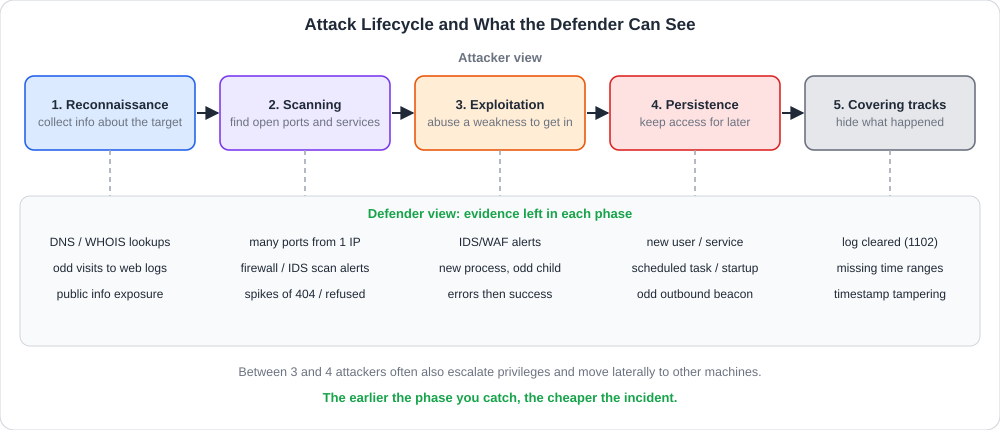<br>
  <sub>خمس مراحل للمهاجم، وتحت كل منها الأدلة التي قد يلتقطها المدافع</sub>
</p>

<table dir="rtl" width="100%">
<thead><tr><th align="right" style="text-align:right">المرحلة</th><th align="right" style="text-align:right">الهدف</th><th align="right" style="text-align:right">أمثلة أنشطة</th><th align="right" style="text-align:right">أثرها عند المدافع</th></tr></thead>
<tbody>
<tr><td align="right" style="text-align:right"><b>1. Reconnaissance</b> (الاستطلاع)</td><td align="right" style="text-align:right">جمع معلومات عن الهدف</td><td align="right" style="text-align:right">العناوين، النطاقات، الموظفون، التقنيات المستخدمة</td><td align="right" style="text-align:right">غالبًا أثر ضئيل (عام)</td></tr>
<tr><td align="right" style="text-align:right"><b>2. Scanning &amp; Enumeration</b> (الفحص والتعداد)</td><td align="right" style="text-align:right">معرفة المنافذ والخدمات وإصداراتها</td><td align="right" style="text-align:right">فحص المنافذ، تحديد الإصدارات، تعداد الحسابات</td><td align="right" style="text-align:right">اتصالات كثيرة من مصدر واحد</td></tr>
<tr><td align="right" style="text-align:right"><b>3. Exploitation</b> (الاستغلال)</td><td align="right" style="text-align:right">الدخول عبر ثغرة</td><td align="right" style="text-align:right">استغلال ثغرة أو كلمة مرور ضعيفة أو رسالة تصيد</td><td align="right" style="text-align:right">تنبيهات IDS/WAF، عمليات جديدة</td></tr>
<tr><td align="right" style="text-align:right"><b>4. Maintaining Access</b> (الإبقاء على الوصول)</td><td align="right" style="text-align:right">ضمان العودة لاحقًا</td><td align="right" style="text-align:right">باب خلفي، مستخدم جديد، مهمة مجدولة</td><td align="right" style="text-align:right">حسابات وخدمات ومهام جديدة</td></tr>
<tr><td align="right" style="text-align:right"><b>5. Covering Tracks</b> (محو الآثار)</td><td align="right" style="text-align:right">إخفاء الهوية والنشاط</td><td align="right" style="text-align:right">حذف السجلات، تعديل الأوقات</td><td align="right" style="text-align:right">حذف سجلات، فجوات زمنية</td></tr>
</tbody>
</table>

وبين المرحلتين 3 و4 يقوم المهاجم عادة بخطوتين مهمتين تُحذفان من الملخصات المختصرة:
- **رفع الصلاحيات (Privilege Escalation):** الانتقال من مستخدم عادي إلى مدير.
- **الحركة الجانبية (Lateral Movement):** الانتقال من الجهاز الأول إلى أجهزة أخرى في الشبكة.

### <a id="t3-6"></a>3.6 تفصيل المراحل: الاستطلاع والفحص

**الاستطلاع (Reconnaissance / Footprinting):** جمع المعلومات عن الهدف **دون تفاعل ضار** مع أنظمته. وينقسم إلى:

<table dir="rtl" width="100%">
<thead><tr><th align="right" style="text-align:right">النوع</th><th align="right" style="text-align:right">الفكرة</th><th align="right" style="text-align:right">أمثلة</th></tr></thead>
<tbody>
<tr><td align="right" style="text-align:right"><b>Passive</b> (سلبي)</td><td align="right" style="text-align:right">جمع من مصادر عامة <b>دون الاتصال بالهدف</b></td><td align="right" style="text-align:right">محركات البحث، تسجيلات <code>whois</code> وDNS، مواقع التوظيف، وسائل التواصل، شهادات الموقع</td></tr>
<tr><td align="right" style="text-align:right"><b>Active</b> (إيجابي)</td><td align="right" style="text-align:right">تفاعل مباشر مع الهدف قد <b>يترك أثرًا</b></td><td align="right" style="text-align:right">زيارة الموقع بأدوات آلية، استعلامات DNS مكثفة</td></tr>
</tbody>
</table>

ويُعرف جمع المعلومات من المصادر العامة بـ **OSINT (Open Source Intelligence)**. وكل ما تنشره الشركة علنًا (أسماء الموظفين، التقنيات في إعلانات الوظائف، النطاقات الفرعية) يساعد المهاجم، ومن هنا أهمية **تقليل البصمة المعلوماتية** المكشوفة.

**الفحص والتعداد (Scanning & Enumeration):** يفحص المهاجم الأجهزة الحية والمنافذ المفتوحة (**Port Scanning**) ويحدد **إصدارات الخدمات** ليعرف نقاط الضعف المحتملة، ثم **يعدد (Enumerate)** ما وراءها: الأسماء، والمشاركات، والمجلدات. وأشهر أداة لذلك **Nmap**. وهذه المرحلة **صاخبة**: ترى جدران الحماية آلاف الاتصالات الفاشلة من عنوان واحد على منافذ متعددة، وهذا أول ما يبحث عنه المدافع.

### <a id="t3-7"></a>3.7 تفصيل المراحل: الاستغلال والحصول على الوصول

**الاستغلال (Exploitation):** استخدام أدوات أو سكربتات أو أساليب لاختراق النظام عبر ثغرة اكتُشفت. وأغلب الاختراقات الناجحة في الواقع تتم عبر **مداخل بسيطة** وليست عبقرية:

<table dir="rtl" width="100%">
<thead><tr><th align="right" style="text-align:right">مدخل الاختراق (Initial Access)</th><th align="right" style="text-align:right">الفكرة</th><th align="right" style="text-align:right">كيف يُمنع</th></tr></thead>
<tbody>
<tr><td align="right" style="text-align:right"><b>Phishing</b> (تصيد)</td><td align="right" style="text-align:right">رسالة تخدع المستخدم ليفتح مرفقًا أو يدخل بياناته</td><td align="right" style="text-align:right">توعية، تصفية بريد، MFA</td></tr>
<tr><td align="right" style="text-align:right"><b>كلمات مرور ضعيفة أو افتراضية</b></td><td align="right" style="text-align:right">تخمين أو إعادة استخدام كلمات مسربة</td><td align="right" style="text-align:right">سياسات كلمات المرور، MFA</td></tr>
<tr><td align="right" style="text-align:right"><b>ثغرات غير مرقّعة</b></td><td align="right" style="text-align:right">خدمة قديمة بثغرة معروفة</td><td align="right" style="text-align:right">إدارة التحديثات والفحص الدوري</td></tr>
<tr><td align="right" style="text-align:right"><b>خدمات مكشوفة</b></td><td align="right" style="text-align:right">لوحة إدارة أو قاعدة بيانات على الإنترنت</td><td align="right" style="text-align:right">تقليل سطح الهجوم، جدار ناري</td></tr>
<tr><td align="right" style="text-align:right"><b>ثغرات تطبيقات الويب</b></td><td align="right" style="text-align:right">حقن SQL وXSS ونحوها</td><td align="right" style="text-align:right">تحقق من المدخلات، WAF</td></tr>
<tr><td align="right" style="text-align:right"><b>أخطاء التهيئة</b></td><td align="right" style="text-align:right">مجلدات مكشوفة أو صلاحيات واسعة</td><td align="right" style="text-align:right">مراجعة التهيئة</td></tr>
<tr><td align="right" style="text-align:right"><b>الهندسة الاجتماعية</b></td><td align="right" style="text-align:right">خداع شخص لإعطاء معلومة أو وصول</td><td align="right" style="text-align:right">تدريب وإجراءات تحقق</td></tr>
</tbody>
</table>

وبعد الدخول يسعى المهاجم لـ **رفع الصلاحيات** ثم **التنقل** إلى أنظمة أهم.

### <a id="t3-8"></a>3.8 الهندسة الاجتماعية (Social Engineering)

أضعف حلقة في أي منظومة غالبًا **الإنسان**، لذلك يبدأ كثير من الهجمات بخداعه بدل اختراق الجهاز. وتعتمد الهندسة الاجتماعية على **الاستعجال والثقة والخوف والفضول**:

<table dir="rtl" width="100%">
<thead><tr><th align="right" style="text-align:right">الأسلوب</th><th align="right" style="text-align:right">الفكرة</th><th align="right" style="text-align:right">مثال</th></tr></thead>
<tbody>
<tr><td dir="ltr" align="left" style="text-align:left"><b>Phishing</b></td><td align="right" style="text-align:right">رسالة بريد تنتحل جهة موثوقة</td><td align="right" style="text-align:right">"حسابك سيُغلق، سجّل الدخول الآن"</td></tr>
<tr><td dir="ltr" align="left" style="text-align:left"><b>Spear Phishing</b></td><td align="right" style="text-align:right">تصيد موجه لشخص محدد بمعلومات عنه</td><td align="right" style="text-align:right">رسالة تذكر اسم مديرك ومشروعك</td></tr>
<tr><td dir="ltr" align="left" style="text-align:left"><b>Vishing / Smishing</b></td><td align="right" style="text-align:right">عبر المكالمات / الرسائل النصية</td><td align="right" style="text-align:right">اتصال يدّعي أنه من الدعم الفني</td></tr>
<tr><td dir="ltr" align="left" style="text-align:left"><b>Pretexting</b></td><td align="right" style="text-align:right">اختلاق قصة مقنعة للحصول على معلومة</td><td align="right" style="text-align:right">"أنا من قسم الصيانة وأحتاج الدخول"</td></tr>
<tr><td dir="ltr" align="left" style="text-align:left"><b>Baiting</b></td><td align="right" style="text-align:right">ترك طُعم مغرٍ</td><td align="right" style="text-align:right">فلاشة مكتوب عليها "رواتب"</td></tr>
</tbody>
</table>

والدفاع **تقني وبشري معًا**: تصفية البريد وMFA، وتدريب الموظفين على التحقق من المرسل والرابط، وإجراءات تحقق من الهوية لطلبات الدعم الحساسة، وقناة سهلة للإبلاغ عن الرسائل المشبوهة.

### <a id="t3-9"></a>3.9 تفصيل المراحل: الإبقاء على الوصول ومحو الآثار

**الإبقاء على الوصول (Persistence):** بعد الدخول يريد المهاجم **ألا يخسر موطئ قدمه** إذا أُعيد تشغيل الجهاز أو غُيّرت كلمة المرور. فيزرع **أبوابًا خلفية (Backdoors)** ووسائل بقاء، مثل:

<table dir="rtl" width="100%">
<thead><tr><th align="right" style="text-align:right">الوسيلة</th><th align="right" style="text-align:right">أمثلة</th><th align="right" style="text-align:right">أين يظهر أثرها</th></tr></thead>
<tbody>
<tr><td align="right" style="text-align:right"><b>حساب جديد</b> أو إضافة حساب للمديرين</td><td align="right" style="text-align:right">مستخدم بصلاحيات عالية</td><td align="right" style="text-align:right">أحداث إنشاء حساب وإضافته لمجموعة</td></tr>
<tr><td align="right" style="text-align:right"><b>مهمة مجدولة / Cron</b></td><td align="right" style="text-align:right">تعمل كل دقيقة أو عند الإقلاع</td><td align="right" style="text-align:right">قائمة المهام المجدولة</td></tr>
<tr><td align="right" style="text-align:right"><b>خدمة جديدة / عنصر بدء تشغيل</b></td><td align="right" style="text-align:right">برنامج يبدأ مع النظام</td><td align="right" style="text-align:right">أحداث تثبيت خدمة، مجلدات Startup</td></tr>
<tr><td align="right" style="text-align:right"><b>مفتاح SSH مضاف</b></td><td align="right" style="text-align:right">دخول بلا كلمة مرور</td><td align="right" style="text-align:right">ملف <code>authorized_keys</code></td></tr>
<tr><td dir="ltr" align="left" style="text-align:left"><b>Web Shell</b></td><td align="right" style="text-align:right">ملف على الموقع يستقبل أوامر</td><td align="right" style="text-align:right">ملفات جديدة في مجلد الويب</td></tr>
</tbody>
</table>

**محو الآثار (Covering Tracks):** يحاول المهاجم **إخفاء هويته** وصعوبة اكتشافه، بحذف **السجلات (Logs)** أو تعديلها وحذف الملفات التي استخدمها وتغيير أوقاتها. لكن المحو نفسه **يترك أثرًا**: حدث "مسح السجل" أو فجوة زمنية، ولذلك يرسل المدافع السجلات فورًا إلى **خادم مركزي (SIEM)** لا يصل إليه المهاجم.

### <a id="t3-10"></a>3.10 منهجية اختبار الاختراق (Penetration Testing)

المختبر الأخلاقي يتبع **منهجية مكتوبة**:

<table dir="rtl" width="100%">
<thead><tr><th align="right" style="text-align:right">المرحلة</th><th align="right" style="text-align:right">ماذا يحدث</th><th align="right" style="text-align:right">مثال أدوات</th></tr></thead>
<tbody>
<tr><td dir="ltr" align="left" style="text-align:left"><b>Pre-engagement</b></td><td align="right" style="text-align:right">الاتفاق على الأهداف والنطاق والقواعد والعقد</td><td align="right" style="text-align:right">وثائق، اجتماعات</td></tr>
<tr><td dir="ltr" align="left" style="text-align:left"><b>Information Gathering (Recon)</b></td><td align="right" style="text-align:right">جمع المعلومات عن الأهداف</td><td align="right" style="text-align:right">OSINT، <code>whois</code>، استعلامات DNS، فحص المنافذ بـ <b>Nmap</b></td></tr>
<tr><td dir="ltr" align="left" style="text-align:left"><b>Vulnerability Assessment</b></td><td align="right" style="text-align:right">فحص الثغرات المعروفة في الأنظمة</td><td align="right" style="text-align:right"><b>Nessus</b> و<b>OpenVAS</b> (فاحصات ثغرات)</td></tr>
<tr><td dir="ltr" align="left" style="text-align:left"><b>Exploitation</b></td><td align="right" style="text-align:right">محاولة استغلال الثغرة <b>بحذر</b> لإثبات الأثر</td><td align="right" style="text-align:right">أُطر الاستغلال مثل <b>Metasploit</b></td></tr>
<tr><td dir="ltr" align="left" style="text-align:left"><b>Post-Exploitation</b></td><td align="right" style="text-align:right">تقييم حجم الضرر المحتمل (إلى أين يصل المهاجم؟)</td><td align="right" style="text-align:right">أدوات النظام والتحقق</td></tr>
<tr><td dir="ltr" align="left" style="text-align:left"><b>Reporting</b></td><td align="right" style="text-align:right">تقرير مفصل للمدافعين: ماذا وجد، وخطورته، وكيف يُصلح</td><td align="right" style="text-align:right">مستند منظم</td></tr>
</tbody>
</table>

ويلاحظ أن **فحص الثغرات** (Vulnerability Assessment) يختلف عن **اختبار الاختراق**: الأول **يبحث ويسرد** الثغرات، والثاني **يستغلها فعليًا** لقياس الأثر الحقيقي. وأهم ما يخرج به الاختبار هو **التقرير** الذي يحوله المدافعون إلى إصلاحات.

### <a id="t3-11"></a>3.11 أطر العمل: Cyber Kill Chain و MITRE ATT&CK

المراحل الخمس السابقة نموذج مبسط. والمحترفون يستخدمون أطرًا أدق:

**Cyber Kill Chain** (من شركة Lockheed Martin) تصف الهجوم بسبع مراحل:

<table dir="rtl" width="100%">
<thead><tr><th align="right" style="text-align:right">الرقم</th><th align="right" style="text-align:right">المرحلة</th><th align="right" style="text-align:right">معناها</th><th align="right" style="text-align:right">أقرب مرحلة في نموذجنا</th></tr></thead>
<tbody>
<tr><td align="right" style="text-align:right">1</td><td dir="ltr" align="left" style="text-align:left">Reconnaissance</td><td align="right" style="text-align:right">استطلاع</td><td align="right" style="text-align:right">الاستطلاع</td></tr>
<tr><td align="right" style="text-align:right">2</td><td dir="ltr" align="left" style="text-align:left">Weaponization</td><td align="right" style="text-align:right">تجهيز السلاح (مرفق مفخخ)</td><td align="right" style="text-align:right">قبل الاستغلال</td></tr>
<tr><td align="right" style="text-align:right">3</td><td dir="ltr" align="left" style="text-align:left">Delivery</td><td align="right" style="text-align:right">إيصاله (بريد، موقع)</td><td align="right" style="text-align:right">الاستغلال</td></tr>
<tr><td align="right" style="text-align:right">4</td><td dir="ltr" align="left" style="text-align:left">Exploitation</td><td align="right" style="text-align:right">تفعيل الثغرة</td><td align="right" style="text-align:right">الاستغلال</td></tr>
<tr><td align="right" style="text-align:right">5</td><td dir="ltr" align="left" style="text-align:left">Installation</td><td align="right" style="text-align:right">تثبيت البرمجية</td><td align="right" style="text-align:right">الإبقاء على الوصول</td></tr>
<tr><td align="right" style="text-align:right">6</td><td dir="ltr" align="left" style="text-align:left">Command &amp; Control (C2)</td><td align="right" style="text-align:right">قناة تحكم عن بعد</td><td align="right" style="text-align:right">الإبقاء على الوصول</td></tr>
<tr><td align="right" style="text-align:right">7</td><td dir="ltr" align="left" style="text-align:left">Actions on Objectives</td><td align="right" style="text-align:right">تنفيذ الهدف (سرقة، تشفير)</td><td align="right" style="text-align:right">ما بعد الدخول</td></tr>
</tbody>
</table>

وتفيد في **قطع الهجوم** عند أي حلقة: كسر حلقة واحدة يوقف السلسلة.

أما **MITRE ATT&CK** فهو **قاعدة معرفة** عالمية تصنف **تكتيكات** المهاجم (الأهداف مثل Initial Access وPersistence وDefense Evasion) و**تقنياته** (كيف ينفذها)، مع أمثلة جماعات حقيقية وطرق الكشف. ويستعمله المحللون لـ **وصف التنبيهات** وبناء قواعد الكشف وقياس التغطية.

### <a id="t3-12"></a>3.12 الزاوية الأمنية: كيف يكتشف المدافع كل مرحلة؟

يمكن قلب الدورة إلى **قائمة كشف**، فكل مرحلة تترك أثرًا في مكان محدد:

1. **الاستطلاع:** صعب الكشف لأنه من مصادر عامة، لكن **الاستطلاع الإيجابي** يظهر: زيارات آلية لمواقعك، واستعلامات DNS غريبة، وتعداد كثيف لنطاقاتك الفرعية. والدفاع هنا **تقليل ما تنشره** ومراقبة الشهادات الجديدة المشابهة لنطاقك.
2. **الفحص:** **عنوان واحد يضرب منافذ كثيرة** في وقت قصير في سجلات الجدار الناري، وسيل 404 على الويب، وأخطاء رفض كثيرة. وهنا تنفع قاعدة "عدد المنافذ الفريدة لكل مصدر".
3. **الاستغلال:** تنبيهات IDS/WAF، وعملية غير مألوفة (مثل Word يشغل PowerShell)، وسلسلة **فشل ثم نجاح** في تسجيل الدخول من نفس العنوان.
4. **الإبقاء على الوصول:** **حسابات** و**خدمات** و**مهام مجدولة** جديدة غير موثقة، ومفاتيح SSH مضافة، واتصالات صادرة منتظمة (Beaconing).
5. **محو الآثار:** حدث **مسح سجل**، وفجوات في الأوقات، وتوقف **وكيل التسجيل**.

والخلاصة أن المهاجم **يخطئ غالبًا في إحدى المراحل**، وعلى المدافع أن يمتلك رؤية كافية ليلتقط أي واحدة، فالتقاط مرحلة واحدة يكفي لكشف الهجوم كله.

<h2 dir="ltr" align="left" style="text-align:left">🛠 Commands &amp; Hands-on</h2>

### <a id="t3-13"></a>3.13 أدوات الكشف الدفاعي لمراحل الهجوم

الأوامر التالية **دفاعية** تقرأ السجلات، وبعضها اختُبر على سجلات اصطناعية من تصميمنا. واستخدم أدوات الفحص (Nmap وغيرها) **على أجهزتك أو بتصريح فقط**.

**1) كشف فحص المنافذ من سجل الجدار الناري:** يعرض السجل كل اتصال محجوب بالمصدر والمنفذ.

<div dir="ltr" align="left">

```text
Oct 12 11:00:01 fw DROP SRC=203.0.113.9 DST=192.0.2.10 DPT=21
Oct 12 11:00:01 fw DROP SRC=203.0.113.9 DST=192.0.2.10 DPT=22
Oct 12 11:00:02 fw DROP SRC=203.0.113.9 DST=192.0.2.10 DPT=80
Oct 12 11:00:03 fw DROP SRC=203.0.113.9 DST=192.0.2.10 DPT=3389
```

</div>

ونحصي **المنافذ الفريدة لكل مصدر**، ومن يتجاوز عتبة (مثل 5 منافذ في دقائق) فهو مشتبه:

<div dir="ltr" align="left">

```bash
grep DROP fw.log | awk '
  { for (i = 1; i <= NF; i++) {
      if ($i ~ /^SRC=/) s = substr($i, 5)
      if ($i ~ /^DPT=/) p[s "," substr($i, 5)] = 1 } }
  END { for (k in p) { split(k, a, ","); c[a[1]]++ }
        for (s in c) print c[s], s }' | sort -rn
# 6 203.0.113.9
```

</div>

**2) كشف تخمين كلمات المرور على SSH في لينكس:**

<div dir="ltr" align="left">

```bash
# failed logins per source IP
grep "Failed password" /var/log/auth.log \
  | awk '{for(i=1;i<=NF;i++) if($i=="from") print $(i+1)}' \
  | sort | uniq -c | sort -rn

# did the same IP later succeed?
grep "Accepted" /var/log/auth.log | grep 203.0.113.7
```

</div>

والمنهج: عدد الفشل لكل عنوان، ثم **هل نجح العنوان نفسه بعد الفشل؟** فهذا هو الفرق بين محاولة وبين اختراق. (على بعض الأنظمة الملف `/var/log/secure` أو `journalctl -u ssh`).

**3) البحث عن مداخل البقاء في لينكس:**

<div dir="ltr" align="left">

```bash
crontab -l                          # current user's cron jobs
ls -la /etc/cron.d /etc/cron.daily  # system cron jobs
cat ~/.ssh/authorized_keys          # allowed SSH keys
systemctl list-unit-files --state=enabled   # services at boot
awk -F: '$3 == 0 {print $1}' /etc/passwd    # accounts with UID 0
last -n 10                          # recent logins
```

</div>

فالمطلوب مقارنة النتائج بما هو **معروف ومصرح**، وأي عنصر جديد أو غير موثق يُحقق فيه. والأمر `awk` الأخير يعرض الحسابات ذات UID 0 أي بصلاحية الجذر، ويجب ألا يكون إلا `root`.

**4) أحداث ويندوز المهمة:** تُقرأ في Event Viewer أو بـ PowerShell:

<div dir="ltr" align="left">

```powershell
# failed logons (4625), last 10
Get-WinEvent -FilterHashtable @{LogName='Security'; Id=4625} `
             -MaxEvents 10

# the same with the classic tool
wevtutil qe Security /q:"*[System[(EventID=4625)]]" /c:10 /f:text
```

</div>

<table dir="rtl" width="100%">
<thead><tr><th align="right" style="text-align:right">Event ID</th><th align="right" style="text-align:right">السجل</th><th align="right" style="text-align:right">ماذا يعني</th><th align="right" style="text-align:right">المرحلة</th></tr></thead>
<tbody>
<tr><td align="right" style="text-align:right"><b>4625</b></td><td dir="ltr" align="left" style="text-align:left">Security</td><td align="right" style="text-align:right">فشل تسجيل دخول</td><td align="right" style="text-align:right">الفحص / التخمين</td></tr>
<tr><td align="right" style="text-align:right"><b>4624</b></td><td dir="ltr" align="left" style="text-align:left">Security</td><td align="right" style="text-align:right">نجاح تسجيل دخول (انظر نوع الدخول: 3 شبكة، 10 عن بعد)</td><td align="right" style="text-align:right">الاستغلال</td></tr>
<tr><td align="right" style="text-align:right"><b>4688</b></td><td dir="ltr" align="left" style="text-align:left">Security</td><td align="right" style="text-align:right">إنشاء عملية جديدة (يحتاج تفعيل التدقيق)</td><td align="right" style="text-align:right">الاستغلال</td></tr>
<tr><td align="right" style="text-align:right"><b>4720</b></td><td dir="ltr" align="left" style="text-align:left">Security</td><td align="right" style="text-align:right"><b>إنشاء حساب مستخدم</b></td><td align="right" style="text-align:right">الإبقاء على الوصول</td></tr>
<tr><td align="right" style="text-align:right"><b>4732</b></td><td dir="ltr" align="left" style="text-align:left">Security</td><td align="right" style="text-align:right"><b>إضافة عضو لمجموعة محلية</b> (مثل Administrators)</td><td align="right" style="text-align:right">رفع الصلاحيات</td></tr>
<tr><td align="right" style="text-align:right"><b>4698</b></td><td dir="ltr" align="left" style="text-align:left">Security</td><td align="right" style="text-align:right"><b>إنشاء مهمة مجدولة</b></td><td align="right" style="text-align:right">الإبقاء على الوصول</td></tr>
<tr><td align="right" style="text-align:right"><b>7045</b></td><td dir="ltr" align="left" style="text-align:left">System</td><td align="right" style="text-align:right"><b>تثبيت خدمة جديدة</b></td><td align="right" style="text-align:right">الإبقاء على الوصول</td></tr>
<tr><td align="right" style="text-align:right"><b>1102</b></td><td dir="ltr" align="left" style="text-align:left">Security</td><td align="right" style="text-align:right"><b>مسح سجل الأمان</b></td><td align="right" style="text-align:right">محو الآثار</td></tr>
<tr><td align="right" style="text-align:right"><b>104</b></td><td dir="ltr" align="left" style="text-align:left">System</td><td align="right" style="text-align:right">مسح سجل النظام</td><td align="right" style="text-align:right">محو الآثار</td></tr>
</tbody>
</table>

**5) ما سيراه المدافع من أدوات الفحص (للتعرّف لا للتنفيذ):**

<table dir="rtl" width="100%">
<thead><tr><th align="right" style="text-align:right">الأمر</th><th align="right" style="text-align:right">غرضه</th><th align="right" style="text-align:right">كيف يظهر في السجلات</th></tr></thead>
<tbody>
<tr><td dir="ltr" align="left" style="text-align:left"><code>nmap -sn &lt;range&gt;</code></td><td align="right" style="text-align:right">اكتشاف الأجهزة الحية</td><td align="right" style="text-align:right">طلبات Ping وARP كثيرة</td></tr>
<tr><td dir="ltr" align="left" style="text-align:left"><code>nmap -sS &lt;host&gt;</code></td><td align="right" style="text-align:right">فحص منافذ نصف مفتوح (SYN)</td><td align="right" style="text-align:right">عشرات المنافذ من مصدر واحد، اتصالات غير مكتملة</td></tr>
<tr><td dir="ltr" align="left" style="text-align:left"><code>nmap -sV &lt;host&gt;</code></td><td align="right" style="text-align:right">تحديد إصدارات الخدمات</td><td align="right" style="text-align:right">اتصالات تطلب بنرات الخدمات</td></tr>
<tr><td dir="ltr" align="left" style="text-align:left"><code>nmap -p- &lt;host&gt;</code></td><td align="right" style="text-align:right">فحص كل المنافذ (65535)</td><td align="right" style="text-align:right">عدد ضخم من المحاولات</td></tr>
</tbody>
</table>

وهي أنماط تظهر في IDS وجدار الحماية، وعلى المحلل ألا يكتفي بالحجب بل **يتحقق هل تبعها نجاح**.

### <a id="t3-14"></a>3.14 جدول مرجعي: مراحل الهجوم والكشف (Cheatsheet)

<table dir="rtl" width="100%">
<thead><tr><th align="right" style="text-align:right">المرحلة</th><th align="right" style="text-align:right">ماذا تفعل</th><th align="right" style="text-align:right">ما تراه</th><th align="right" style="text-align:right">أمر أو مصدر الكشف</th></tr></thead>
<tbody>
<tr><td dir="ltr" align="left" style="text-align:left"><b>Recon</b></td><td align="right" style="text-align:right">جمع معلومات</td><td align="right" style="text-align:right">زيارات آلية، استعلامات DNS غريبة</td><td align="right" style="text-align:right">سجلات الويب وDNS</td></tr>
<tr><td dir="ltr" align="left" style="text-align:left"><b>Scanning</b></td><td align="right" style="text-align:right">منافذ وخدمات</td><td align="right" style="text-align:right">منافذ كثيرة من مصدر واحد</td><td align="right" style="text-align:right"><code>grep DROP fw.log</code> + عد المنافذ</td></tr>
<tr><td dir="ltr" align="left" style="text-align:left"><b>Brute Force</b></td><td align="right" style="text-align:right">تخمين كلمات المرور</td><td align="right" style="text-align:right"><code>Failed password</code>، Event 4625</td><td dir="ltr" align="left" style="text-align:left"><code>grep "Failed password" auth.log</code></td></tr>
<tr><td dir="ltr" align="left" style="text-align:left"><b>Exploitation</b></td><td align="right" style="text-align:right">دخول فعلي</td><td align="right" style="text-align:right">فشل ثم نجاح، Event 4624، عملية غريبة</td><td align="right" style="text-align:right"><code>grep Accepted</code>، Event 4688</td></tr>
<tr><td dir="ltr" align="left" style="text-align:left"><b>Persistence</b></td><td align="right" style="text-align:right">بقاء</td><td align="right" style="text-align:right">حساب/مهمة/خدمة جديدة</td><td align="right" style="text-align:right">4720 و4698 و7045، <code>crontab -l</code></td></tr>
<tr><td dir="ltr" align="left" style="text-align:left"><b>Privilege Esc.</b></td><td align="right" style="text-align:right">صلاحيات أعلى</td><td align="right" style="text-align:right">إضافة لمجموعة المديرين</td><td dir="ltr" align="left" style="text-align:left">Event 4732</td></tr>
<tr><td dir="ltr" align="left" style="text-align:left"><b>Covering Tracks</b></td><td align="right" style="text-align:right">محو الأثر</td><td align="right" style="text-align:right">مسح سجل، فجوات</td><td align="right" style="text-align:right">1102 و104</td></tr>
<tr><td dir="ltr" align="left" style="text-align:left"><b>Kill Chain</b></td><td align="right" style="text-align:right">سبعة مراحل</td><td align="right" style="text-align:right">تعرّف أين قطعتَ السلسلة</td><td align="right" style="text-align:right">تصنيف التنبيه</td></tr>
<tr><td dir="ltr" align="left" style="text-align:left"><b>ATT&amp;CK</b></td><td align="right" style="text-align:right">تكتيكات وتقنيات</td><td align="right" style="text-align:right">مرجع لوصف أي سلوك</td><td dir="ltr" align="left" style="text-align:left">attack.mitre.org</td></tr>
</tbody>
</table>

<h2 dir="ltr" align="left" style="text-align:left">🖼 Practical Scenarios</h2>

### <a id="t3-15"></a>3.15 سيناريو: سلسلة تنبيهات تحكي قصة اختراق

يجمع نظام SIEM التنبيهات التالية خلال ساعتين، وكلها تخص الخادم `192.0.2.10`:

1. **11:00:** جدار الحماية يحجب اتصالات من `203.0.113.9` على 6 منافذ مختلفة خلال ثانيتين.
2. **11:20:** عشرات `Failed password` على حساب `admin` من `203.0.113.7`.
3. **11:23:** `Accepted password for admin` من العنوان نفسه.
4. **11:27:** Event **4720** و**4732**: إنشاء مستخدم جديد وإضافته إلى المديرين.
5. **11:40:** مهمة مجدولة جديدة تتصل بعنوان خارجي كل 5 دقائق.
6. **12:05:** Event **1102**: مسح سجل الأمان.

خطوات المحلل:

1. **رتّب الأحداث زمنيًا** على خط واحد؛ التسلسل نفسه يخبرك القصة: فحص ثم تخمين ثم دخول ثم بقاء ثم محو.
2. **صنّف كل حدث على مرحلة:** الفحص (1)، الاستغلال بتخمين (2 و3)، البقاء (4 و5)، محو الآثار (6).
3. **الأخطر هو 3**: نجاح الدخول بعد التخمين يعني أن الحادث **اخترق فعلًا**، وليس مجرد محاولات.
4. **قدّر الأثر بالثلاثية:** الحساب المنشأ والمهمة يعنيان السلامة، والاتصال الخارجي المنتظم يوحي بقناة تحكم (C2) وربما سرقة (السرية).
5. **الاحتواء:** عزل الخادم عن الشبكة، وتعطيل الحساب الجديد وحساب `admin`، وحجب العناوين، **مع الحفاظ على الأدلة** (نسخة من السجلات المركزية لأن المحلي مسح).
6. **التقصي:** هل انتقل المهاجم لأجهزة أخرى؟ (سجلات الدخول على بقية الخوادم من الخادم المصاب).
7. **المعالجة:** إعادة بناء الخادم من صورة سليمة، وإضافة MFA، وقفل SSH بالمفاتيح لا كلمات المرور، وتنبيه على أنماط التخمين.

والدرس: **كل مرحلة كانت قابلة للكشف**، وأضعف حلقة هنا هي أن التنبيه الأول (فحص المنافذ) لم يُتابَع، ولو أُغلقت المداخل منذ البداية لما وصل الأمر إلى الحذف.

### <a id="t3-16"></a>3.16 كيف تتعامل مع أسئلة الغرفة بمنهجية

أسئلة هذه الغرفة نظرية في الغالب حول **المفاهيم والمراحل**. ولا تُذكر هنا إجابات، بل **طريقة التفكير**:

1. **حدد نوع المطلوب:** هل السؤال عن **نية** المهاجم (الأنواع)؟ أم عن **مرحلة** (الدورة)؟ أم عن **أداة** أم عن **هدف**؟
2. **اربط النشاط بالمرحلة:** جمع المعلومات = استطلاع، فحص المنافذ = مسح، استغلال = دخول، باب خلفي = بقاء، حذف سجلات = محو آثار.
3. **انتبه لكلمة "الإذن"** عند التفريق بين الهاكر الأخلاقي والخبيث.
4. **ارجع لتسمية الأطر:** إن سُئلت عن الأسماء فاحفظها بالإنجليزية بترتيبها.
5. **اسأل نفسك دائمًا:** ما الذي يراه المدافع في هذه المرحلة؟ فهو أفضل طريقة للحفظ الدائم.

<h2 dir="ltr" align="left" style="text-align:left">📝 Practical Takeaways</h2>

- **فكّر كمهاجم لتدافع**: الهدف اكتشاف الثغرات قبل أن يستغلها الخبيث.
- الفرق بين **White Hat** و**Black Hat** هو **الإذن والنية**، لا المهارة. و**Grey Hat** يخالف القانون رغم نيته.
- الاختبار الأخلاقي يتم بـ **Rules of Engagement**: نطاق ووقت وأساليب وتقرير.
- مراحل الهجوم: **Recon ثم Scanning ثم Exploitation ثم Persistence ثم Covering Tracks**، وبينها رفع الصلاحيات والحركة الجانبية.
- **Cyber Kill Chain** سبع مراحل، و**MITRE ATT&CK** قاعدة تكتيكات وتقنيات لوصف السلوك.
- منهجية الاختبار: **Pre-engagement ثم Recon ثم Vulnerability Assessment ثم Exploitation ثم Post-Exploitation ثم Reporting**.
- **فحص الثغرات ≠ اختبار الاختراق**: الأول يسرد والثاني يستغل ويقيس الأثر.
- لكل مرحلة **أثر قابل للكشف**.

## 🛡 خلاصة المحلل الأمني (SOC Takeaways)

- **تعلم أثر كل مرحلة:** منافذ كثيرة (مسح)، فشل ثم نجاح (تخمين ناجح)، حساب/مهمة/خدمة جديدة (بقاء)، مسح سجل (إخفاء).
- **لا تحجب وتمضِ:** بعد حجب عنوان ماسح، تحقق هل **نجح** شيء قبل الحجب.
- **راقب Event IDs الأساسية:** 4625 و4624 و4688 و4720 و4732 و4698 و7045 و1102.
- **ارسل السجلات لخادم مركزي فورًا** فالمهاجم يمحو المحلية.
- **قارن بالمعروف:** كل حساب أو مهمة أو خدمة أو مفتاح SSH جديد غير موثق يستحق التحقيق.
- **رتّب الأحداث زمنيًا** لتقرأ القصة، وصنّف كل حدث على مرحلة وعلى تكتيك MITRE.
- **قلّل البصمة العامة:** ما تنشره الشركة علنًا هو مادة الاستطلاع.
- **الاستغلال غالبًا ثغرة بسيطة:** تصيد وكلمات مرور ضعيفة وتحديثات متأخرة، فأغلق الأساسيات أولًا.
- **اعمل ضمن النطاق القانوني دائمًا:** لا تفحص إلا ما تملكه أو لديك إذن مكتوب به.

<br>

<a id="room-4"></a>
<table align="center" width="100%"><tr><td align="right" style="text-align:right">

### 🚪 الغرفة 4: Mystery Chest (صندوق الغموض)

</td></tr></table>

<h1 dir="ltr" align="left" style="text-align:left">Mystery Chest</h1>

### <a id="t4-1"></a>4.1 التعريف بالغرفة وأهدافها

هذه غرفة **تحدٍّ (Challenge)** بأسلوب **CTF (Capture The Flag)**، أي مسابقات "التقاط العلم". تعمل كأنها **صندوق خزانة** مغلق تحاول فتحه بربط ما تعلمته: أفكار التشفير والترميز، وقراءة البيانات، وتحليل السيناريو. والعلم **Flag** نص خاص يثبت أنك حللت التحدي. ولذلك لا نكتب هنا أي Flag أو إجابة، فالقيمة كلها في **طريقة التفكير** التي تتكرر في كل تحدٍّ وفي عمل المحلل الأمني.

ومن أهداف الغرفة أن نكون قادرين في نهايتها على:
- فهم ما هو **CTF** وأنواعه وفائدته للمدافع.
- اتباع **منهجية** منظمة لحل أي تحدٍّ تقني.
- التعرف على **أشكال الترميز والتشفير الشائعة** من مظهرها.
- استخدام الأدوات الأساسية (**CyberChef** وسطر الأوامر ومتصفح الويب).
- فك **طبقات متعددة** من الترميز خطوة بخطوة.
- ربط مهارات الـ CTF **بالعمل الفعلي** (فك أوامر مخفية، تحليل ملفات مشبوهة).

<h2 dir="ltr" align="left" style="text-align:left">📌 Concepts Covered</h2>

### <a id="t4-2"></a>4.2 ما هو الـ CTF ولماذا يهم؟

**CTF (Capture The Flag)** مسابقات أو تدريبات أمنية تُعطى فيها **تحديات**، وكل تحدٍّ يخفي **Flag** (نصًا بصيغة معينة) تجده بحل التحدي وتقدمه لتحصل على النقاط. وهما نوعان رئيسيان:

<table dir="rtl" width="100%">
<thead><tr><th align="right" style="text-align:right">النوع</th><th align="right" style="text-align:right">الفكرة</th></tr></thead>
<tbody>
<tr><td dir="ltr" align="left" style="text-align:left"><b>Jeopardy</b></td><td align="right" style="text-align:right">قائمة تحديات مصنفة بفئات ونقاط مختلفة، يختار المشارك ما يشاء ويحلها منفردًا</td></tr>
<tr><td dir="ltr" align="left" style="text-align:left"><b>Attack-Defense</b></td><td align="right" style="text-align:right">فرق تحمي خوادمها وتهاجم خوادم الآخرين في آن واحد</td></tr>
</tbody>
</table>

وغرف التدريب غالبًا بنمط **Jeopardy**. وفائدته للمدافع كبيرة، لأنه يدرّب على:
- **قراءة البيانات الغريبة** وتحليلها بصبر.
- **فك التمويه (Deobfuscation)** كما يفعل محلل البرمجيات الخبيثة.
- **البحث عن المعلومة المخفية** في ملف أو صفحة أو سجل.
- **الاستدلال المنطقي** بالتجربة والخطأ المنظم.

### <a id="t4-3"></a>4.3 فئات تحديات الـ CTF

تُصنف التحديات بحسب المهارة المطلوبة، وتدمج الغرف التجميعية عدة فئات:

<table dir="rtl" width="100%">
<thead><tr><th align="right" style="text-align:right">الفئة</th><th align="right" style="text-align:right">موضوعها</th><th align="right" style="text-align:right">أمثلة مهارات</th></tr></thead>
<tbody>
<tr><td align="right" style="text-align:right"><b>Misc</b> (متنوع)</td><td align="right" style="text-align:right">ألغاز متفرقة ومنطق</td><td align="right" style="text-align:right">تحويلات، تفكير جانبي</td></tr>
<tr><td align="right" style="text-align:right"><b>Cryptography</b> (تشفير)</td><td align="right" style="text-align:right">شفرات وترميزات</td><td align="right" style="text-align:right">قيصر، Base64، Hex، XOR</td></tr>
<tr><td dir="ltr" align="left" style="text-align:left"><b>Web</b></td><td align="right" style="text-align:right">مواقع وثغرات الويب</td><td align="right" style="text-align:right">قراءة مصدر الصفحة، الكوكيز، الرؤوس</td></tr>
<tr><td align="right" style="text-align:right"><b>Forensics</b> (تحقيق رقمي)</td><td align="right" style="text-align:right">ملفات وصور وسجلات</td><td align="right" style="text-align:right">بيانات وصفية، سلاسل نصية مخفية</td></tr>
<tr><td dir="ltr" align="left" style="text-align:left"><b>OSINT</b></td><td align="right" style="text-align:right">معلومات عامة</td><td align="right" style="text-align:right">بحث في مصادر مفتوحة</td></tr>
<tr><td dir="ltr" align="left" style="text-align:left"><b>Reverse Engineering</b></td><td align="right" style="text-align:right">تحليل برنامج لفهم عمله</td><td align="right" style="text-align:right">قراءة الكود، الأدوات المتقدمة</td></tr>
<tr><td align="right" style="text-align:right"><b>Pwn</b> (استغلال)</td><td align="right" style="text-align:right">ثغرات برمجية</td><td align="right" style="text-align:right">مستوى متقدم</td></tr>
</tbody>
</table>

وما يخص مستوى هذا المسار هو الفئات الأولى: **Misc** و**Cryptography** وجزء من **Web** و**Forensics**.

### <a id="t4-4"></a>4.4 منهجية حل التحديات

ليس الحل ببراعة خارقة بل **بعادة منظمة** تتكرر:

<p align="center">
  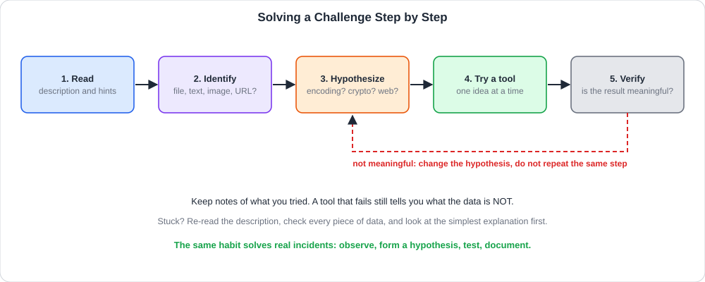<br>
  <sub>قراءة، تحديد النوع، فرضية، تجربة أداة، تحقق، وعودة لتغيير الفرضية عند الفشل</sub>
</p>

<table dir="rtl" width="100%">
<thead><tr><th align="right" style="text-align:right">الخطوة</th><th align="right" style="text-align:right">ماذا تفعل</th><th align="right" style="text-align:right">سؤال تسأله</th></tr></thead>
<tbody>
<tr><td align="right" style="text-align:right"><b>1. اقرأ التوصيف بعناية</b></td><td align="right" style="text-align:right">كثيرًا ما يحمل <b>تلميحًا (Hint)</b> يدل على أداة أو ثغرة</td><td align="right" style="text-align:right">ما الكلمات غير العادية في النص؟</td></tr>
<tr><td align="right" style="text-align:right"><b>2. حدد نوع المدخلات</b></td><td align="right" style="text-align:right">ملف؟ نص مشفر؟ صورة؟ رابط موقع؟</td><td align="right" style="text-align:right">ما الذي أمامي بالضبط؟</td></tr>
<tr><td align="right" style="text-align:right"><b>3. كوّن فرضية</b></td><td align="right" style="text-align:right">ترميز؟ تشفير؟ معلومة مخفية؟</td><td align="right" style="text-align:right">ما أبسط تفسير؟</td></tr>
<tr><td align="right" style="text-align:right"><b>4. جرّب أداة مناسبة</b></td><td align="right" style="text-align:right">أداة واحدة وفكرة واحدة في كل مرة</td><td align="right" style="text-align:right">هل الناتج أقرب للمعنى؟</td></tr>
<tr><td align="right" style="text-align:right"><b>5. تحقق</b></td><td align="right" style="text-align:right">هل النتيجة مفهومة أو بصيغة العلم المتوقعة؟</td><td align="right" style="text-align:right">هل أنهيت التحدي أم أحتاج طبقة أخرى؟</td></tr>
</tbody>
</table>

وقواعد تحفظ وقتك:
- **ابدأ بالأبسط:** الترميز الشائع قبل التشفير المعقد.
- **دوّن ما جربته** وما كانت نتيجته، فالفشل يستبعد احتمالًا.
- **لا تكرر الخطوة الفاشلة**؛ غيّر الفرضية.
- **افحص كل مادة** أعطيت لك: النص والعنوان والملف المرفق والصفحة المصدر.
- **الطبقات:** قد يكون الناتج ترميزًا آخر يحتاج فكًا جديدًا.

### <a id="t4-5"></a>4.5 التعرف على الترميزات والتشفيرات الشائعة

أول مهارة في التحديات هي **التعرف على شكل النص**:

<table dir="rtl" width="100%">
<thead><tr><th align="right" style="text-align:right">النوع</th><th align="right" style="text-align:right">كيف يبدو</th><th align="right" style="text-align:right">أمثلة</th><th align="right" style="text-align:right">ملاحظات للتعرف</th></tr></thead>
<tbody>
<tr><td dir="ltr" align="left" style="text-align:left"><b>Base64</b></td><td align="right" style="text-align:right">حروف وأرقام و<code>+</code> و<code>/</code>، وغالبًا تنتهي بـ <code>=</code> أو <code>==</code></td><td dir="ltr" align="left" style="text-align:left"><code>SGVsbG8=</code></td><td align="right" style="text-align:right">طوله من مضاعفات 4</td></tr>
<tr><td align="right" style="text-align:right"><b>Hex</b> (سداسي عشري)</td><td align="right" style="text-align:right">أرقام وحروف <code>a-f</code> فقط، أزواج</td><td dir="ltr" align="left" style="text-align:left"><code>48 65 6c 6c 6f</code></td><td align="right" style="text-align:right">كل بايت رقمان</td></tr>
<tr><td align="right" style="text-align:right"><b>Binary</b> (ثنائي)</td><td align="right" style="text-align:right">أصفار وآحاد في مجموعات من 8</td><td align="right" style="text-align:right"><code>01001000 01101001</code></td><td align="right" style="text-align:right">كل 8 بتات حرف</td></tr>
<tr><td dir="ltr" align="left" style="text-align:left"><b>URL Encoding</b></td><td align="right" style="text-align:right">علامة <code>%</code> وبعدها رقمان</td><td dir="ltr" align="left" style="text-align:left"><code>%48%65%6c</code></td><td align="right" style="text-align:right">داخل الروابط</td></tr>
<tr><td dir="ltr" align="left" style="text-align:left"><b>Caesar / ROT13</b></td><td align="right" style="text-align:right">نص بحروف لكنه بلا معنى</td><td dir="ltr" align="left" style="text-align:left"><code>Uryyb</code></td><td align="right" style="text-align:right">أنماط الكلمات تحفظ الطول</td></tr>
<tr><td align="right" style="text-align:right"><b>ASCII بالأرقام</b></td><td align="right" style="text-align:right">أرقام عشرية بين 32 و126</td><td align="right" style="text-align:right"><code>72 101 108</code></td><td align="right" style="text-align:right">كل رقم حرف</td></tr>
<tr><td dir="ltr" align="left" style="text-align:left"><b>Morse</b></td><td align="right" style="text-align:right">نقاط وخطوط</td><td align="right" style="text-align:right"><code>.... .. </code></td><td align="right" style="text-align:right">ترميز بصري</td></tr>
<tr><td dir="ltr" align="left" style="text-align:left"><b>Hash</b></td><td align="right" style="text-align:right">سلسلة سداسية بطول ثابت</td><td align="right" style="text-align:right">32 أو 40 أو 64 رمزًا</td><td align="right" style="text-align:right">لا تُفك، تُقارن أو تُخمَّن</td></tr>
</tbody>
</table>

وتذكّر من **الوحدة 4** (ترميز البيانات) الفرق بين الأرقام والنصوص، ومن **الغرفة 2** أن Base64 ليس تشفيرًا. وإذا كان النص بحروف بلا معنى فالأرجح **شفرة إزاحة**، وإذا كان طوله ثابتًا وسداسيًا فهو **بصمة (Hash)**.

### <a id="t4-6"></a>4.6 أدوات الحل الأساسية

<table dir="rtl" width="100%">
<thead><tr><th align="right" style="text-align:right">الأداة</th><th align="right" style="text-align:right">استخدامها</th><th align="right" style="text-align:right">ملاحظة</th></tr></thead>
<tbody>
<tr><td dir="ltr" align="left" style="text-align:left"><b>CyberChef</b></td><td align="right" style="text-align:right">"سكين الجيش السويسري": فك الترميزات والتشفيرات بسلسلة عمليات في المتصفح</td><td align="right" style="text-align:right">يكتشف الترميز تلقائيًا بـ <b>Magic</b></td></tr>
<tr><td align="right" style="text-align:right"><b>سطر الأوامر</b></td><td align="right" style="text-align:right"><code>base64</code> و<code>tr</code> و<code>xxd</code> و<code>od</code> و<code>strings</code> و<code>file</code></td><td align="right" style="text-align:right">يحتاج كتابة لكنه دقيق وسريع</td></tr>
<tr><td align="right" style="text-align:right"><b>متصفح الويب</b></td><td align="right" style="text-align:right"><code>View Source</code> وDevTools (الرؤوس والكوكيز والمصدر)</td><td align="right" style="text-align:right">معلومات مخفية في الصفحة</td></tr>
<tr><td align="right" style="text-align:right"><b>بايثون</b></td><td align="right" style="text-align:right">سكربت صغير للتجربة الآلية</td><td align="right" style="text-align:right">مثل كسر قيصر</td></tr>
<tr><td align="right" style="text-align:right"><b>محركات البحث</b></td><td align="right" style="text-align:right">معنى رمز أو صيغة غير مألوفة</td><td align="right" style="text-align:right">الاستعانة طبيعية</td></tr>
</tbody>
</table>

ويمكن للأداة الواحدة أن تنفذ **سلسلة** عمليات (Recipe) مثل: فك Base64 ثم إزاحة قيصر. وتساعدك ميزة **Magic** في CyberChef على الاقتراح، لكن **لا تعتمد عليها دون فهم**.

### <a id="t4-7"></a>4.7 مثال تطبيقي كامل: فك طبقتين

لنأخذ تحديًا من تصميمنا (وليس من الغرفة): أعطيناك هذا النص ووصفًا يقول "رسالة مخبأة بطبقتين":

<div dir="ltr" align="left">

```text
dGxsYSB0bCBoYSBhb2wgdnNrIHNwaXloeWY=
```

</div>

**الخطوة 1: التعرف.** حروف وأرقام وتنتهي بـ `=`، فهذا **Base64** غالبًا.

**الخطوة 2: فك الطبقة الأولى:**

<div dir="ltr" align="left">

```bash
echo "dGxsYSB0bCBoYSBhb2wgdnNrIHNwaXloeWY=" | base64 -d
# tlla tl ha aol vsk spiyhyf
```

</div>

**الخطوة 3: تحليل الناتج.** نص بحروف إنجليزية لكن بلا معنى، وأنماط الكلمات تشبه جملة (كلمة من حرفين وأخرى من ثلاثة)، فهو **شفرة إزاحة (Caesar)** على الأرجح.

**الخطوة 4: كسر الإزاحة.** نجرب كل الإزاحات (الـ25) بالسكربت من الغرفة 2، ويظهر أحد الأسطر جملة مفهومة. ونتحقق بأمر `tr` بالإزاحة التي وجدناها (7 للخلف):

<div dir="ltr" align="left">

```bash
echo "tlla tl ha aol vsk spiyhyf" | tr 'h-za-g' 'a-z'
# meet me at the old library
```

</div>

**الخطوة 5: التحقق.** الناتج جملة إنجليزية مفهومة، فانتهينا من الطبقتين.

والدرس: **لا تتوقف عند أول ناتج**، فإن لم يكن مفهومًا فاسأل: أي نوع هذا؟ ثم فكّه.

### <a id="t4-8"></a>4.8 الزاوية الأمنية: من الـ CTF إلى عمل المحلل

كل مهارة هنا لها استخدام مباشر في عمل الـ SOC:

1. **أوامر PowerShell المرمّزة:** يخفي المهاجمون أوامرهم بـ `powershell -EncodedCommand <Base64>`، والترميز هنا **Base64 على نص UTF-16LE**. والمحلل يفكه ليقرأ ما سيُنفذ (انظر الأوامر).
2. **ترميز Base64 داخل الهجمات:** رؤوس وحمولات وملفات تحمل Base64 لتتجاوز الفحص البسيط. و**الترميز المتعدد** (Base64 ثم URL) يُستخدم لتهريب الحمولة.
3. **تحليل الملفات المشبوهة:** `file` و`strings` تعطيك نوع الملف حقيقة (امتداد مزور) ونصوصًا مقروءة مثل عناوين وأسماء أوامر.
4. **التحقيق في الويب:** مصدر الصفحة والرؤوس والكوكيز تكشف معلومات يتجاهلها المستخدم، وهو ما يفعله المحلل عند فحص صفحة تصيد.
5. **فك التمويه (Deobfuscation):** سكربتات خبيثة (JavaScript وPowerShell) مموهة بطبقات متعددة، والصبر على الطبقات هو المهارة نفسها.
6. **البصمات:** تعرّف الـ Hash بطوله (32 أو 40 أو 64) تعني معرفة هل هو MD5 أو SHA-1 أو SHA-256 للبحث في قواعد المعلومات.

والمبدأ المشترك: **لا تثق بالمظهر الأول**، وفكّك النص طبقة طبقة، وتحقق في كل خطوة.

<h2 dir="ltr" align="left" style="text-align:left">🛠 Commands &amp; Hands-on</h2>

### <a id="t4-9"></a>4.9 أدوات فك الترميز في سطر الأوامر

الأمثلة اختُبرت على لينكس بقيم من تصميمنا.

**1) Base64:**

<div dir="ltr" align="left">

```bash
echo -n "meet at noon" | base64      # encode
echo "bWVldCBhdCBub29u" | base64 -d  # decode
```

</div>

والخيار `-n` يمنع إضافة سطر جديد قبل الترميز، و`-d` للفك.

**2) Hex و Binary و URL Encoding:**

<div dir="ltr" align="left">

```bash
echo -n "hello" | od -An -tx1               # text -> hex bytes
python3 -c "print(bytes.fromhex('68656c6c6f').decode())"   # hex -> text

echo 01001000 01101001 | python3 -c \
 "import sys; print(''.join(chr(int(b,2)) for b in sys.stdin.read().split()))"
# Hi

python3 -c "import urllib.parse as u; print(u.unquote('%48%65%6c%6c%6f'))"
# Hello
```

</div>

**3) إزاحات قيصر و ROT13:**

<div dir="ltr" align="left">

```bash
echo "Uryyb" | tr 'A-Za-z' 'N-ZA-Mn-za-m'     # ROT13
echo "tlla tl ha" | tr 'h-za-g' 'a-z'         # shift back 7 (lower case)
```

</div>

**4) فحص الملفات:**

<div dir="ltr" align="left">

```bash
file unknown.bin          # real type, ignores the extension
strings unknown.bin       # readable text inside binary data
strings -n 8 unknown.bin  # only strings of 8+ chars
```

</div>

والأمر `file` يقرأ **بنية الملف** لا اسمه، فملف باسم `photo.jpg` قد يكون في الحقيقة برنامجًا. و`strings` يستخرج النصوص المقروءة، وغالبًا فيها عناوين وكلمات مفيدة.

**5) تفكيك أمر PowerShell المرمّز:**

<div dir="ltr" align="left">

```bash
# the payload is Base64 over UTF-16LE text
echo "VwByAGkAdABlAC0ATwB1AHQAcAB1AHQAIABoAGkA" \
  | base64 -d | iconv -f UTF-16LE -t UTF-8
# Write-Output hi
```

</div>

وهذه المرة الأمر هو `Write-Output hi` البريء من تصميمنا. أما المهاجم فيضع هنا أوامر خبيثة. **لا تنفذ الناتج أبدًا**، بل **اقرأه فقط** في بيئة معزولة.

**6) فحص مصدر صفحة ويب:**

<div dir="ltr" align="left">

```bash
curl -s http://example.com | head -40        # page source
curl -sI http://example.com                  # response headers
curl -s http://example.com | grep -i "<!--"  # HTML comments
```

</div>

والتعليقات `<!-- -->` تكشف أحيانًا معلومات نسيها المطور.

### <a id="t4-10"></a>4.10 جدول مرجعي: تحديات التشفير والترميز (Cheatsheet)

<table dir="rtl" width="100%">
<thead><tr><th align="right" style="text-align:right">النمط الذي تراه</th><th align="right" style="text-align:right">غالبًا</th><th align="right" style="text-align:right">الأمر المناسب</th><th align="right" style="text-align:right">مثال</th></tr></thead>
<tbody>
<tr><td align="right" style="text-align:right">ينتهي بـ <code>=</code> أو <code>==</code></td><td dir="ltr" align="left" style="text-align:left">Base64</td><td dir="ltr" align="left" style="text-align:left"><code>base64 -d</code></td><td dir="ltr" align="left" style="text-align:left"><code>echo "SGk=" | base64 -d</code></td></tr>
<tr><td align="right" style="text-align:right">أزواج <code>a-f0-9</code></td><td dir="ltr" align="left" style="text-align:left">Hex</td><td dir="ltr" align="left" style="text-align:left"><code>python3 -c "bytes.fromhex(...)"</code></td><td align="right" style="text-align:right"><code>68 69</code></td></tr>
<tr><td align="right" style="text-align:right">أصفار وآحاد</td><td dir="ltr" align="left" style="text-align:left">Binary</td><td align="right" style="text-align:right">سكربت <code>int(b,2)</code></td><td align="right" style="text-align:right"><code>01101000</code></td></tr>
<tr><td dir="ltr" align="left" style="text-align:left"><code>%XX</code></td><td dir="ltr" align="left" style="text-align:left">URL Encoding</td><td dir="ltr" align="left" style="text-align:left"><code>urllib.parse.unquote</code></td><td align="right" style="text-align:right"><code>%48%69</code></td></tr>
<tr><td align="right" style="text-align:right">حروف بلا معنى</td><td align="right" style="text-align:right">قيصر / ROT13</td><td align="right" style="text-align:right"><code>tr</code> أو كسر 25 إزاحة</td><td dir="ltr" align="left" style="text-align:left"><code>tr 'A-Z' 'D-ZA-C'</code></td></tr>
<tr><td align="right" style="text-align:right">سلسلة ثابتة الطول</td><td dir="ltr" align="left" style="text-align:left">Hash</td><td align="right" style="text-align:right">مقارنة أو بحث</td><td align="right" style="text-align:right">32 / 40 / 64 رمزًا</td></tr>
<tr><td align="right" style="text-align:right">ملف مجهول</td><td align="right" style="text-align:right">نوع غير معروف</td><td align="right" style="text-align:right"><code>file</code> ثم <code>strings</code></td><td dir="ltr" align="left" style="text-align:left"><code>file a.bin</code></td></tr>
<tr><td align="right" style="text-align:right">صفحة ويب</td><td align="right" style="text-align:right">معلومات مخفية</td><td dir="ltr" align="left" style="text-align:left"><code>curl</code> + View Source</td><td dir="ltr" align="left" style="text-align:left"><code>curl -s &lt;url&gt;</code></td></tr>
<tr><td align="right" style="text-align:right">أمر PowerShell مرمّز</td><td dir="ltr" align="left" style="text-align:left">Base64 UTF-16LE</td><td dir="ltr" align="left" style="text-align:left"><code>base64 -d | iconv</code></td><td dir="ltr" align="left" style="text-align:left"><code>-EncodedCommand</code></td></tr>
<tr><td align="right" style="text-align:right">طبقات متعددة</td><td align="right" style="text-align:right">ترميز فوق ترميز</td><td align="right" style="text-align:right">كرر الخطوات</td><td align="right" style="text-align:right">Base64 ثم قيصر</td></tr>
</tbody>
</table>

<h2 dir="ltr" align="left" style="text-align:left">🖼 Practical Scenarios</h2>

### <a id="t4-11"></a>4.11 سيناريو: أمر PowerShell مرمّز في تنبيه EDR

يرسل نظام EDR تنبيهًا: عملية `winword.exe` أطلقت `powershell.exe` بالخيار `-EncodedCommand` وسلسلة طويلة. خطوات المحلل، وهي نفس **منهجية الـ CTF**:

1. **اقرأ التنبيه جيدًا (الخطوة 1):** من الأب؟ ومن الابن؟ وما خياراته؟ برنامج مكتبي يطلق PowerShell مؤشر خطر بحد ذاته.
2. **حدد نوع المدخل (الخطوة 2):** السلسلة بحروف وأرقام وتنتهي بـ `=`، فهي Base64.
3. **كوّن الفرضية وجرب (الخطوات 3 و4):** فك Base64 على UTF-16LE كما في الأوامر أعلاه.
4. **تحقق (الخطوة 5):** الناتج نص أوامر، فهل فيه ترميز آخر؟ أو عنوان خارجي؟ أو تنزيل ملف؟
5. **تعامل بحذر:** **لا تنفذ الناتج**، بل حلله في **بيئة معزولة**، واستخرج المؤشرات (النطاقات والعناوين وأسماء الملفات).
6. **الاحتواء والبحث:** عزل الجهاز، والبحث عن النطاق أو العنوان في سجلات DNS والوكيل لباقي الأجهزة، وحجب المؤشرات، وفحص مصدر المستند (بريد تصيد غالبًا).

والدرس: **مهارة فك الألغاز نفسها** هي مهارة التحقيق، لكن بحذر وفي بيئة معزولة.

### <a id="t4-12"></a>4.12 كيف تتعامل مع أسئلة الغرفة بمنهجية

تمنحك الغرفة صندوقًا مغلقًا وتحديات متتالية. ولا تُذكر هنا إجابات ولا Flags، بل **طريقة العمل**:

1. **اقرأ كل شيء قبل أن تفعل أي شيء:** التوصيف والعنوان والمرفقات، فكثير من التلميحات صريحة.
2. **حدد المواد المتاحة:** ماذا أُعطيت؟ نص؟ ملف؟ رابط؟ رقم؟
3. **اربط بما درسته في الوحدة:** هل فيها ترميز؟ (الوحدة 4)، تشفير؟ (الغرفة 2)، ويب؟ (الوحدة 6)؟
4. **جرّب خطوة واحدة في كل مرة** وسجّل الناتج، ولا تكرر ما فشل.
5. **انتبه لصيغة العلم:** غالبًا نص بصيغة ثابتة تعرفها من وصف التحدي، فإذا ظهر ناتج بهذه الصيغة فأنت قريب.
6. **إن عجزت فخذ استراحة** ثم ارجع للتوصيف، فالتلميح ربما كان أمامك.

<h2 dir="ltr" align="left" style="text-align:left">📝 Practical Takeaways</h2>

- **CTF** تحديات تخفي **Flags**، وفائدتها تدريب العقلية التحليلية، وأنواعها الأساسية **Jeopardy** و**Attack-Defense**.
- **المنهجية:** اقرأ التوصيف، حدد نوع المدخل، كوّن فرضية، جرّب أداة، تحقق، وغيّر الفرضية عند الفشل.
- **ابدأ بالأبسط** ودوّن ما جربته.
- **تعرّف على الأنماط:** `=` في النهاية Base64، وأزواج a-f للـ Hex، و%XX للـ URL، وحروف بلا معنى لقيصر، وسلسلة ثابتة الطول Hash.
- **الطبقات المتعددة** تحتاج فكًا متتاليًا، لا تتوقف عند أول ناتج.
- **الأدوات:** CyberChef وسطر الأوامر (`base64` و`tr` و`file` و`strings`) والمتصفح وبايثون.

## 🛡 خلاصة المحلل الأمني (SOC Takeaways)

- **افتح الطبقات بصبر:** كثير من الهجمات تخفي أوامرها بترميز متعدد، والمحلل الذي يتقن الفك يوفر ساعات.
- **تعرّف على `-EncodedCommand`:** هو Base64 على UTF-16LE، وفكّه في بيئة معزولة.
- **لا تنفذ ما تفكه:** اقرأه فقط، واستخرج المؤشرات (IoC).
- **`file` ثم `strings`** أول خطوتين مع أي ملف مجهول.
- **الترميز ليس تشفيرًا:** Base64 لا يحمي شيئًا ولا يعتبر دليل أمان.
- **مصدر الصفحة والرؤوس** يكشفان الكثير عن موقع التصيد.
- **دوّن مسار التحليل** (ما جربته وما وجدته) فهو أساس التقرير.
- **تدرب على CTF قانونيًا** على منصات التدريب لتبني الحدس.

<br>

<a id="room-5"></a>
<table align="center" width="100%"><tr><td align="right" style="text-align:right">

### 🚪 الغرفة 5: Become a Defender (كن مدافعًا)

</td></tr></table>

<h1 dir="ltr" align="left" style="text-align:left">Become a Defender</h1>

### <a id="t5-1"></a>5.1 التعريف بالغرفة وأهدافها

بعد أن نظرنا إلى الهجوم من عين المهاجم، نختم المسار بالنظر من **الجهة الأخرى**: **كيف تُبنى الدفاعات، وكيف يعمل من يحرسها كل يوم؟** وهذه هي مهنة **Blue Team**: منع ما يمكن منعه، واكتشاف ما يفلت، والتصرف بسرعة حين يقع الحادث، ثم التعلم منه حتى لا يتكرر.

ومن أهداف الغرفة أن نكون قادرين في نهايتها على:
- شرح **عقلية الدفاع** ومبدأ **الدفاع العميق (Defense in Depth)**.
- معرفة **طبقات الدفاع** وأمثلة الضوابط في كل طبقة.
- التفريق بين الضوابط **الوقائية والكاشفة والتصحيحية**.
- ربط الضوابط بالركائز **CIA** التي تحميها.
- فهم دور فريق **SOC** وأدواته: **SIEM** و**EDR** و**IDS/IPS** والجدار الناري.
- **فرز التنبيهات (Triage)** والتفريق بين **True Positive** و**False Positive**.
- معرفة **دورة الاستجابة للحوادث** وإجراءات الاحتواء.
- تطبيق **مبادئ تقليل سطح الهجوم** وبناء قاعدة كشف بسيطة.

<h2 dir="ltr" align="left" style="text-align:left">📌 Concepts Covered</h2>

### <a id="t5-2"></a>5.2 عقلية الدفاع وفريق Blue Team

المدافع لا يسأل "هل سأتعرض لهجوم؟" بل **"متى، وكيف سأعرف، وماذا سأفعل؟"**. وهذه هي **عقلية الافتراض بالاختراق (Assume Breach)**: نبني الأمن على أساس أن بعض الهجمات **ستنجح**، فنحتاج كشفًا واستجابة لا وقاية فقط.

ويقوم فريق الدفاع (**Blue Team / SOC**) بثلاث وظائف متكاملة:

<table dir="rtl" width="100%">
<thead><tr><th align="right" style="text-align:right">الوظيفة</th><th align="right" style="text-align:right">الهدف</th><th align="right" style="text-align:right">أمثلة أعمال</th></tr></thead>
<tbody>
<tr><td align="right" style="text-align:right"><b>المراقبة المستمرة (Monitoring)</b></td><td align="right" style="text-align:right">رصد أي سلوك مريب</td><td align="right" style="text-align:right">تحليل <b>السجلات (Logs)</b> وحركة الشبكة، متابعة التنبيهات</td></tr>
<tr><td align="right" style="text-align:right"><b>التخفيف من المخاطر (Mitigation)</b></td><td align="right" style="text-align:right">تقليل فرص الهجوم ونجاحه</td><td align="right" style="text-align:right">إغلاق الثغرات، تحديث الأنظمة، تقليل <b>سطح الهجوم (Attack Surface)</b></td></tr>
<tr><td align="right" style="text-align:right"><b>الاستجابة للحوادث (Incident Response)</b></td><td align="right" style="text-align:right">احتواء الهجوم فور وقوعه</td><td align="right" style="text-align:right">عزل الأجهزة المصابة، تحليل السبب، منع التكرار</td></tr>
</tbody>
</table>

### <a id="t5-3"></a>5.3 الدفاع العميق (Defense in Depth)

لا توجد أداة أمنية واحدة تحمي بنسبة **100%**. ولذلك يعتمد الدفاع على **طبقات متتالية مستقلة**: إذا اخترق المهاجم طبقة وجد أمامه طبقة أخرى، وكل طبقة تعطيه صعوبة جديدة وتمنح المدافع فرصة أخرى للاكتشاف.

<p align="center">
  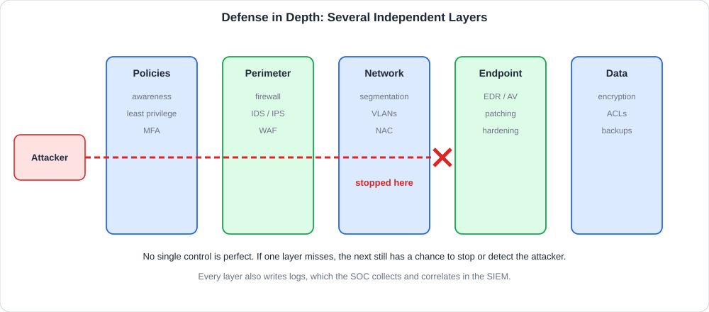<br>
  <sub>خمس طبقات مستقلة بين المهاجم والبيانات، وهنا يتوقف الهجوم عند إحداها</sub>
</p>

وقد درسنا في الوحدة 3 كيف يكون **نظام التشغيل** طبقة دفاع، وهنا نرى الصورة الكاملة.

### <a id="t5-4"></a>5.4 طبقات الدفاع بالتفصيل

<table dir="rtl" width="100%">
<thead><tr><th align="right" style="text-align:right">الطبقة</th><th align="right" style="text-align:right">الهدف</th><th align="right" style="text-align:right">أمثلة ضوابط</th><th align="right" style="text-align:right">ما تحمي منه</th></tr></thead>
<tbody>
<tr><td align="right" style="text-align:right"><b>السياسات والأفراد</b></td><td align="right" style="text-align:right">تقليل الخطأ البشري</td><td align="right" style="text-align:right">توعية، سياسة كلمات مرور، <b>Least Privilege</b>، <b>MFA</b></td><td align="right" style="text-align:right">تصيد، إهمال، إساءة استخدام</td></tr>
<tr><td align="right" style="text-align:right"><b>المحيط (Perimeter)</b></td><td align="right" style="text-align:right">تصفية ما يدخل ويخرج من الشبكة</td><td align="right" style="text-align:right"><b>جدار ناري (Firewall)</b>، <b>IDS/IPS</b>، <b>WAF</b></td><td align="right" style="text-align:right">فحص، حجب خدمة، هجمات ويب</td></tr>
<tr><td align="right" style="text-align:right"><b>الشبكة (Network)</b></td><td align="right" style="text-align:right">تقييد الحركة الداخلية</td><td align="right" style="text-align:right"><b>تقسيم الشبكة (Segmentation)</b> وVLANs، <b>NAC</b>، تأمين Wi-Fi</td><td align="right" style="text-align:right">الحركة الجانبية</td></tr>
<tr><td align="right" style="text-align:right"><b>الجهاز الطرفي (Endpoint)</b></td><td align="right" style="text-align:right">حماية الأجهزة نفسها</td><td align="right" style="text-align:right"><b>EDR / Antivirus</b>، التحديثات، التقوية (Hardening)</td><td align="right" style="text-align:right">برمجيات خبيثة، استغلال</td></tr>
<tr><td align="right" style="text-align:right"><b>التطبيق (Application)</b></td><td align="right" style="text-align:right">تطبيق آمن</td><td align="right" style="text-align:right">تحقق المدخلات، مراجعة الكود، تحديث المكتبات</td><td align="right" style="text-align:right">حقن SQL، XSS</td></tr>
<tr><td align="right" style="text-align:right"><b>البيانات (Data)</b></td><td align="right" style="text-align:right">حماية الأصل نفسه</td><td align="right" style="text-align:right"><b>تشفير</b>، ضوابط وصول، نسخ احتياطي، DLP</td><td align="right" style="text-align:right">سرقة، تعديل، فقدان</td></tr>
</tbody>
</table>

وأهم مبدأين يسندان الطبقات:
- **Least Privilege (الحد الأدنى من الصلاحيات):** يعطى كل مستخدم وبرنامج **ما يلزمه فقط**، فيقل ما يستطيعه المهاجم إذا سرق حسابًا.
- **Segmentation (التقسيم):** فصل الأجهزة الحساسة في شبكات منعزلة، فاختراق جهاز لا يعني الوصول للكل.

### <a id="t5-5"></a>5.5 أنواع الضوابط الأمنية

تُصنَّف الضوابط بحسب **متى تعمل** وبحسب **طبيعتها**:

<table dir="rtl" width="100%">
<thead><tr><th align="right" style="text-align:right">النوع</th><th align="right" style="text-align:right">متى يعمل</th><th align="right" style="text-align:right">أمثلة</th></tr></thead>
<tbody>
<tr><td align="right" style="text-align:right"><b>وقائي (Preventive)</b></td><td align="right" style="text-align:right"><b>قبل</b> الحادث لمنعه</td><td align="right" style="text-align:right">جدار ناري، MFA، تشفير، تحديثات</td></tr>
<tr><td align="right" style="text-align:right"><b>كاشف (Detective)</b></td><td align="right" style="text-align:right"><b>أثناء</b> الحادث أو بعده لاكتشافه</td><td align="right" style="text-align:right">SIEM، IDS، مراقبة السجلات، كاميرات</td></tr>
<tr><td align="right" style="text-align:right"><b>تصحيحي (Corrective)</b></td><td align="right" style="text-align:right"><b>بعد</b> الحادث لإصلاح الضرر</td><td align="right" style="text-align:right">استعادة من نسخة احتياطية، تصحيح ثغرة</td></tr>
<tr><td align="right" style="text-align:right"><b>رادع (Deterrent)</b></td><td align="right" style="text-align:right"><b>يثني</b> المهاجم عن المحاولة</td><td align="right" style="text-align:right">لافتات تحذير، عقوبات، تدقيق معلن</td></tr>
<tr><td align="right" style="text-align:right"><b>تعويضي (Compensating)</b></td><td align="right" style="text-align:right"><b>بديل</b> عند تعذر الضابط الأساسي</td><td align="right" style="text-align:right">عزل جهاز قديم بدل ترقيته</td></tr>
</tbody>
</table>

وبحسب الطبيعة: **إدارية** (سياسات وتدريب)، و**تقنية** (برامج وإعدادات)، و**مادية** (أبواب وأقفال وكاميرات). والدفاع الجيد يجمع **الأنواع كلها**، فالوقاية وحدها لا تكفي والكشف وحده متأخر.

### <a id="t5-6"></a>5.6 ربط الضوابط بثلاثية CIA

كل ضابط يخدم ركيزة أو أكثر من الثلاثية التي درسناها:

<table dir="rtl" width="100%">
<thead><tr><th align="right" style="text-align:right">الركيزة</th><th align="right" style="text-align:right">ضوابط الحماية</th></tr></thead>
<tbody>
<tr><td align="right" style="text-align:right"><b>السرية (Confidentiality)</b></td><td align="right" style="text-align:right"><b>التشفير</b> وإدارة <b>الصلاحيات</b> وMFA وتصنيف البيانات وDLP</td></tr>
<tr><td align="right" style="text-align:right"><b>السلامة (Integrity)</b></td><td align="right" style="text-align:right"><b>التوقيعات الرقمية</b> و<b>التجزئة</b>، ومراقبة تعديل الملفات (FIM)، وسجلات التدقيق، وضوابط الكتابة</td></tr>
<tr><td align="right" style="text-align:right"><b>التوافر (Availability)</b></td><td align="right" style="text-align:right">أنظمة <b>منع حجب الخدمة (Anti-DDoS)</b>، <b>خطط استمرارية الأعمال (BCP)</b> والتعافي (DR)، <b>النسخ الاحتياطي</b>، والتكرار</td></tr>
</tbody>
</table>

وحين تُفكر في أي ضابط جديد اسأل: **أي ركيزة يحمي؟** وهل يضر ركيزة أخرى؟

### <a id="t5-7"></a>5.7 تقليل سطح الهجوم والتقوية (Hardening)

**سطح الهجوم (Attack Surface)** هو مجموع ما يمكن للمهاجم **لمسه**: المنافذ المفتوحة، والخدمات، والحسابات، والتطبيقات. وكل ما نغلقه أو نحذفه يضيق عليه الطريق:

<table dir="rtl" width="100%">
<thead><tr><th align="right" style="text-align:right">الإجراء</th><th align="right" style="text-align:right">الفائدة</th></tr></thead>
<tbody>
<tr><td align="right" style="text-align:right"><b>التحديثات (Patching)</b></td><td align="right" style="text-align:right">سد الثغرات المعروفة التي يستغلها أغلب الهجمات</td></tr>
<tr><td align="right" style="text-align:right"><b>إيقاف الخدمات والمنافذ غير الضرورية</b></td><td align="right" style="text-align:right">أقل مداخل للهجوم</td></tr>
<tr><td align="right" style="text-align:right"><b>المصادقة متعددة العوامل (MFA)</b></td><td align="right" style="text-align:right">تنجو الحسابات من سرقة كلمة المرور</td></tr>
<tr><td dir="ltr" align="left" style="text-align:left"><b>Least Privilege</b></td><td align="right" style="text-align:right">تقييد ما يفعله الحساب المسروق</td></tr>
<tr><td align="right" style="text-align:right"><b>التقسيم (Segmentation)</b></td><td align="right" style="text-align:right">منع الحركة الجانبية</td></tr>
<tr><td align="right" style="text-align:right"><b>النسخ الاحتياطي 3-2-1 وغير المتصل</b></td><td align="right" style="text-align:right">النجاة من الفدية</td></tr>
<tr><td align="right" style="text-align:right"><b>التشفير</b></td><td align="right" style="text-align:right">حماية البيانات المسروقة أو الضائعة</td></tr>
<tr><td align="right" style="text-align:right"><b>التوعية والتدريب</b></td><td align="right" style="text-align:right">تقليل نجاح التصيد</td></tr>
<tr><td align="right" style="text-align:right"><b>مراجعة التهيئة الدورية</b></td><td align="right" style="text-align:right">اكتشاف الإعدادات الافتراضية والضعيفة</td></tr>
</tbody>
</table>

وتُتابَع الثغرات المعروفة برقم **CVE** (معرّف عالمي لكل ثغرة، مثل CVE-2021-44228)، ويصفها مقياس **CVSS** بدرجة من 0 إلى 10 تساعد في **ترتيب أولويات الترقيع**: الأعلى درجة والأكثر استغلالًا أولًا.

ويتجه الفكر الأمني الحديث إلى نموذج **Zero Trust** ("لا تثق بأحد، تحقق دائمًا"): لا ثقة تلقائية بمجرد أن الجهاز داخل الشبكة، بل تحقق من الهوية والجهاز عند كل طلب.

### <a id="t5-8"></a>5.8 فريق SOC وأدواته

**SOC (Security Operations Center)** مركز عمليات الأمن، وهو الفريق الذي **يراقب على مدار الساعة**. ويتكون عادة من مستويات:

<table dir="rtl" width="100%">
<thead><tr><th align="right" style="text-align:right">المستوى</th><th align="right" style="text-align:right">الدور</th></tr></thead>
<tbody>
<tr><td align="right" style="text-align:right"><b>Tier 1</b> (محلل مبتدئ)</td><td align="right" style="text-align:right">مراقبة التنبيهات و<b>فرزها (Triage)</b> وتصعيد الحقيقي منها</td></tr>
<tr><td align="right" style="text-align:right"><b>Tier 2</b> (محلل متقدم)</td><td align="right" style="text-align:right">تحقيق أعمق وتحليل الحوادث والاحتواء</td></tr>
<tr><td align="right" style="text-align:right"><b>Tier 3</b> (متخصص)</td><td align="right" style="text-align:right">صيد التهديدات (Threat Hunting) وتحليل البرمجيات الخبيثة وتطوير قواعد الكشف</td></tr>
<tr><td align="right" style="text-align:right"><b>قائد / مدير</b></td><td align="right" style="text-align:right">تنسيق الاستجابة والتواصل مع الإدارة</td></tr>
</tbody>
</table>

وتتخصص أدوار أخرى: **Incident Responder** و**Forensic Analyst** (التحقيق الرقمي) و**Threat Intelligence Analyst** و**Detection Engineer**.

وأهم أدوات الفريق:

<table dir="rtl" width="100%">
<thead><tr><th align="right" style="text-align:right">الأداة</th><th align="right" style="text-align:right">وظيفتها</th></tr></thead>
<tbody>
<tr><td dir="ltr" align="left" style="text-align:left"><b>SIEM</b> (Security Information and Event Management)</td><td align="right" style="text-align:right"><b>تجمع وتحلل سجلات</b> كل أجهزة الشبكة في مكان واحد، وتربط الأحداث، وتنبّه على السلوك المشبوه</td></tr>
<tr><td dir="ltr" align="left" style="text-align:left"><b>EDR</b> (Endpoint Detection and Response)</td><td align="right" style="text-align:right">تراقب الأجهزة الطرفية بعمق وتسمح بالعزل والتحقيق عن بعد</td></tr>
<tr><td dir="ltr" align="left" style="text-align:left"><b>IDS / IPS</b></td><td align="right" style="text-align:right"><b>تكشف</b> (IDS) أو <b>تكشف وتحجب</b> (IPS) حركة الشبكة المشبوهة</td></tr>
<tr><td dir="ltr" align="left" style="text-align:left"><b>Firewall / WAF</b></td><td align="right" style="text-align:right">تصفية الحركة، وحماية تطبيقات الويب</td></tr>
<tr><td dir="ltr" align="left" style="text-align:left"><b>SOAR</b></td><td align="right" style="text-align:right">أتمتة خطوات الاستجابة المتكررة</td></tr>
<tr><td dir="ltr" align="left" style="text-align:left"><b>Threat Intelligence</b></td><td align="right" style="text-align:right">معلومات عن المهاجمين والمؤشرات (IoC)</td></tr>
<tr><td dir="ltr" align="left" style="text-align:left"><b>Vulnerability Scanner</b></td><td align="right" style="text-align:right">فحص دوري للثغرات في الأنظمة</td></tr>
</tbody>
</table>

وتعمل هذه الأدوات معًا: السجلات من كل طبقة تتدفق إلى **SIEM** فتقارنها وتعرض **تنبيهات**، ويحقق المحلل ويستعين بـ **EDR** للعزل.

<p align="center">
  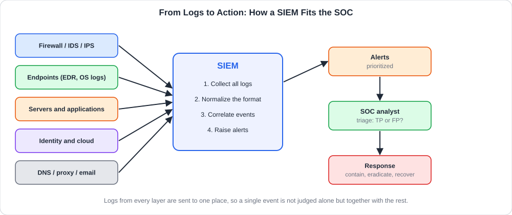<br>
  <sub>مصادر السجلات تتدفق إلى SIEM الذي يجمع ويربط وينبّه، ثم يحقق المحلل ويستجيب</sub>
</p>

### <a id="t5-9"></a>5.9 فرز التنبيهات (Alert Triage)

يستلم SOC **مئات التنبيهات** يوميًا وأغلبها غير حقيقي، لذلك **الفرز** هو المهارة الأولى: هل هذا التنبيه **حقيقي** وما **أولويته**؟ والنتائج الأربعة الممكنة:

<table dir="rtl" width="100%">
<thead><tr><th align="right" style="text-align:right"></th><th align="right" style="text-align:right"><b>هجوم حقيقي</b></th><th align="right" style="text-align:right"><b>لا يوجد هجوم</b></th></tr></thead>
<tbody>
<tr><td align="right" style="text-align:right"><b>أُطلق تنبيه</b></td><td align="right" style="text-align:right"><b>True Positive (TP)</b> ✔ تنبيه صحيح</td><td align="right" style="text-align:right"><b>False Positive (FP)</b> إنذار كاذب</td></tr>
<tr><td align="right" style="text-align:right"><b>لم يُطلق تنبيه</b></td><td align="right" style="text-align:right"><b>False Negative (FN)</b> ⚠ هجوم فاتنا</td><td align="right" style="text-align:right"><b>True Negative (TN)</b> سلوك عادي</td></tr>
</tbody>
</table>

- **True Positive:** هجوم حقيقي، يُصعَّد ويُعالج **فورًا**.
- **False Positive:** نشاط شرعي ظنه النظام هجومًا (مثل مدير يسجل الدخول من مكان جديد). **يُغلق مع توثيق السبب** وضبط القاعدة لتقليل تكراره.
- **False Negative:** الأخطر، لأنه هجوم **لم يُكتشف**، ومن هنا نحتاج تغطية جيدة وصيدًا استباقيًا.

وعند الفرز اسأل: **ما الأصل المتأثر؟ ما حساسية المستخدم؟ هل نشاط ناجح أم محاولة فقط؟ هل تكرر؟ هل المصدر معروف في استخبارات التهديد؟**

وانتبه إلى **إجهاد التنبيهات (Alert Fatigue)**: كثرة الإنذارات الكاذبة تجعل المحلل يهمل الحقيقي. وعلاجه ضبط القواعد وربط التنبيهات ببعضها.

### <a id="t5-10"></a>5.10 الاستجابة للحوادث (Incident Response)

حين يتأكد الحادث ينتقل الفريق من الفرز إلى **الاستجابة**، وفق دورة معيارية (من **NIST**):

<p align="center">
  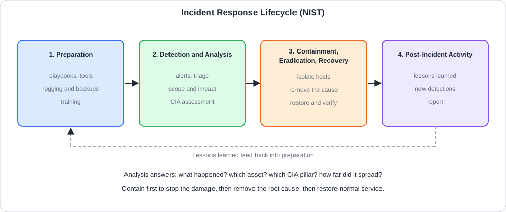<br>
  <sub>التحضير، الكشف والتحليل، الاحتواء والاستئصال والتعافي، ثم الدروس المستفادة</sub>
</p>

<table dir="rtl" width="100%">
<thead><tr><th align="right" style="text-align:right">المرحلة</th><th align="right" style="text-align:right">ماذا يحدث</th></tr></thead>
<tbody>
<tr><td align="right" style="text-align:right"><b>1. Preparation</b> (التحضير)</td><td align="right" style="text-align:right">خطط وأدوات وتدريب وتسجيل ونسخ احتياطي، <b>قبل</b> وقوع أي حادث</td></tr>
<tr><td align="right" style="text-align:right"><b>2. Detection &amp; Analysis</b> (الكشف والتحليل)</td><td align="right" style="text-align:right">اكتشاف التنبيه وتأكيده وتحديد <b>النطاق والأثر</b> (أي ركيزة؟ وأي أصول؟)</td></tr>
<tr><td dir="ltr" align="left" style="text-align:left"><b>3. Containment, Eradication &amp; Recovery</b></td><td align="right" style="text-align:right"><b>احتواء</b> الضرر، <b>استئصال</b> السبب، <b>التعافي</b> وعودة الخدمة</td></tr>
<tr><td align="right" style="text-align:right"><b>4. Post-Incident Activity</b> (ما بعد الحادث)</td><td align="right" style="text-align:right"><b>الدروس المستفادة</b>، وتحسين القواعد والضوابط، وكتابة التقرير</td></tr>
</tbody>
</table>

وتفصيل مرحلة الاحتواء، وهي الأكثر استعجالًا:

<table dir="rtl" width="100%">
<thead><tr><th align="right" style="text-align:right">الإجراء</th><th align="right" style="text-align:right">الغرض</th><th align="right" style="text-align:right">ملاحظة</th></tr></thead>
<tbody>
<tr><td align="right" style="text-align:right"><b>عزل الجهاز المصاب</b> عن الشبكة</td><td align="right" style="text-align:right">منع الانتشار</td><td align="right" style="text-align:right">عزل الشبكة لا إطفاء الجهاز، للحفاظ على الذاكرة كدليل</td></tr>
<tr><td align="right" style="text-align:right"><b>تعطيل الحسابات المخترقة</b></td><td align="right" style="text-align:right">قطع الوصول</td><td align="right" style="text-align:right">وتغيير كلمات المرور وإنهاء الجلسات</td></tr>
<tr><td align="right" style="text-align:right"><b>حجب المؤشرات</b></td><td align="right" style="text-align:right">منع الاتصال بالمهاجم</td><td align="right" style="text-align:right">عناوين ونطاقات في الجدار الناري وDNS</td></tr>
<tr><td align="right" style="text-align:right"><b>حفظ الأدلة</b></td><td align="right" style="text-align:right">التحقيق والمساءلة</td><td align="right" style="text-align:right">نسخ السجلات وصور الأقراص قبل أي تغيير</td></tr>
<tr><td align="right" style="text-align:right"><b>استبعاد السبب الجذري</b></td><td align="right" style="text-align:right">منع العودة</td><td align="right" style="text-align:right">إصلاح الثغرة، إزالة الأبواب الخلفية</td></tr>
<tr><td align="right" style="text-align:right"><b>الاستعادة والتحقق</b></td><td align="right" style="text-align:right">العودة للعمل بأمان</td><td align="right" style="text-align:right">من نسخة سليمة، ثم مراقبة مكثفة</td></tr>
</tbody>
</table>

وقاعدة الترتيب: **احتوِ أولًا لإيقاف الضرر، ثم استأصل السبب، ثم استعد الخدمة**. ولا يُمسح شيء قبل **حفظ الدليل**.

### <a id="t5-11"></a>5.11 الزاوية الأمنية: بناء قاعدة كشف وقياس الأداء

الكشف الجيد يبدأ بفكرة بسيطة: **سلوك + عتبة + سياق**. أمثلة على قواعد من تصميمنا:

<table dir="rtl" width="100%">
<thead><tr><th align="right" style="text-align:right">القاعدة</th><th align="right" style="text-align:right">المنطق</th><th align="right" style="text-align:right">يغطي</th></tr></thead>
<tbody>
<tr><td align="right" style="text-align:right"><b>تخمين كلمات المرور</b></td><td align="right" style="text-align:right">5 أو أكثر <code>Failed password</code> لنفس العنوان خلال 5 دقائق</td><td align="right" style="text-align:right">محاولة وصول (Credential Access)</td></tr>
<tr><td align="right" style="text-align:right"><b>فشل ثم نجاح</b></td><td align="right" style="text-align:right">نجاح دخول بعد فشل متكرر من العنوان نفسه</td><td align="right" style="text-align:right"><b>اختراق ناجح محتمل</b></td></tr>
<tr><td align="right" style="text-align:right"><b>فحص المنافذ</b></td><td align="right" style="text-align:right">عنوان واحد يضرب أكثر من 10 منافذ خلال دقيقة</td><td align="right" style="text-align:right">استطلاع</td></tr>
<tr><td align="right" style="text-align:right"><b>حساب جديد بصلاحيات عالية</b></td><td align="right" style="text-align:right">Event 4720 ثم 4732 خلال دقائق</td><td align="right" style="text-align:right">بقاء ورفع صلاحيات</td></tr>
<tr><td align="right" style="text-align:right"><b>مسح السجلات</b></td><td align="right" style="text-align:right">Event 1102 أو 104</td><td align="right" style="text-align:right">محو آثار</td></tr>
<tr><td align="right" style="text-align:right"><b>أب غريب لعملية</b></td><td align="right" style="text-align:right">Word يطلق PowerShell</td><td align="right" style="text-align:right">استغلال عبر تصيد</td></tr>
<tr><td align="right" style="text-align:right"><b>اتصال منتظم خارجي</b></td><td align="right" style="text-align:right">نفس الوجهة كل N ثانية</td><td dir="ltr" align="left" style="text-align:left">Beaconing / C2</td></tr>
</tbody>
</table>

ولتحسين القواعد:
- **قلّل الإنذارات الكاذبة** بإضافة سياق (قائمة استثناءات مشروعة، وقت الدوام).
- **اربط عدة تنبيهات** (Correlation): مسح ثم تخمين ثم نجاح أقوى من أي منها منفردًا.
- **اربط القاعدة بإطار ATT&CK** لمعرفة ما تغطيه وما لا تغطيه.
- **اختبر القاعدة** بمحاكاة الهجوم (Purple Team) للتأكد أنها تُطلَق.

ويقاس أداء الفريق بمؤشرات مثل:

<table dir="rtl" width="100%">
<thead><tr><th align="right" style="text-align:right">المؤشر</th><th align="right" style="text-align:right">معناه</th><th align="right" style="text-align:right">الهدف</th></tr></thead>
<tbody>
<tr><td dir="ltr" align="left" style="text-align:left"><b>MTTD</b> (Mean Time To Detect)</td><td align="right" style="text-align:right">متوسط الزمن من بدء الهجوم إلى اكتشافه</td><td align="right" style="text-align:right">أقل ما يمكن</td></tr>
<tr><td dir="ltr" align="left" style="text-align:left"><b>MTTR</b> (Mean Time To Respond/Recover)</td><td align="right" style="text-align:right">متوسط الزمن من الاكتشاف إلى الاحتواء أو التعافي</td><td align="right" style="text-align:right">أقل ما يمكن</td></tr>
<tr><td align="right" style="text-align:right"><b>نسبة الإنذارات الكاذبة</b></td><td align="right" style="text-align:right">كم من التنبيهات غير حقيقية</td><td align="right" style="text-align:right">تنخفض مع ضبط القواعد</td></tr>
</tbody>
</table>

<h2 dir="ltr" align="left" style="text-align:left">🛠 Commands &amp; Hands-on</h2>

### <a id="t5-12"></a>5.12 أدوات المراقبة والاستجابة الأساسية

الأوامر التالية أمثلة دفاعية، واختُبر ما أمكن منها على سجلات اصطناعية من تصميمنا.

**1) كشف التخمين بعتبة (قاعدة بسيطة):**

<div dir="ltr" align="left">

```bash
grep "Failed password" auth.log | awk '
  { for (i = 1; i <= NF; i++)
      if ($i == "from") c[$(i+1)]++ }
  END { for (ip in c)
          if (c[ip] >= 3) print "ALERT", ip, c[ip] }'
# ALERT 203.0.113.7 4
```

</div>

وتفسير: يعد الفشل لكل عنوان ويطبع تنبيهًا إذا بلغ العتبة (هنا 3). وهذا هو نفس منطق قاعدة SIEM لكن بسطر واحد.

**2) بناء خط زمني للنشاط المشبوه:**

<div dir="ltr" align="left">

```bash
grep "203.0.113.7" auth.log | sort | awk '{print $1,$2,$3,$6,$7,$8,$9}'
```

</div>

وهو يعرض كل ما فعله عنوان معين مرتبًا بالزمن: فشل فشل فشل ثم **Accepted**. وبناء **الخط الزمني (Timeline)** أول خطوة في أي تحقيق.

**3) مراقبة سلامة الملفات (FIM) البسيطة:**

<div dir="ltr" align="left">

```bash
sha256sum web/index.html > baseline.sha256   # take the baseline
sha256sum -c baseline.sha256                 # web/index.html: OK
# ... later, someone modifies the file ...
sha256sum -c baseline.sha256                 # web/index.html: FAILED
```

</div>

وهكذا تعمل أدوات FIM الكبيرة: بصمة معروفة وسليمة، ثم مقارنة دورية، وأي اختلاف في ملف **لا يُفترض أن يتغير** يُنبّه.

**4) فحص الحالة الحالية للجهاز (لينكس):**

<div dir="ltr" align="left">

```bash
ss -tulpn          # listening ports + owning process
ss -tnp            # active connections + process
last -n 10         # recent logins
who                # who is logged in now
ps aux --sort=-%cpu | head      # busiest processes
```

</div>

والمطلوب مقارنة المنافذ والاتصالات بما هو **متوقع**: خدمة تستمع على منفذ غريب أو اتصال صادر غير مفهوم يحتاج تحقيقًا.

**5) إجراءات احتواء سريعة (على أنظمتك فقط):**

<div dir="ltr" align="left">

```bash
# Linux: block an attacker IP (needs root)
iptables -A INPUT -s 203.0.113.7 -j DROP

# Linux: disable a compromised account
usermod -L compromised_user      # lock the password
pkill -KILL -u compromised_user  # end its sessions
```

</div>

<div dir="ltr" align="left">

```powershell
# Windows: disable an account and block an IP
Disable-LocalUser -Name "compromised_user"
New-NetFirewallRule -DisplayName "Block attacker" `
    -Direction Inbound -RemoteAddress 203.0.113.7 -Action Block
```

</div>

وقبل أي إجراء **وثّق ما ستفعله**، ولا تحذف الأدلة. وفي المؤسسات الكبيرة تُنفَّذ هذه الإجراءات غالبًا عبر **EDR** وجدار الحماية لا يدويًا.

### <a id="t5-13"></a>5.13 جدول مرجعي: الدفاع والاستجابة (Cheatsheet)

<table dir="rtl" width="100%">
<thead><tr><th align="right" style="text-align:right">العنصر</th><th align="right" style="text-align:right">المعنى</th><th align="right" style="text-align:right">مثال</th></tr></thead>
<tbody>
<tr><td dir="ltr" align="left" style="text-align:left">Defense in Depth</td><td align="right" style="text-align:right">طبقات مستقلة</td><td align="right" style="text-align:right">سياسات، محيط، شبكة، جهاز، تطبيق، بيانات</td></tr>
<tr><td dir="ltr" align="left" style="text-align:left">Preventive / Detective / Corrective</td><td align="right" style="text-align:right">يمنع / يكشف / يصلح</td><td align="right" style="text-align:right">جدار ناري / SIEM / استعادة</td></tr>
<tr><td dir="ltr" align="left" style="text-align:left">TP / FP / FN / TN</td><td align="right" style="text-align:right">تنبيه صحيح / كاذب / فاتنا / عادي</td><td align="right" style="text-align:right">أغلق FP ووثّق، صعّد TP</td></tr>
<tr><td dir="ltr" align="left" style="text-align:left">SIEM</td><td align="right" style="text-align:right">تجميع السجلات وربطها</td><td align="right" style="text-align:right">تنبيه على فشل ثم نجاح</td></tr>
<tr><td dir="ltr" align="left" style="text-align:left">EDR</td><td align="right" style="text-align:right">مراقبة الجهاز وعزله</td><td align="right" style="text-align:right">عزل جهاز مصاب</td></tr>
<tr><td dir="ltr" align="left" style="text-align:left">IR Phases</td><td align="right" style="text-align:right">تحضير، كشف وتحليل، احتواء وتعافٍ، دروس</td><td align="right" style="text-align:right">دورة NIST</td></tr>
<tr><td dir="ltr" align="left" style="text-align:left"><code>grep ... | awk</code></td><td align="right" style="text-align:right">عد الأحداث لكل مصدر</td><td align="right" style="text-align:right">عتبة التخمين</td></tr>
<tr><td dir="ltr" align="left" style="text-align:left"><code>sha256sum -c</code></td><td align="right" style="text-align:right">التحقق من سلامة ملف</td><td align="right" style="text-align:right">مراقبة ملفات الموقع</td></tr>
<tr><td dir="ltr" align="left" style="text-align:left"><code>ss -tulpn</code></td><td align="right" style="text-align:right">المنافذ المستمعة</td><td align="right" style="text-align:right">بحث عن خدمة غريبة</td></tr>
<tr><td dir="ltr" align="left" style="text-align:left"><code>last -n 10</code></td><td align="right" style="text-align:right">آخر عمليات الدخول</td><td align="right" style="text-align:right">تحقق من دخول مشبوه</td></tr>
<tr><td dir="ltr" align="left" style="text-align:left"><code>iptables -A INPUT -s &lt;ip&gt; -j DROP</code></td><td align="right" style="text-align:right">حجب عنوان</td><td align="right" style="text-align:right">احتواء سريع</td></tr>
<tr><td dir="ltr" align="left" style="text-align:left"><code>usermod -L &lt;user&gt;</code></td><td align="right" style="text-align:right">قفل حساب</td><td align="right" style="text-align:right">تعطيل حساب مخترق (يقفل كلمة المرور فقط ولا يمنع الدخول بمفتاح SSH، فراجع <code>authorized_keys</code> أيضًا)</td></tr>
<tr><td dir="ltr" align="left" style="text-align:left">Event 4625 / 4624</td><td align="right" style="text-align:right">فشل / نجاح دخول</td><td dir="ltr" align="left" style="text-align:left">Windows Security</td></tr>
<tr><td dir="ltr" align="left" style="text-align:left">Event 1102</td><td align="right" style="text-align:right">مسح سجل الأمان</td><td align="right" style="text-align:right">محو آثار</td></tr>
<tr><td dir="ltr" align="left" style="text-align:left">MTTD / MTTR</td><td align="right" style="text-align:right">زمن الاكتشاف / الاستجابة</td><td align="right" style="text-align:right">مقياس أداء SOC</td></tr>
</tbody>
</table>

<h2 dir="ltr" align="left" style="text-align:left">🖼 Practical Scenarios</h2>

### <a id="t5-14"></a>5.14 سيناريو: فرز تنبيه واستجابة كاملة

يظهر في SIEM تنبيه **High**: "دخول ناجح لحساب مدير بعد 40 محاولة فاشلة" من `203.0.113.7` إلى خادم الملفات `192.0.2.20`. خطوات المحلل:

1. **الفرز (Triage):** هل هو TP أم FP؟ العنوان خارجي غير معروف، والمحاولات كثيفة ثم نجاح. هذا **TP على الأرجح**، ويُصعَّد.
2. **التحليل:** الخط الزمني للعنوان في سجلات الجدار الناري والمصادقة. هل بدأ بفحص منافذ؟ ماذا فعل الحساب بعد الدخول؟ (4688 عمليات جديدة، 4720 مستخدم جديد، نقل ملفات كبير).
3. **تقدير الأثر بالثلاثية:** هل قُرئت ملفات (السرية)؟ هل عُدّلت (السلامة)؟ هل تعطل الخادم (التوافر)؟
4. **الاحتواء:** عزل الخادم بـ EDR، وتعطيل الحساب وإنهاء جلساته، وحجب العنوان، **وحفظ نسخة من السجلات**.
5. **الاستئصال:** البحث عن بقاء (مهام مجدولة، حسابات، خدمات)، وإزالتها، وإغلاق السبب (كلمة مرور ضعيفة وبلا MFA، وSSH/RDP مكشوف على الإنترنت).
6. **التعافي:** إعادة بناء الخادم من صورة سليمة والتحقق منه، ثم مراقبة مكثفة.
7. **الدروس المستفادة:** تفعيل MFA، وإغلاق المنفذ المكشوف، وإضافة قاعدة "فحص منافذ ثم تخمين" تنبه أبكر، وتسجيل **MTTD** و**MTTR** للحادث.

والدرس: **ثلاث طبقات فشلت** (كلمة مرور ضعيفة، خدمة مكشوفة، غياب MFA)، لكن **طبقة الكشف** (SIEM) أنقذت الموقف، وهذا معنى الدفاع العميق.

### <a id="t5-15"></a>5.15 كيف تتعامل مع أسئلة الغرفة بمنهجية

تتناول الغرفة **مفاهيم الدفاع**. ولا تُذكر هنا إجابات، بل **طريقة التفكير**:

1. **اسأل أي ركيزة يحميها الضابط:** السرية؟ السلامة؟ التوافر؟ هذا يحدد الجواب في أسئلة الربط.
2. **ميّز الوقاية والكشف والاستجابة:** المنع غير الاكتشاف غير الإصلاح.
3. **اربط الأداة بوظيفتها:** من يجمع السجلات؟ ومن يراقب الأجهزة؟ ومن يحجب الحركة؟
4. **راجع الاستراتيجية الأساسية بالإنجليزية:** Defense in Depth، Blue Team، SOC، SIEM.
5. **تذكر أن الدفاع طبقات:** إذا سألك سؤال "هل تكفي أداة واحدة؟" فالجواب في فلسفة الدفاع العميق.

<h2 dir="ltr" align="left" style="text-align:left">📝 Practical Takeaways</h2>

- **عقلية الدفاع:** افترض أن الاختراق **سيحدث**، وابنِ الكشف والاستجابة بجانب الوقاية.
- **الدفاع العميق:** طبقات مستقلة (سياسات، محيط، شبكة، جهاز، تطبيق، بيانات)، فلا أداة تحمي 100%.
- **الضوابط:** وقائية وكاشفة وتصحيحية ورادعة وتعويضية، وكلها لازمة.
- **ربط CIA:** التشفير والصلاحيات للسرية، التوقيعات والتجزئة وFIM للسلامة، مكافحة DDoS والنسخ الاحتياطي واستمرارية الأعمال للتوافر.
- **SOC:** **SIEM** يجمع ويربط السجلات، و**EDR** يراقب ويعزل، و**IDS/IPS** وجدار الحماية يصفّيان الحركة.
- **الفرز:** TP يُعالج، FP يُغلق ويوثق، FN أخطر الأنواع.
- **الاستجابة:** تحضير، كشف وتحليل، احتواء واستئصال وتعافٍ، ثم دروس مستفادة.
- **تقليل سطح الهجوم:** تحديثات (ورتّبها بـ CVSS)، MFA، Least Privilege، تقسيم، نسخ احتياطية.

## 🛡 خلاصة المحلل الأمني (SOC Takeaways)

- **افترض الاختراق** وصمم الكشف على هذا الأساس: ماذا سأرى إذا نجح المهاجم؟
- **السجلات أساس كل شيء:** أرسلها لخادم مركزي (SIEM) وفعّل التسجيل في كل طبقة.
- **اربط الأحداث:** تنبيه منفرد ضعيف، أما **فشل ثم نجاح ثم حساب جديد ثم مسح سجل** فقصة اختراق.
- **قدّر الأثر بالثلاثية** قبل أن تختار الإجراء.
- **احتوِ أولًا، ثم استأصل، ثم استعد** مع **حفظ الأدلة** قبل أي تغيير.
- **أغلق الإنذارات الكاذبة بتوثيق السبب** وضبط القاعدة لتفادي إجهاد التنبيهات.
- **أصلح الأساسيات:** MFA والتحديثات وإغلاق المنافذ المكشوفة تمنع أغلب الهجمات.
- **تعلم من كل حادث:** حدّث القواعد وقس MTTD وMTTR، ودرّب الفريق بمحاكاة (Purple Team).
- **أنت جزء من طبقة أخيرة:** حين تفشل الوقاية يأتي دور عينيك وعقلك.
- **بإنهاء هذه الغرفة تكون أنهيت مسار Pre-Security:** عندك الآن الأساس في الشبكات والويب والهجوم والدفاع، والخطوة التالية مسارات مثل Cyber Security 101 وSOC Level 1 لتطبيق ذلك عمليًا.

<a id="module-glossary"></a>

## 📖 جدول المصطلحات

<table dir="rtl" width="100%">
<thead><tr><th align="right" style="text-align:right">المصطلح</th><th align="right" style="text-align:right">المعنى</th><th align="right" style="text-align:right">الغرفة</th></tr></thead>
<tbody>
<tr><td dir="ltr" align="left" style="text-align:left"><b>CIA Triad</b></td><td align="right" style="text-align:right">ثلاثية السرية والسلامة والتوافر</td><td align="right" style="text-align:right">1</td></tr>
<tr><td dir="ltr" align="left" style="text-align:left"><b>Confidentiality</b></td><td align="right" style="text-align:right">ألا يطلع على البيانات إلا المصرح لهم</td><td align="right" style="text-align:right">1</td></tr>
<tr><td dir="ltr" align="left" style="text-align:left"><b>Integrity</b></td><td align="right" style="text-align:right">ألا تتغير البيانات دون إذن، فتبقى موثوقة</td><td align="right" style="text-align:right">1</td></tr>
<tr><td dir="ltr" align="left" style="text-align:left"><b>Availability</b></td><td align="right" style="text-align:right">إتاحة البيانات والخدمات وقت الحاجة</td><td align="right" style="text-align:right">1</td></tr>
<tr><td dir="ltr" align="left" style="text-align:left"><b>Security Incident</b></td><td align="right" style="text-align:right">حادث أمني يؤثر على إحدى الركائز</td><td align="right" style="text-align:right">1</td></tr>
<tr><td dir="ltr" align="left" style="text-align:left"><b>Security Mindset</b></td><td align="right" style="text-align:right">عقلية تقييم الأثر بالثلاثية</td><td align="right" style="text-align:right">1</td></tr>
<tr><td dir="ltr" align="left" style="text-align:left"><b>AAA</b></td><td align="right" style="text-align:right">المصادقة والتفويض والمساءلة</td><td align="right" style="text-align:right">1</td></tr>
<tr><td dir="ltr" align="left" style="text-align:left"><b>Non-repudiation</b></td><td align="right" style="text-align:right">عدم القدرة على إنكار فعل تم</td><td align="right" style="text-align:right">1</td></tr>
<tr><td dir="ltr" align="left" style="text-align:left"><b>Need to Know</b></td><td align="right" style="text-align:right">لا يرى الموظف إلا ما تتطلبه مهمته</td><td align="right" style="text-align:right">1</td></tr>
<tr><td dir="ltr" align="left" style="text-align:left"><b>DLP</b></td><td align="right" style="text-align:right">منع تسريب البيانات</td><td align="right" style="text-align:right">1</td></tr>
<tr><td dir="ltr" align="left" style="text-align:left"><b>FIM</b></td><td align="right" style="text-align:right">مراقبة سلامة الملفات</td><td align="right" style="text-align:right">1</td></tr>
<tr><td dir="ltr" align="left" style="text-align:left"><b>Backup 3-2-1</b></td><td align="right" style="text-align:right">ثلاث نسخ على وسيطين واحدة خارج الموقع</td><td align="right" style="text-align:right">1</td></tr>
<tr><td dir="ltr" align="left" style="text-align:left"><b>DDoS</b></td><td align="right" style="text-align:right">حجب خدمة موزع يغرق الخدمة بالطلبات</td><td align="right" style="text-align:right">1</td></tr>
<tr><td dir="ltr" align="left" style="text-align:left"><b>Cryptography</b></td><td align="right" style="text-align:right">علم التشفير وحماية المعلومات بالرياضيات</td><td align="right" style="text-align:right">2</td></tr>
<tr><td dir="ltr" align="left" style="text-align:left"><b>Plaintext / Ciphertext</b></td><td align="right" style="text-align:right">النص الصريح / النص المشفر</td><td align="right" style="text-align:right">2</td></tr>
<tr><td dir="ltr" align="left" style="text-align:left"><b>Key</b></td><td align="right" style="text-align:right">السر الذي يتحكم في التشفير وفكه</td><td align="right" style="text-align:right">2</td></tr>
<tr><td dir="ltr" align="left" style="text-align:left"><b>Algorithm</b></td><td align="right" style="text-align:right">الخطوات الرياضية العامة للتشفير</td><td align="right" style="text-align:right">2</td></tr>
<tr><td dir="ltr" align="left" style="text-align:left"><b>Kerckhoffs's principle</b></td><td align="right" style="text-align:right">الأمان في سرية المفتاح لا الخوارزمية</td><td align="right" style="text-align:right">2</td></tr>
<tr><td dir="ltr" align="left" style="text-align:left"><b>Caesar Cipher</b></td><td align="right" style="text-align:right">شفرة إزاحة الحروف بعدد ثابت</td><td align="right" style="text-align:right">2</td></tr>
<tr><td dir="ltr" align="left" style="text-align:left"><b>Key Space</b></td><td align="right" style="text-align:right">عدد المفاتيح الممكنة</td><td align="right" style="text-align:right">2</td></tr>
<tr><td dir="ltr" align="left" style="text-align:left"><b>Brute Force</b></td><td align="right" style="text-align:right">تجربة كل المفاتيح الممكنة</td><td align="right" style="text-align:right">2</td></tr>
<tr><td dir="ltr" align="left" style="text-align:left"><b>Frequency Analysis</b></td><td align="right" style="text-align:right">كسر الشفرة بتكرار الحروف</td><td align="right" style="text-align:right">2</td></tr>
<tr><td dir="ltr" align="left" style="text-align:left"><b>Symmetric Encryption</b></td><td align="right" style="text-align:right">تشفير بمفتاح واحد مشترك (AES)</td><td align="right" style="text-align:right">2</td></tr>
<tr><td dir="ltr" align="left" style="text-align:left"><b>Asymmetric Encryption</b></td><td align="right" style="text-align:right">تشفير بمفتاحين عام وخاص (RSA)</td><td align="right" style="text-align:right">2</td></tr>
<tr><td dir="ltr" align="left" style="text-align:left"><b>Public Key / Private Key</b></td><td align="right" style="text-align:right">المفتاح العلني / المفتاح السري لصاحبه</td><td align="right" style="text-align:right">2</td></tr>
<tr><td dir="ltr" align="left" style="text-align:left"><b>Key Distribution Problem</b></td><td align="right" style="text-align:right">صعوبة مشاركة المفتاح السري عبر شبكة عامة</td><td align="right" style="text-align:right">2</td></tr>
<tr><td dir="ltr" align="left" style="text-align:left"><b>Hybrid Approach</b></td><td align="right" style="text-align:right">غير متماثل لتبادل المفتاح ثم متماثل للبيانات</td><td align="right" style="text-align:right">2</td></tr>
<tr><td dir="ltr" align="left" style="text-align:left"><b>AES</b></td><td align="right" style="text-align:right">معيار التشفير المتماثل الحالي</td><td align="right" style="text-align:right">2</td></tr>
<tr><td dir="ltr" align="left" style="text-align:left"><b>RSA / ECC</b></td><td align="right" style="text-align:right">خوارزميات غير متماثلة</td><td align="right" style="text-align:right">2</td></tr>
<tr><td dir="ltr" align="left" style="text-align:left"><b>Block / Stream Cipher</b></td><td align="right" style="text-align:right">تشفير كتل / تشفير تدفق</td><td align="right" style="text-align:right">2</td></tr>
<tr><td dir="ltr" align="left" style="text-align:left"><b>Hash</b></td><td align="right" style="text-align:right">بصمة ثابتة الطول لا تُعكس</td><td align="right" style="text-align:right">2</td></tr>
<tr><td dir="ltr" align="left" style="text-align:left"><b>Salt</b></td><td align="right" style="text-align:right">قيمة عشوائية تضاف قبل تجزئة كلمة المرور</td><td align="right" style="text-align:right">2</td></tr>
<tr><td dir="ltr" align="left" style="text-align:left"><b>Digital Signature</b></td><td align="right" style="text-align:right">توقيع يثبت المصدر والسلامة</td><td align="right" style="text-align:right">2</td></tr>
<tr><td dir="ltr" align="left" style="text-align:left"><b>Encoding</b></td><td align="right" style="text-align:right">تمثيل بصيغة أخرى بلا مفتاح (Base64)</td><td align="right" style="text-align:right">2</td></tr>
<tr><td dir="ltr" align="left" style="text-align:left"><b>Digital Certificate</b></td><td align="right" style="text-align:right">وثيقة تربط هوية بمفتاح عام</td><td align="right" style="text-align:right">2</td></tr>
<tr><td dir="ltr" align="left" style="text-align:left"><b>CA (Certificate Authority)</b></td><td align="right" style="text-align:right">جهة موثوقة توقع الشهادات</td><td align="right" style="text-align:right">2</td></tr>
<tr><td dir="ltr" align="left" style="text-align:left"><b>TLS / HTTPS</b></td><td align="right" style="text-align:right">بروتوكول تشفير اتصال الويب</td><td align="right" style="text-align:right">2</td></tr>
<tr><td dir="ltr" align="left" style="text-align:left"><b>Forward Secrecy</b></td><td align="right" style="text-align:right">حماية الجلسات القديمة عند سرقة المفتاح لاحقًا</td><td align="right" style="text-align:right">2</td></tr>
<tr><td dir="ltr" align="left" style="text-align:left"><b>Data in Transit / at Rest / in Use</b></td><td align="right" style="text-align:right">بيانات منقولة / مخزنة / قيد المعالجة</td><td align="right" style="text-align:right">2</td></tr>
<tr><td dir="ltr" align="left" style="text-align:left"><b>Deprecated</b></td><td align="right" style="text-align:right">خوارزمية مهجورة (MD5 وSHA-1 وDES)</td><td align="right" style="text-align:right">2</td></tr>
<tr><td dir="ltr" align="left" style="text-align:left"><b>Collision</b></td><td align="right" style="text-align:right">مدخلان مختلفان لهما بصمة واحدة</td><td align="right" style="text-align:right">2</td></tr>
<tr><td dir="ltr" align="left" style="text-align:left"><b>MitM</b></td><td align="right" style="text-align:right">رجل في المنتصف يعترض الاتصال</td><td align="right" style="text-align:right">2</td></tr>
<tr><td dir="ltr" align="left" style="text-align:left"><b>Ethical Hacker</b></td><td align="right" style="text-align:right">مختبر اختراق يعمل بإذن</td><td align="right" style="text-align:right">3</td></tr>
<tr><td dir="ltr" align="left" style="text-align:left"><b>White / Black / Grey Hat</b></td><td align="right" style="text-align:right">هاكر بإذن / بلا إذن بنية سيئة / بلا إذن بنية حسنة</td><td align="right" style="text-align:right">3</td></tr>
<tr><td dir="ltr" align="left" style="text-align:left"><b>Rules of Engagement</b></td><td align="right" style="text-align:right">عقد وقواعد الاختبار: النطاق والوقت والأساليب</td><td align="right" style="text-align:right">3</td></tr>
<tr><td dir="ltr" align="left" style="text-align:left"><b>Red / Blue / Purple Team</b></td><td align="right" style="text-align:right">الهجوم / الدفاع / تعاونهما</td><td align="right" style="text-align:right">3</td></tr>
<tr><td dir="ltr" align="left" style="text-align:left"><b>Reconnaissance</b></td><td align="right" style="text-align:right">جمع المعلومات عن الهدف</td><td align="right" style="text-align:right">3</td></tr>
<tr><td dir="ltr" align="left" style="text-align:left"><b>OSINT</b></td><td align="right" style="text-align:right">استخبارات من مصادر مفتوحة</td><td align="right" style="text-align:right">3</td></tr>
<tr><td dir="ltr" align="left" style="text-align:left"><b>Scanning &amp; Enumeration</b></td><td align="right" style="text-align:right">فحص المنافذ والخدمات وتعدادها</td><td align="right" style="text-align:right">3</td></tr>
<tr><td dir="ltr" align="left" style="text-align:left"><b>Exploitation</b></td><td align="right" style="text-align:right">استغلال ثغرة للدخول</td><td align="right" style="text-align:right">3</td></tr>
<tr><td dir="ltr" align="left" style="text-align:left"><b>Privilege Escalation</b></td><td align="right" style="text-align:right">رفع الصلاحيات</td><td align="right" style="text-align:right">3</td></tr>
<tr><td dir="ltr" align="left" style="text-align:left"><b>Lateral Movement</b></td><td align="right" style="text-align:right">الانتقال بين الأجهزة داخل الشبكة</td><td align="right" style="text-align:right">3</td></tr>
<tr><td dir="ltr" align="left" style="text-align:left"><b>Persistence / Backdoor</b></td><td align="right" style="text-align:right">البقاء بعد الدخول / باب خلفي</td><td align="right" style="text-align:right">3</td></tr>
<tr><td dir="ltr" align="left" style="text-align:left"><b>Covering Tracks</b></td><td align="right" style="text-align:right">محو الآثار والسجلات</td><td align="right" style="text-align:right">3</td></tr>
<tr><td dir="ltr" align="left" style="text-align:left"><b>Cyber Kill Chain</b></td><td align="right" style="text-align:right">نموذج من سبع مراحل للهجوم</td><td align="right" style="text-align:right">3</td></tr>
<tr><td dir="ltr" align="left" style="text-align:left"><b>MITRE ATT&amp;CK</b></td><td align="right" style="text-align:right">قاعدة معرفة بتكتيكات وتقنيات المهاجمين</td><td align="right" style="text-align:right">3</td></tr>
<tr><td dir="ltr" align="left" style="text-align:left"><b>Penetration Testing</b></td><td align="right" style="text-align:right">اختبار اختراق مصرح لتقييم الأمان</td><td align="right" style="text-align:right">3</td></tr>
<tr><td dir="ltr" align="left" style="text-align:left"><b>Vulnerability Assessment</b></td><td align="right" style="text-align:right">فحص وسرد الثغرات دون استغلال</td><td align="right" style="text-align:right">3</td></tr>
<tr><td dir="ltr" align="left" style="text-align:left"><b>Phishing</b></td><td align="right" style="text-align:right">رسالة خادعة لسرقة بيانات أو تنفيذ ملف</td><td align="right" style="text-align:right">3</td></tr>
<tr><td dir="ltr" align="left" style="text-align:left"><b>CTF</b></td><td align="right" style="text-align:right">مسابقة التقاط العلم لحل تحديات أمنية</td><td align="right" style="text-align:right">4</td></tr>
<tr><td dir="ltr" align="left" style="text-align:left"><b>Flag</b></td><td align="right" style="text-align:right">نص يثبت حل التحدي</td><td align="right" style="text-align:right">4</td></tr>
<tr><td dir="ltr" align="left" style="text-align:left"><b>Jeopardy / Attack-Defense</b></td><td align="right" style="text-align:right">نمطا مسابقات CTF</td><td align="right" style="text-align:right">4</td></tr>
<tr><td dir="ltr" align="left" style="text-align:left"><b>CyberChef</b></td><td align="right" style="text-align:right">أداة فك الترميزات والتشفيرات في المتصفح</td><td align="right" style="text-align:right">4</td></tr>
<tr><td dir="ltr" align="left" style="text-align:left"><b>Deobfuscation</b></td><td align="right" style="text-align:right">فك التمويه وكشف حقيقة الكود</td><td align="right" style="text-align:right">4</td></tr>
<tr><td dir="ltr" align="left" style="text-align:left"><b>Base64 / Hex / URL Encoding</b></td><td align="right" style="text-align:right">ترميزات شائعة</td><td align="right" style="text-align:right">4</td></tr>
<tr><td dir="ltr" align="left" style="text-align:left"><b>ROT13</b></td><td align="right" style="text-align:right">قيصر بإزاحة 13</td><td align="right" style="text-align:right">4</td></tr>
<tr><td dir="ltr" align="left" style="text-align:left"><b>EncodedCommand</b></td><td align="right" style="text-align:right">خيار PowerShell يستقبل أمرًا مرمزًا</td><td align="right" style="text-align:right">4</td></tr>
<tr><td dir="ltr" align="left" style="text-align:left"><b>Defense in Depth</b></td><td align="right" style="text-align:right">دفاع بطبقات مستقلة</td><td align="right" style="text-align:right">5</td></tr>
<tr><td dir="ltr" align="left" style="text-align:left"><b>Blue Team / SOC</b></td><td align="right" style="text-align:right">فريق الدفاع / مركز عمليات الأمن</td><td align="right" style="text-align:right">5</td></tr>
<tr><td dir="ltr" align="left" style="text-align:left"><b>Assume Breach</b></td><td align="right" style="text-align:right">افتراض أن الاختراق سيحدث</td><td align="right" style="text-align:right">5</td></tr>
<tr><td dir="ltr" align="left" style="text-align:left"><b>Attack Surface</b></td><td align="right" style="text-align:right">مجموع ما يمكن للمهاجم لمسه</td><td align="right" style="text-align:right">5</td></tr>
<tr><td dir="ltr" align="left" style="text-align:left"><b>Least Privilege</b></td><td align="right" style="text-align:right">أقل صلاحيات لازمة</td><td align="right" style="text-align:right">5</td></tr>
<tr><td dir="ltr" align="left" style="text-align:left"><b>Segmentation</b></td><td align="right" style="text-align:right">تقسيم الشبكة لعزل الأجهزة</td><td align="right" style="text-align:right">5</td></tr>
<tr><td dir="ltr" align="left" style="text-align:left"><b>Zero Trust</b></td><td align="right" style="text-align:right">لا ثقة تلقائية، تحقق دائمًا</td><td align="right" style="text-align:right">5</td></tr>
<tr><td dir="ltr" align="left" style="text-align:left"><b>Preventive / Detective / Corrective</b></td><td align="right" style="text-align:right">ضابط وقائي / كاشف / تصحيحي</td><td align="right" style="text-align:right">5</td></tr>
<tr><td dir="ltr" align="left" style="text-align:left"><b>SIEM</b></td><td align="right" style="text-align:right">تجميع السجلات وربطها والتنبيه</td><td align="right" style="text-align:right">5</td></tr>
<tr><td dir="ltr" align="left" style="text-align:left"><b>EDR</b></td><td align="right" style="text-align:right">كشف واستجابة على الأجهزة الطرفية</td><td align="right" style="text-align:right">5</td></tr>
<tr><td dir="ltr" align="left" style="text-align:left"><b>IDS / IPS</b></td><td align="right" style="text-align:right">كشف / كشف وحجب التسلل</td><td align="right" style="text-align:right">5</td></tr>
<tr><td dir="ltr" align="left" style="text-align:left"><b>SOAR</b></td><td align="right" style="text-align:right">أتمتة الاستجابة</td><td align="right" style="text-align:right">5</td></tr>
<tr><td dir="ltr" align="left" style="text-align:left"><b>Triage</b></td><td align="right" style="text-align:right">فرز التنبيهات وتحديد أولويتها</td><td align="right" style="text-align:right">5</td></tr>
<tr><td dir="ltr" align="left" style="text-align:left"><b>TP / FP / FN / TN</b></td><td align="right" style="text-align:right">تنبيه صحيح / كاذب / هجوم فاتنا / سلوك عادي</td><td align="right" style="text-align:right">5</td></tr>
<tr><td dir="ltr" align="left" style="text-align:left"><b>Alert Fatigue</b></td><td align="right" style="text-align:right">إجهاد المحلل من كثرة الإنذارات الكاذبة</td><td align="right" style="text-align:right">5</td></tr>
<tr><td dir="ltr" align="left" style="text-align:left"><b>Incident Response</b></td><td align="right" style="text-align:right">الاستجابة للحوادث وفق دورة NIST</td><td align="right" style="text-align:right">5</td></tr>
<tr><td dir="ltr" align="left" style="text-align:left"><b>Containment / Eradication / Recovery</b></td><td align="right" style="text-align:right">احتواء / استئصال / تعافٍ</td><td align="right" style="text-align:right">5</td></tr>
<tr><td dir="ltr" align="left" style="text-align:left"><b>Hardening</b></td><td align="right" style="text-align:right">تقوية النظام وإغلاق الإعدادات الضعيفة</td><td align="right" style="text-align:right">5</td></tr>
<tr><td dir="ltr" align="left" style="text-align:left"><b>IoC</b></td><td align="right" style="text-align:right">مؤشر اختراق</td><td align="right" style="text-align:right">5</td></tr>
<tr><td dir="ltr" align="left" style="text-align:left"><b>MTTD / MTTR</b></td><td align="right" style="text-align:right">متوسط زمن الاكتشاف / الاستجابة</td><td align="right" style="text-align:right">5</td></tr>
</tbody>
</table>

</div>
