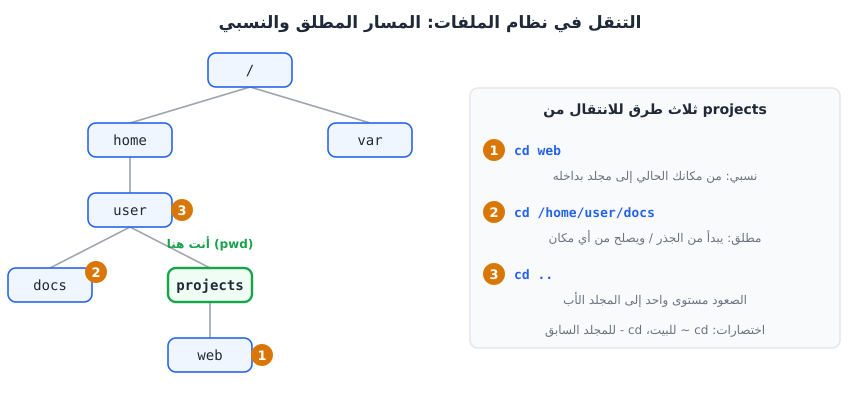
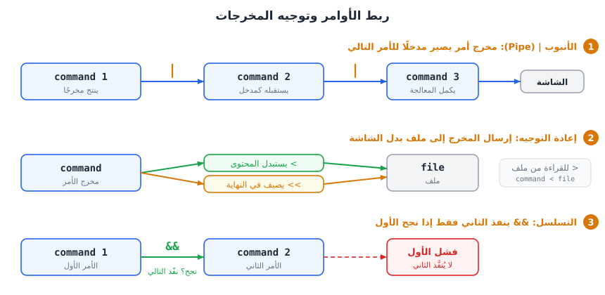

<div dir="rtl" align="right">

<h1 align="center">🐧 Linux Fundamentals</h1>
<p align="center"><b>أساسيات لينكس</b> · مسار Cyber Security 101</p>

## 📑 فهرس الوحدة

<table dir="rtl" width="100%">
<thead><tr><th align="right" style="text-align:right">#</th><th align="right" style="text-align:right">الغرفة</th><th align="right" style="text-align:right">الموضوعات بالترتيب</th></tr></thead>
<tbody>
<tr><td align="right" style="text-align:right">—</td><td align="right" style="text-align:right"><a href="#module-intro">مقدمة الوحدة</a></td><td align="right" style="text-align:right">تعريف لينكس وما تغطيه الوحدة</td></tr>
<tr><td align="right" style="text-align:right">1</td><td dir="ltr" align="left" style="text-align:left"><a href="#room-1">Linux Fundamentals Part 1</a></td><td align="right" style="text-align:right"><a href="#t1-1">1.1 التعريف بالغرفة</a><br><a href="#t1-2">1.2 ما هو لينكس ومميزاته</a><br><a href="#t1-3">1.3 علاقة لينكس بالأمن السيبراني</a><br><a href="#t1-4">1.4 الـ Terminal وتشغيل الآلة</a><br><a href="#t1-5">1.5 ما هي الأوامر وكيف تُكتب</a><br><a href="#t1-6">1.6 أول أمرين: whoami و echo</a><br><a href="#t1-7">1.7 التنقل في نظام الملفات: pwd و ls و cd</a><br><a href="#t1-8">1.8 قراءة الملفات: cat</a><br><a href="#t1-9">1.9 البحث عن الملفات: find</a><br><a href="#t1-10">1.10 البحث داخل الملفات: grep</a><br><a href="#t1-11">1.11 الجمع بين الأوامر: الأنبوب |</a><br><a href="#t1-12">1.12 إعادة التوجيه: > و >> و <</a><br><a href="#t1-13">1.13 تسلسل الأوامر: && و &</a><br><a href="#t1-14">1.14 الزاوية الأمنية: لينكس في عمل المحلل</a></td></tr>
<tr><td align="right" style="text-align:right">—</td><td align="right" style="text-align:right"><a href="#module-commands">جدول الأوامر المستخدمة</a></td><td align="right" style="text-align:right">الأوامر مرتبة من الأبسط إلى الأعمق مع وظيفة كل أمر وصيغته</td></tr>
</tbody>
</table>

<a id="module-intro"></a>

## 🧭 مقدمة عن الوحدة

**لينكس (Linux)** نظام التشغيل الذي تعمل عليه أغلب الخوادم والبنية السحابية، ولذلك يحتاجه كل من يعمل في الأمن السيبراني. وتعلّمنا هذه الوحدة كيف نتعامل معه من سطر الأوامر خطوة بخطوة.

تتكون الوحدة من أربع غرف: ثلاث غرف لأساسيات لينكس، ثم غرفة الصندوق الغامض (Mystery Chest).

<br>

<a id="room-1"></a>
<table align="center" width="100%"><tr><td align="center" style="text-align:center">

### 🚪 الغرفة 1: Linux Fundamentals Part 1 (أساسيات لينكس: الجزء الأول)

</td></tr></table>

### <a id="t1-1"></a>1.1 التعريف بالغرفة

تعرّفنا في هذه الغرفة على النظام ومميزاته وعلاقته بالأمن السيبراني، ثم بدأنا نتعامل معه من الـ Terminal بأوامر بسيطة: معرفة المستخدم، والتنقل بين المجلدات، وقراءة الملفات، والبحث عنها وعن محتواها، وربط الأوامر ببعضها.

<h2 dir="ltr" align="left" style="text-align:left">📌 Concepts Covered</h2>

### <a id="t1-2"></a>1.2 ما هو لينكس ومميزاته

لينكس نظام تشغيل **مفتوح المصدر**. قلبه هو **النواة (Kernel)**، وتُضم إليها أدوات وبرامج لتصبح نسخة جاهزة تسمى **توزيعة (Distribution)**. ومن أشهر التوزيعات:

<table dir="rtl" width="100%">
<thead><tr><th align="center" style="text-align:center">التوزيعة</th><th align="center" style="text-align:center">ملاحظة</th></tr></thead>
<tbody>
<tr><td dir="ltr" align="center" style="text-align:center">Ubuntu</td><td align="center" style="text-align:center">الأشهر والأسهل للمبتدئين، وهي المستخدمة في هذه الغرفة</td></tr>
<tr><td dir="ltr" align="center" style="text-align:center">Debian</td><td align="center" style="text-align:center">الأساس الذي بُني عليه Ubuntu، وتشتهر بالاستقرار</td></tr>
<tr><td dir="ltr" align="center" style="text-align:center">Kali</td><td align="center" style="text-align:center">مخصصة للاختراق الأخلاقي وتأتي بأدواته جاهزة</td></tr>
<tr><td dir="ltr" align="center" style="text-align:center">Red Hat</td><td align="center" style="text-align:center">شائعة في الشركات والخوادم</td></tr>
</tbody></table>

ومن مميزات لينكس:

<table dir="rtl" width="100%">
<thead><tr><th align="center" style="text-align:center">الميزة</th><th align="center" style="text-align:center">معناها</th></tr></thead>
<tbody>
<tr><td align="center" style="text-align:center">مجاني ومفتوح المصدر</td><td align="center" style="text-align:center">يمكن لأي شخص قراءة الكود وتعديله</td></tr>
<tr><td align="center" style="text-align:center">خفيف ومستقر</td><td align="center" style="text-align:center">يعمل بكفاءة ولمدد طويلة دون إعادة تشغيل</td></tr>
<tr><td align="center" style="text-align:center">قابل للتخصيص</td><td align="center" style="text-align:center">نختار منه ما نحتاجه فقط</td></tr>
<tr><td align="center" style="text-align:center">صلاحيات صارمة</td><td align="center" style="text-align:center">لكل ملف وبرنامج مالك وأذونات محددة</td></tr>
<tr><td align="center" style="text-align:center">منتشر جدًا</td><td align="center" style="text-align:center">يعمل في الخوادم والسحابة والراوترات وأندرويد</td></tr>
</tbody></table>

### <a id="t1-3"></a>1.3 علاقة لينكس بالأمن السيبراني

<table dir="rtl" width="100%">
<thead><tr><th align="center" style="text-align:center">المجال</th><th align="center" style="text-align:center">دور لينكس</th></tr></thead>
<tbody>
<tr><td align="center" style="text-align:center">الدفاع</td><td align="center" style="text-align:center">تحليل السجلات والتحقيق على الخوادم، وأغلبها لينكس</td></tr>
<tr><td align="center" style="text-align:center">الاختراق الأخلاقي</td><td align="center" style="text-align:center">توزيعات مثل Kali تأتي بأدوات الفحص جاهزة</td></tr>
<tr><td align="center" style="text-align:center">السحابة والحاويات</td><td align="center" style="text-align:center">معظم البنية السحابية قائمة على لينكس</td></tr>
<tr><td align="center" style="text-align:center">الأتمتة</td><td align="center" style="text-align:center">السكربتات تُسرّع الفحص وتحليل الملفات الكبيرة</td></tr>
</tbody></table>

### <a id="t1-4"></a>1.4 الـ Terminal وتشغيل الآلة

الـ Terminal واجهة نصية نكتب فيها الأوامر بدل الضغط بالفأرة. وهو أسرع وأدق، وكثير من الخوادم ليس لها واجهة رسومية أصلًا. ولذلك نستخدمه في هذه الغرفة بدل الواجهة الرسومية.

عند فتحه يظهر سطر ينتظر أمرك يسمى **Prompt**، وشكله:

<div dir="ltr" align="left">

```text
user@hostname:~$
```

</div>

<table dir="rtl" width="100%">
<thead><tr><th align="center" style="text-align:center">الجزء</th><th align="center" style="text-align:center">معناه</th></tr></thead>
<tbody>
<tr><td dir="ltr" align="center" style="text-align:center"><code>user</code></td><td align="center" style="text-align:center">اسم المستخدم الحالي</td></tr>
<tr><td dir="ltr" align="center" style="text-align:center"><code>hostname</code></td><td align="center" style="text-align:center">اسم الجهاز</td></tr>
<tr><td dir="ltr" align="center" style="text-align:center"><code>~</code></td><td align="center" style="text-align:center">المسار الحالي، وتعني مجلد المستخدم الرئيسي (Home)</td></tr>
<tr><td dir="ltr" align="center" style="text-align:center"><code>$</code></td><td align="center" style="text-align:center">مستخدم عادي. وإذا ظهرت <code>#</code> فالمستخدم هو root صاحب أعلى صلاحية</td></tr>
</tbody></table>

### <a id="t1-5"></a>1.5 ما هي الأوامر وكيف تُكتب

**الأمر (Command)** تعليمة نكتبها فينفذها النظام ويعرض النتيجة. وله شكل ثابت:

<div dir="ltr" align="left">

```text
command [options] [arguments]
```

</div>

<table dir="rtl" width="100%">
<thead><tr><th align="center" style="text-align:center">الجزء</th><th align="center" style="text-align:center">وظيفته</th></tr></thead>
<tbody>
<tr><td dir="ltr" align="center" style="text-align:center"><b>Command</b></td><td align="center" style="text-align:center">ما نريد فعله</td></tr>
<tr><td dir="ltr" align="center" style="text-align:center"><b>Option</b></td><td align="center" style="text-align:center">يعدّل طريقة عمل الأمر، ويبدأ بـ <code>-</code> أو <code>--</code></td></tr>
<tr><td dir="ltr" align="center" style="text-align:center"><b>Argument</b></td><td align="center" style="text-align:center">ما يُنفَّذ عليه الأمر: ملف أو مجلد</td></tr>
</tbody></table>

ولينكس **حساس لحالة الأحرف**، فالاسم `File` يختلف عن `file`. وللمساعدة في أي أمر:

<table dir="rtl" width="100%">
<thead><tr><th align="center" style="text-align:center">الطريقة</th><th align="center" style="text-align:center">الاستخدام</th></tr></thead>
<tbody>
<tr><td dir="ltr" align="center" style="text-align:center"><code>man &lt;command&gt;</code></td><td align="center" style="text-align:center">دليل كامل للأمر، ونخرج منه بزر <code>q</code></td></tr>
<tr><td dir="ltr" align="center" style="text-align:center"><code>&lt;command&gt; --help</code></td><td align="center" style="text-align:center">ملخص سريع للخيارات</td></tr>
<tr><td dir="ltr" align="center" style="text-align:center"><code>Tab</code></td><td align="center" style="text-align:center">إكمال أسماء الملفات والأوامر تلقائيًا</td></tr>
<tr><td align="center" style="text-align:center">السهم لأعلى</td><td align="center" style="text-align:center">استدعاء الأوامر السابقة</td></tr>
<tr><td dir="ltr" align="center" style="text-align:center"><code>clear</code></td><td align="center" style="text-align:center">مسح الشاشة</td></tr>
</tbody></table>

<h2 dir="ltr" align="left" style="text-align:left">🛠 Commands & Hands-on</h2>

### <a id="t1-6"></a>1.6 أول أمرين: whoami و echo

<table dir="rtl" width="100%">
<thead><tr><th align="center" style="text-align:center">الأمر</th><th align="center" style="text-align:center">وظيفته</th></tr></thead>
<tbody>
<tr><td dir="ltr" align="center" style="text-align:center"><code>whoami</code></td><td align="center" style="text-align:center">يعرض <b>اسم المستخدم الحالي</b>، وهو أول سؤال نسأله عن أي جهاز نصل إليه</td></tr>
<tr><td dir="ltr" align="center" style="text-align:center"><code>echo</code></td><td align="center" style="text-align:center">يطبع النص الذي نعطيه له على الشاشة</td></tr>
</tbody></table>

<div dir="ltr" align="left">

```text
whoami
echo "text"
```

</div>

الاقتباس المزدوج `" "` يترجم المتغيرات مثل `$HOME`، أما الاقتباس المفرد `' '` فيطبعها كما هي.

### <a id="t1-7"></a>1.7 التنقل في نظام الملفات: pwd و ls و cd

نظام الملفات في لينكس **شجرة** جذرها `/`. ونحتاج دائمًا أن نعرف أين نقف وماذا حولنا وكيف ننتقل:

<table dir="rtl" width="100%">
<thead><tr><th align="center" style="text-align:center">الأمر</th><th align="center" style="text-align:center">وظيفته</th></tr></thead>
<tbody>
<tr><td dir="ltr" align="center" style="text-align:center"><code>pwd</code></td><td align="center" style="text-align:center"><b>Print Working Directory</b>: يعرض المسار الحالي</td></tr>
<tr><td dir="ltr" align="center" style="text-align:center"><code>ls</code></td><td align="center" style="text-align:center">يعرض محتويات المجلد الحالي</td></tr>
<tr><td dir="ltr" align="center" style="text-align:center"><code>cd &lt;path&gt;</code></td><td align="center" style="text-align:center"><b>Change Directory</b>: ينتقل إلى مجلد</td></tr>
</tbody></table>

<p align="center">
  <br>
  <sub>المسار النسبي يبدأ من مكانك الحالي، والمطلق يبدأ من الجذر</sub>
</p>

**المسار المطلق** يبدأ من الجذر `/` ويصلح من أي مكان. و**المسار النسبي** يبدأ من مكانك الحالي. وأهم خيارات `ls`:

<table dir="rtl" width="100%">
<thead><tr><th align="center" style="text-align:center">الخيار</th><th align="center" style="text-align:center">معناه</th></tr></thead>
<tbody>
<tr><td dir="ltr" align="center" style="text-align:center"><code>-l</code></td><td align="center" style="text-align:center">عرض تفصيلي: النوع والأذونات والمالك والحجم والتاريخ</td></tr>
<tr><td dir="ltr" align="center" style="text-align:center"><code>-a</code></td><td align="center" style="text-align:center">إظهار <b>الملفات المخفية</b>، وأسماؤها تبدأ بنقطة</td></tr>
<tr><td dir="ltr" align="center" style="text-align:center"><code>-h</code></td><td align="center" style="text-align:center">أحجام مقروءة مع <code>-l</code></td></tr>
<tr><td dir="ltr" align="center" style="text-align:center"><code>-R</code></td><td align="center" style="text-align:center">عرض المجلدات وما بداخلها تباعًا</td></tr>
</tbody></table>

وفي العرض التفصيلي يدل الحرف الأول على النوع: `-` ملف، و`d` مجلد. وخيارات الانتقال:

<table dir="rtl" width="100%">
<thead><tr><th align="center" style="text-align:center">الأمر</th><th align="center" style="text-align:center">يذهب إلى</th></tr></thead>
<tbody>
<tr><td dir="ltr" align="center" style="text-align:center"><code>cd &lt;path&gt;</code></td><td align="center" style="text-align:center">المسار المحدد، مطلقًا كان أم نسبيًا</td></tr>
<tr><td dir="ltr" align="center" style="text-align:center"><code>cd ..</code></td><td align="center" style="text-align:center">المجلد الأب، أي مستوى للأعلى</td></tr>
<tr><td align="center" style="text-align:center"><code>cd ~</code> أو <code>cd</code></td><td align="center" style="text-align:center">مجلد المستخدم الرئيسي</td></tr>
<tr><td dir="ltr" align="center" style="text-align:center"><code>cd -</code></td><td align="center" style="text-align:center">المجلد الذي كنا فيه قبل الأخير</td></tr>
<tr><td dir="ltr" align="center" style="text-align:center"><code>cd /</code></td><td align="center" style="text-align:center">الجذر</td></tr>
</tbody></table>

### <a id="t1-8"></a>1.8 قراءة الملفات: cat

**`cat`** يعرض محتوى ملف أو أكثر على الشاشة، ويصلح للملفات القصيرة.

<div dir="ltr" align="left">

```text
cat <file>
```

</div>

### <a id="t1-9"></a>1.9 البحث عن الملفات: find

**`find`** يبحث عن الملفات والمجلدات بـ **أسمائها وخصائصها** داخل مسار معين.

<div dir="ltr" align="left">

```text
find <where> <condition>
```

</div>

<table dir="rtl" width="100%">
<thead><tr><th align="center" style="text-align:center">الخيار</th><th align="center" style="text-align:center">معناه</th></tr></thead>
<tbody>
<tr><td dir="ltr" align="center" style="text-align:center"><code>-name</code></td><td align="center" style="text-align:center">الاسم، مع التفريق بين الحروف الكبيرة والصغيرة</td></tr>
<tr><td dir="ltr" align="center" style="text-align:center"><code>-iname</code></td><td align="center" style="text-align:center">الاسم دون التفريق بين الحروف</td></tr>
<tr><td dir="ltr" align="center" style="text-align:center"><code>-type f</code></td><td align="center" style="text-align:center">ملفات فقط</td></tr>
<tr><td dir="ltr" align="center" style="text-align:center"><code>-type d</code></td><td align="center" style="text-align:center">مجلدات فقط</td></tr>
<tr><td dir="ltr" align="center" style="text-align:center"><code>-mtime -1</code></td><td align="center" style="text-align:center">ما عُدِّل خلال آخر يوم</td></tr>
</tbody></table>

والرمز `*` يطابق **أي عدد من الأحرف**، فالنمط `*.txt` يعني كل ما ينتهي بـ `.txt`. وعند البحث في مسار واسع تظهر رسائل `Permission denied` كثيرة، ونخفيها بإضافة `2>/dev/null` في آخر الأمر.

### <a id="t1-10"></a>1.10 البحث داخل الملفات: grep

**`find`** يبحث عن الملف، أما **`grep`** فيبحث عن **نص داخل الملف** ويعرض الأسطر التي تحتويه.

<div dir="ltr" align="left">

```text
grep [options] "text" <file>
```

</div>

<table dir="rtl" width="100%">
<thead><tr><th align="center" style="text-align:center">الخيار</th><th align="center" style="text-align:center">معناه</th></tr></thead>
<tbody>
<tr><td dir="ltr" align="center" style="text-align:center"><code>-i</code></td><td align="center" style="text-align:center">تجاهل حالة الأحرف</td></tr>
<tr><td dir="ltr" align="center" style="text-align:center"><code>-n</code></td><td align="center" style="text-align:center">إظهار رقم السطر</td></tr>
<tr><td dir="ltr" align="center" style="text-align:center"><code>-v</code></td><td align="center" style="text-align:center">عكس البحث: الأسطر التي <b>لا</b> تحتوي النص</td></tr>
<tr><td dir="ltr" align="center" style="text-align:center"><code>-c</code></td><td align="center" style="text-align:center">عدّ الأسطر المطابقة فقط</td></tr>
<tr><td dir="ltr" align="center" style="text-align:center"><code>-r</code></td><td align="center" style="text-align:center">البحث داخل كل ملفات مجلد</td></tr>
</tbody></table>

### <a id="t1-11"></a>1.11 الجمع بين الأوامر: الأنبوب |

كل أمر في لينكس **صغير ومتخصص**، ثم نجمع الأوامر معًا. **الأنبوب (Pipe)** الرمز `|` يأخذ **مخرج الأمر الأول** ويجعله **مدخلًا للأمر الثاني**.

<div dir="ltr" align="left">

```text
command1 | command2 | command3
```

</div>

<p align="center">
  <br>
  <sub>الأنبوب يمرر المخرج لأمر آخر، وإعادة التوجيه تحفظه في ملف، و&& يربط تنفيذ الأوامر</sub>
</p>

ومن الأوامر التي تُربط به كثيرًا: `wc -l` لعدّ الأسطر، و`sort` للترتيب، و`uniq -c` لعدّ التكرار.

### <a id="t1-12"></a>1.12 إعادة التوجيه: > و >> و <

الأوامر تطبع نتيجتها على الشاشة افتراضيًا، و**إعادة التوجيه (Redirection)** تغيّر مكان المخرج أو المدخل:

<table dir="rtl" width="100%">
<thead><tr><th align="center" style="text-align:center">الرمز</th><th align="center" style="text-align:center">وظيفته</th></tr></thead>
<tbody>
<tr><td dir="ltr" align="center" style="text-align:center"><code>&gt;</code></td><td align="center" style="text-align:center">يكتب المخرج في ملف و<b>يستبدل</b> محتواه</td></tr>
<tr><td dir="ltr" align="center" style="text-align:center"><code>&gt;&gt;</code></td><td align="center" style="text-align:center">يكتب المخرج <b>في نهاية</b> الملف دون مسح ما فيه</td></tr>
<tr><td dir="ltr" align="center" style="text-align:center"><code>&lt;</code></td><td align="center" style="text-align:center">يعطي الأمر محتوى ملف كمدخل</td></tr>
<tr><td dir="ltr" align="center" style="text-align:center"><code>2&gt;</code></td><td align="center" style="text-align:center">يوجّه رسائل <b>الأخطاء</b> فقط</td></tr>
</tbody></table>

فالفرق بين `>` و`>>` هو الفرق بين **الاستبدال** و**الإضافة**.

### <a id="t1-13"></a>1.13 تسلسل الأوامر: && و &

<table dir="rtl" width="100%">
<thead><tr><th align="center" style="text-align:center">الرمز</th><th align="center" style="text-align:center">معناه</th></tr></thead>
<tbody>
<tr><td dir="ltr" align="center" style="text-align:center"><code>&amp;&amp;</code></td><td align="center" style="text-align:center">ينفذ الأمر الثاني <b>فقط إذا نجح الأول</b></td></tr>
<tr><td dir="ltr" align="center" style="text-align:center"><code>&amp;</code></td><td align="center" style="text-align:center">يشغّل الأمر <b>في الخلفية</b> ويعيد لك الـ Terminal فورًا</td></tr>
</tbody></table>

وإذا فشل الأمر الأول عند استخدام `&&` فلا يُنفَّذ الثاني أبدًا.

### <a id="t1-14"></a>1.14 الزاوية الأمنية: لينكس في عمل المحلل

أهم فائدة لهذه الأوامر في الدفاع هي **تحليل السجلات**. ومسار سجل الدخول على Ubuntu هو:

<div dir="ltr" align="left">

```text
/var/log/auth.log
```

</div>

ومنه نستخرج ما نريد بالأوامر التالية:

<table dir="rtl" width="100%">
<thead><tr><th align="center" style="text-align:center">سؤال المحلل</th><th align="center" style="text-align:center">الأمر</th></tr></thead>
<tbody>
<tr><td align="center" style="text-align:center">كم محاولة دخول فاشلة؟</td><td dir="ltr" align="center" style="text-align:center"><code>grep -c "Failed password" auth.log</code></td></tr>
<tr><td align="center" style="text-align:center">هل دخل أحد بنجاح؟</td><td dir="ltr" align="center" style="text-align:center"><code>grep "Accepted" auth.log</code></td></tr>
<tr><td align="center" style="text-align:center">من أي عناوين جاءت المحاولات؟ ومن أكثر؟</td><td dir="ltr" align="center" style="text-align:center"><code>grep "Failed password" auth.log | grep -o "from [0-9.]*" | sort | uniq -c | sort -rn</code></td></tr>
<tr><td align="center" style="text-align:center">ما الملفات التي تغيّرت اليوم؟</td><td dir="ltr" align="center" style="text-align:center"><code>find /var/www -type f -mtime -1</code></td></tr>
<tr><td align="center" style="text-align:center">كيف نحفظ الدليل دون مسح ما قبله؟</td><td dir="ltr" align="center" style="text-align:center"><code>grep "Failed" auth.log &gt;&gt; evidence.txt</code></td></tr>
</tbody></table>

وللانتباه: الرمز `>` الذي يستبدل المحتوى يستخدمه المهاجمون أيضًا لـ **مسح السجلات**، لذلك نحفظ نسخًا منها في مكان آخر. وأول سؤال عند الوصول إلى أي جهاز هو `whoami` لنعرف صلاحياتنا.

## 🛡 نصيحة للمحلل الأمني

اربط الأوامر الصغيرة بالأنبوب بدل الاعتماد على أمر واحد، وابنِ السلسلة خطوة خطوة وتأكد من مخرج كل خطوة قبل إضافة التالية. واحفظ أدلتك بـ `>>` لا `>` حتى لا تمسح ما قبلها.

<br>

<a id="module-commands"></a>

## 🧾 جدول الأوامر المستخدمة في الوحدة

<table dir="rtl" width="100%">
<thead><tr><th align="right" style="text-align:right">الأمر</th><th align="right" style="text-align:right">وظيفته</th><th align="right" style="text-align:right">الصيغة</th></tr></thead>
<tbody>
<tr><td dir="ltr" align="left" style="text-align:left"><code>whoami</code></td><td align="right" style="text-align:right">معرفة المستخدم الحالي</td><td dir="ltr" align="left" style="text-align:left"><code>whoami</code></td></tr>
<tr><td dir="ltr" align="left" style="text-align:left"><code>echo</code></td><td align="right" style="text-align:right">طباعة نص أو متغير</td><td dir="ltr" align="left" style="text-align:left"><code>echo "text"</code></td></tr>
<tr><td dir="ltr" align="left" style="text-align:left"><code>pwd</code></td><td align="right" style="text-align:right">عرض المسار الحالي</td><td dir="ltr" align="left" style="text-align:left"><code>pwd</code></td></tr>
<tr><td dir="ltr" align="left" style="text-align:left"><code>ls</code></td><td align="right" style="text-align:right">عرض محتويات المجلد</td><td dir="ltr" align="left" style="text-align:left"><code>ls [options] [path]</code></td></tr>
<tr><td dir="ltr" align="left" style="text-align:left"><code>cd</code></td><td align="right" style="text-align:right">الانتقال بين المجلدات</td><td dir="ltr" align="left" style="text-align:left"><code>cd &lt;path&gt;</code></td></tr>
<tr><td dir="ltr" align="left" style="text-align:left"><code>cat</code></td><td align="right" style="text-align:right">عرض محتوى ملف</td><td dir="ltr" align="left" style="text-align:left"><code>cat &lt;file&gt;</code></td></tr>
<tr><td dir="ltr" align="left" style="text-align:left"><code>man / --help</code></td><td align="right" style="text-align:right">قراءة دليل الأمر</td><td dir="ltr" align="left" style="text-align:left"><code>man &lt;command&gt;</code></td></tr>
<tr><td dir="ltr" align="left" style="text-align:left"><code>find</code></td><td align="right" style="text-align:right">البحث عن ملفات بالاسم أو النوع</td><td dir="ltr" align="left" style="text-align:left"><code>find &lt;where&gt; &lt;condition&gt;</code></td></tr>
<tr><td dir="ltr" align="left" style="text-align:left"><code>grep</code></td><td align="right" style="text-align:right">البحث عن نص داخل الملفات</td><td dir="ltr" align="left" style="text-align:left"><code>grep [options] "text" &lt;file&gt;</code></td></tr>
<tr><td dir="ltr" align="left" style="text-align:left"><code>|</code></td><td align="right" style="text-align:right">تمرير مخرج أمر إلى أمر آخر</td><td dir="ltr" align="left" style="text-align:left"><code>command1 | command2</code></td></tr>
<tr><td dir="ltr" align="left" style="text-align:left"><code>wc -l</code></td><td align="right" style="text-align:right">عدّ الأسطر</td><td dir="ltr" align="left" style="text-align:left"><code>command | wc -l</code></td></tr>
<tr><td dir="ltr" align="left" style="text-align:left"><code>sort / uniq -c</code></td><td align="right" style="text-align:right">ترتيب النتائج وعدّ التكرار</td><td dir="ltr" align="left" style="text-align:left"><code>command | sort | uniq -c</code></td></tr>
<tr><td dir="ltr" align="left" style="text-align:left"><code>&gt;</code></td><td align="right" style="text-align:right">كتابة المخرج في ملف مع الاستبدال</td><td dir="ltr" align="left" style="text-align:left"><code>command &gt; file</code></td></tr>
<tr><td dir="ltr" align="left" style="text-align:left"><code>&gt;&gt;</code></td><td align="right" style="text-align:right">إضافة المخرج في نهاية ملف</td><td dir="ltr" align="left" style="text-align:left"><code>command &gt;&gt; file</code></td></tr>
<tr><td dir="ltr" align="left" style="text-align:left"><code>&lt;</code></td><td align="right" style="text-align:right">إعطاء ملف كمدخل لأمر</td><td dir="ltr" align="left" style="text-align:left"><code>command &lt; file</code></td></tr>
<tr><td dir="ltr" align="left" style="text-align:left"><code>2&gt;/dev/null</code></td><td align="right" style="text-align:right">إخفاء رسائل الأخطاء</td><td dir="ltr" align="left" style="text-align:left"><code>command 2&gt;/dev/null</code></td></tr>
<tr><td dir="ltr" align="left" style="text-align:left"><code>&amp;&amp;</code></td><td align="right" style="text-align:right">تنفيذ الثاني فقط عند نجاح الأول</td><td dir="ltr" align="left" style="text-align:left"><code>command1 &amp;&amp; command2</code></td></tr>
<tr><td dir="ltr" align="left" style="text-align:left"><code>&amp;</code></td><td align="right" style="text-align:right">تشغيل أمر في الخلفية</td><td dir="ltr" align="left" style="text-align:left"><code>command &amp;</code></td></tr>
</tbody></table>

</div>